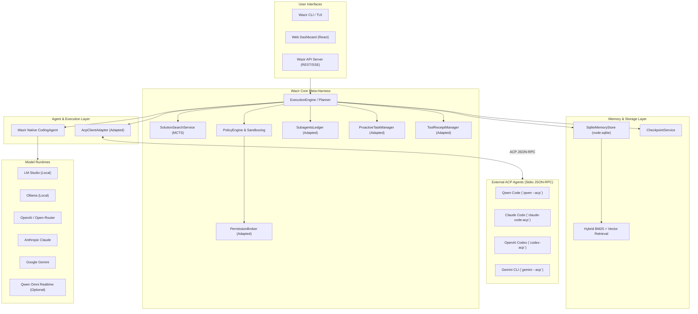
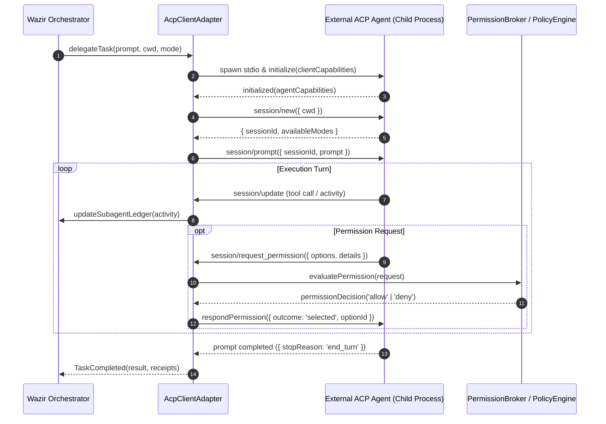
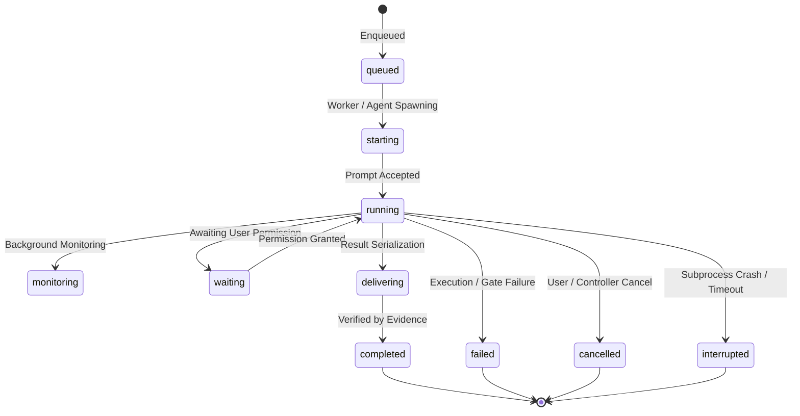
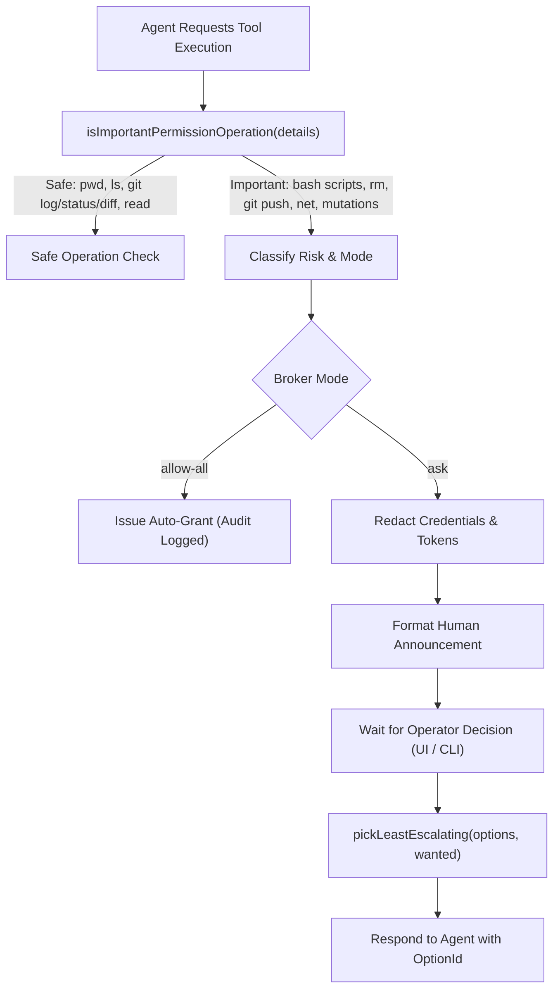
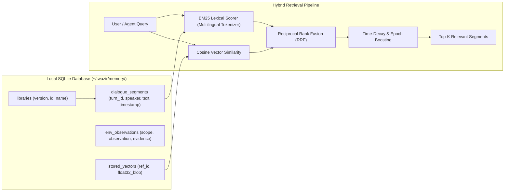
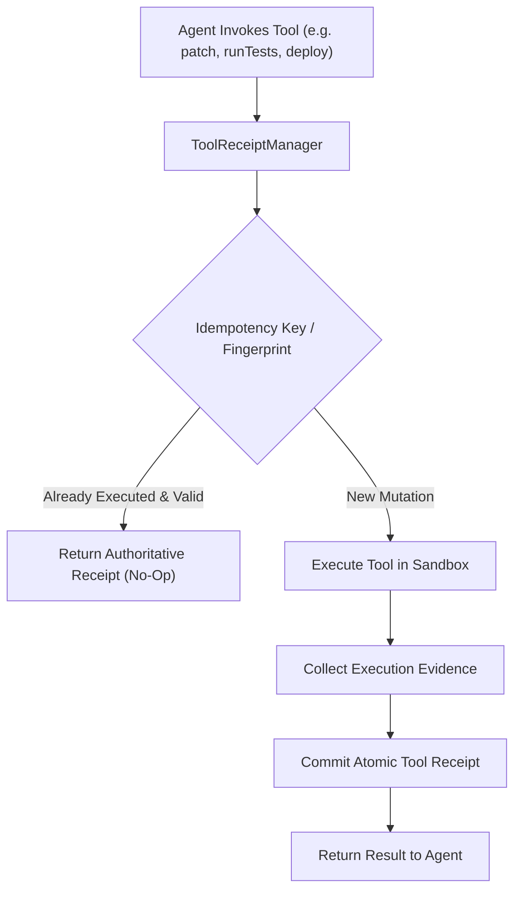

# Qwen-Live-Harness Integration Architecture for Wazir

This document defines the architectural integration of production-grade components adapted from **Qwen-Live-Harness** into **Wazir**.

---

## 1. System Context & Component Boundaries

The integration preserves Wazir's model- and runtime-agnostic meta-harness architecture while infusing Qwen's protocol interoperability, subagent visibility, permission brokering, and persistent memory.

---

## 2. Subsystem Integrations

### A. ACP Agent Client Integration (`@wazir/agents/src/acp`)

Wazir can delegate tasks to any external autonomous agent supporting the standard Agent Client Protocol (ACP) over stdio:

**Key Architectural Invariants:**
1. **Preemption Safety:** `AcpClientAdapter` enforces a strict one-turn-in-flight latch (`sendPromptNow`). Successive tasks are queued (`pendingPrompts`) rather than aborting active turns.
2. **Steer Mid-Turn Draining:** For agents supporting mid-turn guidance (`craft/drainMidTurnQueue`), steer instructions are delivered synchronously without breaking current execution.
3. **Graceful Subprocess Lifecycle:** Spawns child processes with isolated pipes, generation counters to fence stale sessions, and SIGTERM/SIGKILL escalation deadlines.

---

### B. Subagents Ledger & Lifecycle Management (`@wazir/core/src/subagents`)

The `SubagentsLedger` maintains an in-memory, bounded, authoritative state machine for all background jobs, canary evaluations, and subagent sessions.

**Key Architectural Invariants:**
1. **Bounded Memory:** Enforces `MAX_SUBAGENT_TASKS = 32`, `MAX_TERMINAL_DETAILS = 32`, and a maximum snapshot payload size of 240 KB to prevent memory leaks in long-running daemons.
2. **Eviction Fencing:** Retains terminal counts while evicting details; prevents re-entry or double counting if stale terminal events arrive.
3. **Throttled Snapshots:** Debounces high-frequency activity updates, notifying UI subscribers at bounded rates (e.g. 50ms) to ensure butter-smooth rendering.

---

### C. Permission Broker & AST Operation Classifier (`@wazir/core/src/permissions`)

The `PermissionBroker` acts as an intelligent intermediary between autonomous agents and Wazir's `PolicyEngine`:

**Key Architectural Invariants:**
1. **Least-Escalating Preference:** When resolving approvals, the broker selects the least-escalating option offered by the agent (e.g. single execution over permanent grants unless explicit).
2. **Deterministic Redaction:** Strips API tokens, private keys, and passwords before presenting approval requests to the user or logging.
3. **AST Command Filtering:** Inspects shell command structures, flagging any commands containing semicolons, pipes, redirects, or variable expansions as dangerous regardless of the command name.

---

### D. Multi-Library SQLite Memory Subsystem (`@wazir/memory`)

Wazir integrates Qwen's persistent SQLite memory engine using Node.js 22 built-in `node:sqlite`:

**Key Architectural Invariants:**
1. **Zero External Native Dependencies:** Uses Node.js 22's native `DatabaseSync` (`node:sqlite`), eliminating native compilation issues, node-gyp failures, and platform incompatibilities.
2. **ACID Transactions:** Full write-ahead logging (WAL), fsync durability, and strict schema versioning.
3. **Hybrid Search:** Combines BM25 keyword matching with dense embedding cosine similarity, fused via RRF, weighted with time recency decay.

---

### E. Proactive Task Manager & Atomic Tool Receipts (`@wazir/core/src/proactive`)

Connects background health monitoring with tool execution idempotency:

**Key Architectural Invariants:**
1. **Idempotency Guarantees:** Ensures that agent retry loops cannot execute duplicate side-effects (e.g., re-applying patches, duplicating git commits, or double-allocating resources).
2. **Atomic Receipts:** Every tool operation yields a structured `ProactiveToolReceipt` containing operation type, active task snapshot, and authoritative outcome.
3. **Hysteresis Scheduling:** Proactive background monitors require an "awaiting false" state transition before re-alerting, preventing notification cascades.
