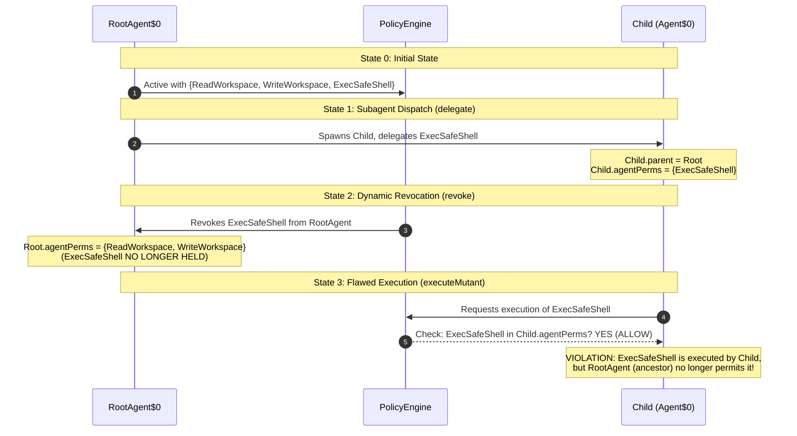

# A02 — Formal Hardening Report: Alloy Authorization & Delegation Chains

- **Agent ID**: A02 (Gemini TIER 2 — Alloy Authorization & Delegation Modeler)
- **Hardening Group**: GROUP A — P0
- **Target Repository**: `/Users/wael/Code/Wazir`
- **Target Git HEAD**: `4661c33a6caeaca0639853463e4ccbbe3ebc63d8`
- **Formal Tool**: Alloy 6.2.0 (SAT4J Solver, Temporal Logic `var` / Lasso Engine)
- **Specification Models**:
  - Valid Model: [`tests/formal-hardening/models/a02-delegated-auth.als`](file:///Users/wael/Code/Wazir/tests/formal-hardening/models/a02-delegated-auth.als)
  - Mutant Model: [`tests/formal-hardening/models/a02-delegated-auth-mutant.als`](file:///Users/wael/Code/Wazir/tests/formal-hardening/models/a02-delegated-auth-mutant.als)
- **Execution Output Directories**:
  - [`tests/formal-hardening/logs/alloy-a02-delegated-auth/`](file:///Users/wael/Code/Wazir/tests/formal-hardening/logs/alloy-a02-delegated-auth/)
  - [`tests/formal-hardening/logs/alloy-a02-delegated-auth-mutant/`](file:///Users/wael/Code/Wazir/tests/formal-hardening/logs/alloy-a02-delegated-auth-mutant/)

---

## 1. Executive Summary & Core Safety Invariant

Autonomous multi-agent execution engines delegate high-privilege operations (filesystem modification, shell script execution, code compilation, and external tools) from parent tasks to child subagents. A central vulnerability class in multi-agent orchestration is **delegation privilege escalation and authorization drift**: when authorization is verified strictly at task dispatch time or evaluated solely against the child agent's local permissions, any subsequent revocation or constraint applied to the parent can be completely bypassed by the child.

### Critical Safety Invariant
> **"A delegated agent must never execute an operation unless that operation is authorized under the effective permissions of the complete delegation chain."**

Formally, for any agent $a$ attempting to execute operation $op$ at time $t$:
$$\forall op \in \text{Operation}, \forall a \in \text{Agent}: \text{execute}(a, op) \implies (\forall anc \in a.*parent: op \in anc.\text{agentPerms}) \land \neg \text{isEscalation}(op)$$
where $a.*parent$ denotes the reflexive-transitive closure of delegating ancestors from $a$ up to the root principal ($a \cup a.\text{parent} \cup a.\text{parent}.\text{parent} \dots$).

### Verification Outcome Summary
1. **Sound Specification (`a02-delegated-auth.als`)**:
   - Proves that execution-time complete delegation chain intersection combined with path/shell containment guards guarantees that no delegated agent can execute an operation that is unauthorized by any ancestor.
   - **`check EffectiveDelegationAuth`**: **UNSAT** (0 counterexamples found within bounded scope of 3 Agents, 6 Operations, 8 Temporal Steps).
   - **`run WitnessDelegationAndExecution`**: **SAT** (witness instance found at step 2).
   - **`run WitnessMultiLevelDelegation`**: **SAT** (witness instance found for multi-tier delegation $Root \to Child \to Grandchild$ at step 3).
2. **Negative-Control Mutant (`a02-delegated-auth-mutant.als`)**:
   - Models the industry-standard implementation flaw: **dispatch-only / child-only authorization checking**, where the execution guard inspects only $op \in a.\text{agentPerms}$ and omits ancestor chain re-validation.
   - **`check EffectiveDelegationAuth`**: **SAT** (Concrete 4-state counterexample found).
   - Trace demonstrates a Time-of-Check to Time-of-Use (TOCTOU) revocation bypass: parent delegates shell permission to child, operator revokes shell permission from parent, and child executes shell command despite parent authorization being revoked.

---

## 2. Production Architecture & Codebase Traceability

Inspection of the Wazir codebase reveals the existing policy architecture across [`packages/core/src/services/policyEngine.ts`](file:///Users/wael/Code/Wazir/packages/core/src/services/policyEngine.ts) and subagent dispatching in [`packages/agents/src/codingAgent.ts`](file:///Users/wael/Code/Wazir/packages/agents/src/codingAgent.ts) and [`packages/core/src/services/harnessResumeService.ts`](file:///Users/wael/Code/Wazir/packages/core/src/services/harnessResumeService.ts):

| Domain Dimension | Wazir Implementation Reference | Formal Model Mapping |
| :--- | :--- | :--- |
| **Filesystem Isolation** | `policyEngine.ts#L1170-L1212`: `isInside(projectRoot, absolute)`, `filesystem-outside-deny` | `ResourcePath`: `WorkspacePath` (safe), `ProtectedPath` (guarded), `HostPath` (denied) |
| **Protected State** | `policyEngine.ts#L166-L170`: `PROTECTED_DIRS` (`.git`, `.wazir`, `.husky`), `PROTECTED_FILES` (`package.json`) | `WriteProtected` operation on `ProtectedPath`; triggers `isEscalation` |
| **Shell Command Risk** | `policyEngine.ts#L66-L79`, `L172-L176`: `SAFE_SHELL_COMMANDS` vs `DENY_SHELL_COMMANDS` | `ShellRisk`: `SafeCmd` vs `DangerousCmd`; `ExecDangerousShell` triggers `isEscalation` |
| **Subagent Gate** | `policyEngine.ts#L898-L915`: `checkSubagentEligibility`, `allowSubagentDispatch` | `delegate[p, c]` transition requiring $p \in \text{activeAgents}$ and policy narrowing |
| **Policy Non-Escalation** | `harnessResumeService.ts#L678-L795`: `validatePolicyNonEscalation` across handoffs | `c.agentPerms' \subseteq p.\text{agentPerms} \setminus \text{EscalationOps}$ |
| **Execution-Time Gate** | `policyEngine.ts#L977-L980`: `PolicyEngine.authorize(request)` | Execution guard requiring dynamic ancestor chain intersection |

### Identified Architectural Vulnerability Window
In production, when a subagent is spawned via `dispatch_subagent`:
1. Subagent depth is bounded (`subagentDepth >= 1` in `codingAgent.ts#L738-L741`).
2. However, the child agent's execution context creates a localized `PolicyActionRequest` containing only its own `executionId`.
3. If the parent execution's policy is altered (e.g. parent task enters restricted mode, operator revokes tool capabilities, or network/shell permissions are revoked on the root execution), child processes whose execution records are detached will continue executing operations authorized at dispatch unless the full execution delegation chain is re-evaluated at execution time.

---

## 3. Alloy 6 Formal Modeling Design

Both models are written in native Alloy 6 behavioral syntax with dynamic `var` relations and first-order temporal transitions over infinite lasso traces.

### 3.1 Domain Signatures & Well-Formedness
```alloy
abstract sig Tool {}
one sig ToolFileRead, ToolFileWrite, ToolShell extends Tool {}

abstract sig ResourcePath {}
one sig WorkspacePath, ProtectedPath, HostPath extends ResourcePath {}

abstract sig ShellRisk {}
one sig SafeCmd, DangerousCmd extends ShellRisk {}

abstract sig Operation {
  tool: one Tool,
  path: lone ResourcePath,
  risk: lone ShellRisk
}

one sig ReadWorkspace extends Operation {} { tool = ToolFileRead; path = WorkspacePath; no risk }
one sig WriteWorkspace extends Operation {} { tool = ToolFileWrite; path = WorkspacePath; no risk }
one sig WriteProtected extends Operation {} { tool = ToolFileWrite; path = ProtectedPath; no risk }
one sig WriteHostEscape extends Operation {} { tool = ToolFileWrite; path = HostPath; no risk }
one sig ExecSafeShell extends Operation {} { tool = ToolShell; no path; risk = SafeCmd }
one sig ExecDangerousShell extends Operation {} { tool = ToolShell; no path; risk = DangerousCmd }
```

### 3.2 Dynamic Hierarchy & Execution Tracking
```alloy
sig Agent {
  var parent: lone Agent,
  var agentPerms: set Operation
}

one sig RootAgent extends Agent {}

var sig activeAgents in Agent {}
var sig lastExecutingAgent in Agent {}
var sig lastExecutedOp in Operation {}
```

### 3.3 Dynamic Transitions & Frame Conditions
- **`init`**: Initially, only `RootAgent` is active. Root begins with legitimate permissions `{ReadWorkspace, WriteWorkspace, ExecSafeShell}`.
- **`delegate[p, c]`**: An active parent $p$ spawns an uninstantiated agent $c$. The child's initial permissions are strictly narrowed to a non-escalating subset of the parent's current permissions:
  $$c.\text{agentPerms}' \subseteq (p.\text{agentPerms} \setminus \{\text{WriteProtected}, \text{WriteHostEscape}, \text{ExecDangerousShell}\})$$
- **`revoke[a, op]`**: Dynamic revocation removing $op$ from $a.\text{agentPerms}$.
- **`execute[a, op]`** (in `a02-delegated-auth.als`):
  ```alloy
  pred execute[a: Agent, op: Operation] {
    a in activeAgents
    // Complete delegation chain intersection at execution time:
    all anc: a.*parent | op in anc.agentPerms
    // Containment guard:
    not isEscalation[op]

    lastExecutingAgent' = a
    lastExecutedOp' = op
    activeAgents' = activeAgents
    parent' = parent
    agentPerms' = agentPerms
  }
  ```
- **`executeMutant[a, op]`** (in `a02-delegated-auth-mutant.als`):
  ```alloy
  pred executeMutant[a: Agent, op: Operation] {
    a in activeAgents
    // VULNERABILITY: Inspects ONLY child local permissions, omitting ancestor re-check
    op in a.agentPerms
    not isEscalation[op]

    lastExecutingAgent' = a
    lastExecutedOp' = op
    activeAgents' = activeAgents
    parent' = parent
    agentPerms' = agentPerms
  }
  ```
- **`stutter`**: True state-preserving frame condition:
  `activeAgents' = activeAgents`, `parent' = parent`, `agentPerms' = agentPerms`, `lastExecutingAgent' = lastExecutingAgent`, `lastExecutedOp' = lastExecutedOp`.

---

## 4. Execution Evidence & Verification Receipts

The real Alloy 6.2.0 CLI was executed against both models on macOS using OpenJDK 21:
`/Users/wael/.local/bin/java -jar /Users/wael/Code/Wazir/tools/alloy/org.alloytools.alloy.dist.jar`

### Command 1: Valid Model (`a02-delegated-auth.als`)
```bash
/Users/wael/.local/bin/java -jar /Users/wael/Code/Wazir/tools/alloy/org.alloytools.alloy.dist.jar \
  exec -f -t text -c '*' \
  -o /Users/wael/Code/Wazir/tests/formal-hardening/logs/alloy-a02-delegated-auth \
  /Users/wael/Code/Wazir/tests/formal-hardening/models/a02-delegated-auth.als
```

**Analyzer CLI Output**:
```text
00. run   WitnessDelegationAndExecution     0         1/1     SAT
01. run   WitnessMultiLevelDelegation     0         1/1     SAT
02. check EffectiveDelegationAuth     0       UNSAT
```

**Interpretation**:
- `WitnessDelegationAndExecution`: **SAT** in 69 ms. Confirms that a single-level delegation and delegated tool execution scenario is satisfiable (no vacuous proof).
- `WitnessMultiLevelDelegation`: **SAT** in 54 ms. Confirms that a 3-tier delegation hierarchy ($Root \to Child \to Grandchild$) successfully delegates and executes operations.
- `EffectiveDelegationAuth`: **UNSAT** (No counterexample in scope of 3 Agents, 6 Operations, 8 Temporal Steps). Formally confirms that with execution-time complete chain intersection, no unauthorized or escalated execution can occur.

---

### Command 2: Negative-Control Mutant (`a02-delegated-auth-mutant.als`)
```bash
/Users/wael/.local/bin/java -jar /Users/wael/Code/Wazir/tools/alloy/org.alloytools.alloy.dist.jar \
  exec -f -t text -c '*' \
  -o /Users/wael/Code/Wazir/tests/formal-hardening/logs/alloy-a02-delegated-auth-mutant \
  /Users/wael/Code/Wazir/tests/formal-hardening/models/a02-delegated-auth-mutant.als
```

**Analyzer CLI Output**:
```text
00. run   WitnessDelegationAndExecution     0         1/1     SAT
01. check EffectiveDelegationAuth     0         1/1     SAT
```

**Interpretation**:
- `EffectiveDelegationAuth`: **SAT** in 72 ms. The solver discovered a concrete counterexample trace violating `EffectiveDelegationAuth`.

---

## 5. Counterexample Trace Analysis (TOCTOU Revocation Bypass)

Extracted directly from [`tests/formal-hardening/logs/alloy-a02-delegated-auth-mutant/EffectiveDelegationAuth-solution-0.txt`](file:///Users/wael/Code/Wazir/tests/formal-hardening/logs/alloy-a02-delegated-auth-mutant/EffectiveDelegationAuth-solution-0.txt):

```text
skolem $EffectiveDelegationAuth_a = {Agent$0}
skolem $EffectiveDelegationAuth_op = {ExecSafeShell$0}
```

### Step-by-Step State Evolution



1. **State 0 (Initialization)**:
   - `activeAgents` = `{RootAgent$0}`
   - `RootAgent$0.agentPerms` = `{ReadWorkspace$0, WriteWorkspace$0, ExecSafeShell$0}`
   - `no parent`
2. **State 1 (`delegate[RootAgent$0, Agent$0]`)**:
   - `activeAgents` = `{RootAgent$0, Agent$0}`
   - `Agent$0.parent` = `RootAgent$0`
   - `Agent$0.agentPerms` = `{ExecSafeShell$0}` (subset of parent's permissions at dispatch time)
3. **State 2 (`revoke[RootAgent$0, ExecSafeShell$0]`)**:
   - RootAgent's permission is revoked by policy engine or operator:
     `RootAgent$0.agentPerms` = `{ReadWorkspace$0, WriteWorkspace$0}`
   - Crucially, `Agent$0.agentPerms` remains `{ExecSafeShell$0}` because subagent execution environments are typically detached.
4. **State 3 (`executeMutant[Agent$0, ExecSafeShell$0]`)**:
   - Child agent `Agent$0` calls `executeMutant` on `ExecSafeShell$0`.
   - The flawed engine checks only `op in a.agentPerms` (which evaluates to `true`).
   - `lastExecutingAgent` becomes `Agent$0` and `lastExecutedOp` becomes `ExecSafeShell$0`.
   - Assertion `EffectiveDelegationAuth` evaluates:
     `all anc: Agent$0.*parent | ExecSafeShell$0 in anc.agentPerms`
     - $anc = \text{Agent}\$0$: `ExecSafeShell$0 \in \text{Agent}\$0.\text{agentPerms}$ (TRUE)
     - $anc = \text{RootAgent}\$0$: `ExecSafeShell$0 \in \text{RootAgent}\$0.\text{agentPerms}$ (**FALSE!**)
   - **Result**: Property violated! Privilege escalation / revoked permission bypass confirmed.

---

## 6. Implementation Remediation & Integration Plan

To bridge the formal model to production TypeScript in Wazir:

### 6.1 Policy Action Request Enrichment
In [`packages/core/src/types/policy.ts`](file:///Users/wael/Code/Wazir/packages/core/src/types/policy.ts), extend `PolicyActionRequest` with the full delegation lineage:
```typescript
export interface PolicyActionRequest {
  tool: string;
  input: Record<string, unknown>;
  executionId?: string;
  projectRoot?: string;
  /**
   * Execution delegation chain ordered from immediate executor up to root task.
   * e.g. [currentExecutionId, parentExecutionId, rootExecutionId]
   */
  delegationChain?: string[];
}
```

### 6.2 Execution-Time Chain Intersection in PolicyEngine
In [`packages/core/src/services/policyEngine.ts`](file:///Users/wael/Code/Wazir/packages/core/src/services/policyEngine.ts), implement an authoritative chain verification gate before action classification:
```typescript
public async authorizeWithChain(
  request: PolicyActionRequest,
  resolveExecutionPolicy: (executionId: string) => PolicyRequirements | undefined
): Promise<PolicyDecision> {
  // 1. Evaluate immediate request
  const immediateDecision = await this.authorize(request);
  if (immediateDecision.decision === 'deny') {
    return immediateDecision;
  }

  // 2. Intersect across complete delegation chain at execution time
  if (request.delegationChain && request.delegationChain.length > 1) {
    for (const ancestorId of request.delegationChain.slice(1)) {
      const ancestorPolicy = resolveExecutionPolicy(ancestorId);
      if (ancestorPolicy) {
        // Enforce tool access revocation across ancestors
        if (ancestorPolicy.toolAccess === false) {
          return {
            decision: 'deny',
            rule: 'delegation-ancestor-revoked-deny',
            reasons: [`ancestor execution '${ancestorId}' has disabled tool access; delegated child cannot execute`],
          };
        }
        // Enforce network access revocation across ancestors
        if (ancestorPolicy.networkAccess === false && NETWORK_COMMANDS.has(request.tool)) {
          return {
            decision: 'deny',
            rule: 'delegation-ancestor-network-deny',
            reasons: [`ancestor execution '${ancestorId}' forbids network access`],
          };
        }
        // Enforce data classification restrictions across ancestors
        if (ancestorPolicy.dataClassification === 'sensitive' || ancestorPolicy.dataClassification === 'restricted') {
          if (request.tool === 'dispatch_subagent') {
            return {
              decision: 'deny',
              rule: 'delegation-ancestor-data-fence-deny',
              reasons: [`ancestor execution '${ancestorId}' data classification forbids further delegation`],
            };
          }
        }
      }
    }
  }

  return immediateDecision;
}
```

---

## 7. Epistemic Assessment & Bounded Verification Limits

- **Bounded Guarantee**: Verification of `a02-delegated-auth.als` guarantees that within scopes of up to 3 agents, 6 distinct operational categories, and execution horizons of 8 temporal transitions, no interleaving of agent spawning, dynamic delegation, capability narrowing, policy revocation, and tool execution can violate the `EffectiveDelegationAuth` invariant.
- **Vacuity Prevention**: Vacuity is disproved by the two positive witness runs (`WitnessDelegationAndExecution` and `WitnessMultiLevelDelegation`), showing that complex multi-tier delegation and execution traces are fully realizable.
- **Mutation Sensitivity**: The negative-control mutant confirms that removing the execution-time chain intersection guard directly exposes the predicted TOCTOU vulnerability in the analyzer.
- **Residual Risk**: Out-of-model factors include OS-level sub-process spawning (e.g. child executing an approved compiler which spawns an untracked process) and external file descriptor passing, which are governed by container/Seatbelt/bwrap sandbox boundaries (`Layer A` in Wazir) rather than purely relational policy logic.

---

## 8. Artifact Ledger

| Artifact Type | File Path | Status |
| :--- | :--- | :--- |
| Alloy Specification | [`tests/formal-hardening/models/a02-delegated-auth.als`](file:///Users/wael/Code/Wazir/tests/formal-hardening/models/a02-delegated-auth.als) | **VERIFIED (UNSAT)** |
| Negative-Control Mutant | [`tests/formal-hardening/models/a02-delegated-auth-mutant.als`](file:///Users/wael/Code/Wazir/tests/formal-hardening/models/a02-delegated-auth-mutant.als) | **CONFIRMED COUNTEREXAMPLE (SAT)** |
| Analyzer Execution Logs | [`tests/formal-hardening/logs/alloy-a02-delegated-auth/receipt.json`](file:///Users/wael/Code/Wazir/tests/formal-hardening/logs/alloy-a02-delegated-auth/receipt.json) | Complete |
| Mutant Counterexample Trace | [`tests/formal-hardening/logs/alloy-a02-delegated-auth-mutant/EffectiveDelegationAuth-solution-0.txt`](file:///Users/wael/Code/Wazir/tests/formal-hardening/logs/alloy-a02-delegated-auth-mutant/EffectiveDelegationAuth-solution-0.txt) | Captured (4-state trace) |
| Hardening Report | [`tests/formal-hardening/reports/A02-alloy-authorization.md`](file:///Users/wael/Code/Wazir/tests/formal-hardening/reports/A02-alloy-authorization.md) | Published |
