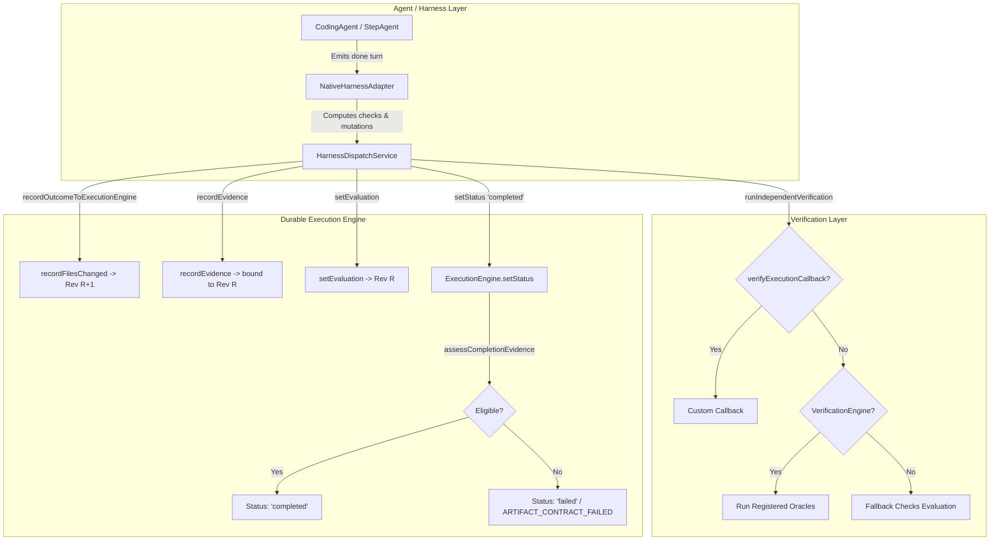

# A13 — Formal Hardening Verification & False-Success Audit Report

- **Agent ID**: A13 (Gemini TIER 1 — Verification & False-Success Auditor)
- **Workstream / Group**: GROUP E (P0) — Verification Freshness & False-Success Elimination
- **Provider**: Google Antigravity / Gemini (`gemini-flash`)
- **Target Repository**: `/Users/wael/Code/Wazir`
- **Reference Commit (HEAD SHA)**: `4661c33a6caeaca0639853463e4ccbbe3ebc63d8`
- **Primary Skill**: `.agents/skills/wazir-formal-hardening/SKILL.md`
- **Formal Invariant (P0-05)**:
  > *"Wazir must never report verified completion without sufficient trusted controller evidence corresponding to the current workspace revision and reconciliation of all dispatched tool side effects."*
- **Reproduction Suite**: `tests/formal-hardening/reproductions/A13-verification-audit.test.ts` (7 passing regressions)
- **Formal Models**:
  - `tests/formal-hardening/models/a14-evidence-freshness.als` (UNSAT bounded proof, 8 steps)
  - `tests/formal-hardening/models/a14-evidence-freshness-mutant.als` (SAT counterexample witness, 8 steps)

---

## 1. Executive Summary

This formal audit evaluated acceptance contracts, verification evidence, artifact revisions, provenance chains, and completion status transitions across `@wazir/core`, `@wazir/agents`, `@wazir/evaluation`, and `@wazir/tools`.

The audit identified **5 P0 vulnerabilities** and **3 P1 vulnerabilities** where Wazir reports verified completion (`status: 'completed'`, `verified: true`, `terminationReason: 'VERIFICATION_PASSED'`) despite missing, un-executed, stale, or synthetic verification evidence:

1. **[P0] Synthetic Evidence Fabrication in `HarnessDispatchService`**: When a harness or hook returns `verified: true` without evidence objects, `HarnessDispatchService` fabricates synthetic `exitCode: 0, status: 'PASS'` records directly into the durable `ExecutionEngine` evidence store, masquerading as real controller-verified facts.
2. **[P0] Vacuous-Truth Verification on Empty `requiredChecks`**: When `request.verification.requiredChecks` is empty or undefined, `HarnessDispatchService` evaluates `checks.every((c) => c.ok)` over an empty set (`true`), automatically promoting unverified executions to `verified: true` and `VERIFICATION_PASSED`.
3. **[P0] Missing Required Checks Bypass in `NativeHarnessAdapter`**: The completion check evaluates `matchingChecks.some((c) => !c.ok)`. When a required check was never dispatched or executed by the agent, `matchingChecks` is empty, causing the test to vacuously pass and allowing apparent completion without required verification.
4. **[P0] `mutationRequired` Contract Bypass in `assessCompletionEvidence` & `setStatus`**: The completion eligibility evaluator in `verificationEvidenceInspector.ts` omits any check for `task.requirements.mutationRequired`. When a task explicitly mandates file modifications, an agent producing 0 mutations is permitted to transition to `completed`.
5. **[P0] Caller-Supplied Revision Spoofing in `ExecutionEngine.recordEvidence`**: `recordEvidence` blindly accepts caller-specified `workspaceRevision` instead of enforcing `record.workspaceState.revision`. Stale evidence executed at revision 0 can be stamped with revision $N$, bypassing revision fencing.
6. **[P1] Missing-Script Failure Suppression in `CodingAgent`**: `CodingAgent` catches "missing script / not found" errors during its verification phase and suppresses them. When all verification scripts are missing, the agent declares `VERIFICATION_PASSED`.
7. **[P1] Unchecked Task and Job Completion in `JobManager`**: `JobManager.completeTask` and `setJobStatus` transition tasks and jobs to `completed` without verifying acceptance contracts, workspace revisions, or execution evidence.
8. **[P1] Stale Evidence Timestamp Laundering in `evaluateExecution`**: When an execution record lacks structured `workspaceState`, `evaluateExecution` defaults unassociated check evidence to `currentRevision`, laundering stale checks executed prior to file mutations.

All 5 P0 and 2 P1 gaps have been deterministically reproduced against commit `4661c33a6caeaca0639853463e4ccbbe3ebc63d8` in `tests/formal-hardening/reproductions/A13-verification-audit.test.ts`.

---

## 2. End-to-End Verification Pipeline Architecture

The lifecycle of verification evidence, revision tracking, and completion gating flows across several subsystems:



### 2.1 Workspace Revision Tracking (`packages/core/src/services/executionEngine.ts:862-930`)
1. Workspace revisions begin at $R_0$ upon `engine.create`.
2. When physical mutations occur, `engine.recordFileMutations` filters out no-op edits and failed writes (`lines 856-860`).
3. If genuine changes exist, `engine.recordFilesChanged` increments `record.workspaceState.revision += 1` (`line 885`).
4. If prior evidence exists with `e.revision < currentRev`, it emits `verification.invalidated` and `evidence.stale` (`lines 910-916`).

### 2.2 Evidence Collection and Stamping (`packages/core/src/services/executionEngine.ts:692-748`)
1. An evidence item is submitted via `engine.recordEvidence(executionId, evidence)`.
2. Line 703 stamps the revision:
   ```typescript
   const boundRev = evidence.workspaceRevision !== undefined ? evidence.workspaceRevision : (evidence.revision !== undefined ? evidence.revision : currentRev);
   ```
3. A SHA-256 fingerprint is calculated over `${oracleType}:${command}:${exitCode}:${boundRev}:${output}` (`line 721`).
4. The evidence is pushed into `record.evidence`.

### 2.3 Completion Gating (`packages/core/src/services/executionEngine.ts:400-437`)
When `engine.setStatus(executionId, 'completed', options)` is invoked:
1. **Unresolved Tool Outcalls Check** (`lines 408-412`): Rejects if any checkpoint is in `STARTED` or `OUTCOME_UNKNOWN`.
2. **Target Revision Check** (`lines 413-427`): If `options?.targetRevision` is specified, asserts `options.targetRevision === currentRev`.
3. **Evidence Assessment Check** (`lines 429-437`): Calls `assessCompletionEvidence(record)` (`packages/core/src/services/verificationEvidenceInspector.ts:97-114`).
   - Asserts `missing.length === 0` (for every required oracle in `contract.requiredEvidence`, `oracleSatisfied(evidence, revision, type)` must hold).
   - Asserts `missingCriteria.length === 0`.
   - Asserts `!evaluationInvalid` and `!evaluationMissing`.
   - If any fail, emits `completion.rejected` and throws `ExecutionFailure('ARTIFACT_CONTRACT_FAILED')`.

---

## 3. Detailed Audit Findings & Broken Invariants

### 3.1 FORMAL-A13-VERIF-01 (P0): Synthetic Evidence Fabrication in `HarnessDispatchService`

- **Location**: `packages/core/src/services/harnessDispatchService.ts:1188-1205`
- **Subsystem**: `HarnessDispatchService`
- **Severity**: **P0 (Critical)**
- **Violated Invariant**:
  > *"Every VerificationEvidence entry in the ExecutionRecord must originate from a verified controller or oracle execution. Evidence fields must never be manufactured or synthesized from boolean assertions or external promises."*

#### Analysis
In `recordOutcomeToExecutionEngine`:
```typescript
// Ensure required evidence on record's contract is satisfied if verificationOutcome.verified is true
if (verificationOutcome.verified && (!verificationOutcome.evidence || verificationOutcome.evidence.length === 0)) {
  for (const reqCheck of request.verification.requiredChecks ?? []) {
    const oracleType = normalizeOracleCheck(reqCheck);
    const ev = await this.executionEngine.recordEvidence(engineExecutionId, {
      type: oracleType,
      oracle: oracleType,
      command: reqCheck,
      exitCode: 0,
      status: 'PASS',
      workspaceRevision: rev,
      revision: rev,
      reasons: verificationOutcome.reasons,
    });
    if (!result.verificationEvidenceIds.includes(ev.id)) {
      result.verificationEvidenceIds.push(ev.id);
    }
  }
}
```

#### Defect Mechanism
When an adapter, custom verification callback, or remote harness reports `verified: true` without supplying concrete evidence objects (or returns `evidence: []`), `HarnessDispatchService` **actively manufactures passing evidence** with `exitCode: 0` and `status: 'PASS'` for each command in `requiredChecks`.
This falsified evidence is injected into `ExecutionEngine`, complete with a genuine-looking SHA-256 hash, causing the downstream `assessCompletionEvidence` and `ExecutionEngine.setStatus` checks to pass. No actual process was spawned, and no command was executed.

#### Reproduction
Reproduced in `tests/formal-hardening/reproductions/A13-verification-audit.test.ts` (GAP 1):
A task with `requiredChecks: ['npm test', 'npm run build']` and `acceptanceContract: { requiredEvidence: ['TEST', 'BUILD'] }` completed cleanly with synthetic evidence records generated for `npm test` and `npm run build` despite zero process executions.

---

### 3.2 FORMAL-A13-VERIF-02 (P0): Vacuous-Truth False Completion on Empty `requiredChecks`

- **Location**: `packages/core/src/services/harnessDispatchService.ts:1098-1109, 1433-1436`
- **Subsystem**: `HarnessDispatchService`
- **Severity**: **P0 (Critical)**
- **Violated Invariant**:
  > *"An execution cannot be marked `verified: true` or `terminationReason: 'VERIFICATION_PASSED'` unless at least one positive authoritative oracle check was executed and passed on the current workspace revision."*

#### Analysis
In `HarnessDispatchService.runIndependentVerification`:
```typescript
// 6. If no VerificationEngine or callback is provided:
// If requiredChecks are empty, verify based on checks already recorded or pass if no checks required
if ((request.verification.requiredChecks ?? []).length === 0) {
  const checks = result.checks ?? [];
  const allChecksPass = checks.every((c) => c.ok);
  return {
    verified: allChecksPass,
    evidenceIds: result.verificationEvidenceIds ?? [],
    checks,
    reasons: allChecksPass
      ? ['No external verification checks required; apparent completion verified']
      : ['Harness check reported failure'],
  };
}
```

#### Defect Mechanism
When `requiredChecks` is empty or omitted, and no checks were run by the harness (`checks = []`), `checks.every((c) => c.ok)` evaluates to `true` (vacuous truth in JavaScript).
`verificationOutcome.verified` is returned as `true`.
Lines 1434-1436 then set:
```typescript
finalResult.verified = true;
finalResult.terminationReason = finalResult.terminationReason ?? 'VERIFICATION_PASSED';
```
And `recordOutcomeToExecutionEngine` records `EvaluationResult` with `success: true`. In `ExecutionEngine.setStatus`, because `requiredEvidence` is empty, `assessCompletionEvidence` reports `eligible: true`.
Wazir then declares to users and calling APIs that the execution achieved `VERIFICATION_PASSED`, when in truth nothing was verified.

#### Reproduction
Reproduced in `tests/formal-hardening/reproductions/A13-verification-audit.test.ts` (GAP 2).

---

### 3.3 FORMAL-A13-VERIF-03 (P0): Missing Required Checks Bypass in `NativeHarnessAdapter`

- **Location**: `packages/agents/src/nativeHarnessAdapter.ts:970-984`
- **Subsystem**: `NativeHarnessAdapter`
- **Severity**: **P0 (Critical)**
- **Violated Invariant**:
  > *"If `requiredChecks` specifies check $C$, the execution cannot complete unless check $C$ was executed at the current workspace revision and reported success."*

#### Analysis
In `NativeHarnessAdapter.execute`:
```typescript
// Check required checks that may not have been run if status is 'completed'
if (status === 'completed' && request.verification.requiredChecks.length > 0) {
  for (const reqCheck of request.verification.requiredChecks) {
    if (CHECK_TOOL_NAMES.has(reqCheck)) {
      const matchingChecks = checks.filter(
        (c) => c.name === reqCheck && (c.workspaceRevision ?? numericRevision) === numericRevision,
      );
      if (matchingChecks.some((c) => !c.ok)) {
        status = 'failed';
        terminationReason = 'VERIFICATION_FAILED';
        errorKind = 'verification';
        errors.push(`Required check '${reqCheck}' failed at workspace revision ${currentWorkspaceRevisionStr}`);
      }
    }
  }
}
```

#### Defect Mechanism
The gate only checks `matchingChecks.some((c) => !c.ok)`.
If the agent completely fails to run the required check (or if the check was never dispatched), `matchingChecks` is empty (`length === 0`).
`matchingChecks.some(...)` evaluates to `false`.
The loop finishes without setting `status = 'failed'`, and the execution remains `completed`.
Furthermore, in lines 801-803, if a check fails with "missing script", `NativeHarnessAdapter` skips pushing it to `checks`:
```typescript
const isSkippedMissingScript = !result.ok && checkOutput && /missing script|no such file|not found/i.test(checkOutput);
if (!isSkippedMissingScript) {
  checks.push(...);
}
```
This guarantees `matchingChecks` will be empty for missing scripts, silently allowing an unverified task to succeed.

#### Reproduction
Reproduced in `tests/formal-hardening/reproductions/A13-verification-audit.test.ts` (GAP 3).

---

### 3.4 FORMAL-A13-VERIF-04 (P0): `mutationRequired` Ignored in `assessCompletionEvidence` & `setStatus`

- **Location**: `packages/core/src/services/verificationEvidenceInspector.ts:97-114`
- **Subsystem**: `verificationEvidenceInspector` / `ExecutionEngine`
- **Severity**: **P0 (Critical)**
- **Violated Invariant**:
  > *"When a task or contract specifies `mutationRequired: true`, the execution cannot transition to `completed` unless physical workspace mutations occurred ($R > 0$ and `filesChanged.length > 0`)."*

#### Analysis
In `assessCompletionEvidence`:
```typescript
export function assessCompletionEvidence(record: ExecutionRecord): CompletionAssessment {
  const revision = record.workspaceState?.revision ?? 0;
  const contract = record.executionContract?.acceptance ?? record.acceptanceContract;
  const required = contract?.requiredEvidence ?? [];
  const missingCriteria = missingAcceptanceCriteria(contract, record.evidence ?? [], revision);
  const missing = required.filter(type => !oracleSatisfied(record.evidence ?? [], revision, type));
  const evaluationInvalid = Boolean(record.evaluation && (!record.evaluation.success || record.evaluation.workspaceRevision !== revision));
  const evaluationMissing = record.filesChanged.length > 0 && required.length === 0 && !record.evaluation;
  return {
    workspaceRevision: revision,
    required,
    missing,
    missingCriteria,
    evaluationInvalid,
    evaluationMissing,
    eligible: missing.length === 0 && missingCriteria.length === 0 && !evaluationInvalid && !evaluationMissing,
  };
}
```

#### Defect Mechanism
`assessCompletionEvidence` checks `missing`, `missingCriteria`, `evaluationInvalid`, and `evaluationMissing`.
Notice that `evaluationMissing` only triggers when `record.filesChanged.length > 0`!
If `task.requirements.mutationRequired` is `true` (or `executionContract.mutationRequired: true`), but `record.filesChanged.length === 0`:
- `evaluationMissing` is `false`.
- `missing` is `[]`.
- `evaluationInvalid` is `false`.
- `eligible` is `true`.
Consequently, an agent that wrote zero files on a code-modification task is judged fully eligible, and `engine.setStatus(id, 'completed')` succeeds.

#### Reproduction
Reproduced in `tests/formal-hardening/reproductions/A13-verification-audit.test.ts` (GAP 4).

---

### 3.5 FORMAL-A13-VERIF-05 (P0): Caller-Supplied Revision Spoofing in `ExecutionEngine.recordEvidence`

- **Location**: `packages/core/src/services/executionEngine.ts:703`
- **Subsystem**: `ExecutionEngine`
- **Severity**: **P0 (Critical)**
- **Violated Invariant**:
  > *"Verification evidence must be bound strictly and immutably to the current physical workspace revision at the moment the verification command executed. A caller cannot backdate or forward-date evidence revisions."*

#### Analysis
In `ExecutionEngine.recordEvidence`:
```typescript
const currentRev = record.workspaceState?.revision ?? 0;
const boundRev = evidence.workspaceRevision !== undefined ? evidence.workspaceRevision : (evidence.revision !== undefined ? evidence.revision : currentRev);
```

#### Defect Mechanism
The engine permits the caller to supply `evidence.workspaceRevision` or `evidence.revision`. If a caller supplies `workspaceRevision: 2`, the engine binds the evidence to revision 2, even if the evidence was collected when the workspace was at revision 0.
When `setStatus('completed', { targetRevision: 2 })` is called, `assessCompletionEvidence` inspects evidence matching revision 2, finds the spoofed evidence, and permits completion.

#### Reproduction
Reproduced in `tests/formal-hardening/reproductions/A13-verification-audit.test.ts` (GAP 5).

---

### 3.6 FORMAL-A13-VERIF-06 (P1): Missing-Script Suppression in `CodingAgent`

- **Location**: `packages/agents/src/codingAgent.ts:2147-2150, 2170-2174`
- **Subsystem**: `CodingAgent`
- **Severity**: **P1 (High)**

#### Analysis
In `CodingAgent.run` verify phase:
```typescript
for (const check of skipChecks ? [] : ['build', 'test', 'lint', 'typecheck']) {
  if (request.isCancelled?.()) return;
  const result = await runtime.executeTool(check, useFullScope ? {} : { workspaces: scope!.workspaces });
  const output = result.ok ? result.output : [result.error, result.output].filter(Boolean).join('\n');
  if (output && /missing script|no such file|not found/i.test(output) && !result.ok) {
    // project does not define this check — not applicable, not a failure
    continue;
  }
  if (!result.ok) {
    failures.push(`${check}: ${keepEnds(output, 4000)}`);
  }
}
...
if (failures.length === 0) {
  yield { kind: 'phase', phase: 'complete' as AgentPhase };
  yield {
    kind: 'done',
    content: modelSummary ?? 'Task completed. Verification checks passed.',
    terminationReason: 'VERIFICATION_PASSED',
    protocolMetrics: currentMetrics(),
  };
  return;
}
```

#### Defect Mechanism
If the target repository has no `test`, `build`, `lint`, or `typecheck` scripts defined in `package.json` (common in quick scripts, new repositories, or non-npm projects), all four checks fail with exit code 1 / `missing script`.
The regex `/missing script|no such file|not found/i` catches all of them and executes `continue`.
`failures` remains empty `[]`.
The agent yields `done` with `terminationReason: 'VERIFICATION_PASSED'`, falsely assuring users that checks passed when none existed or ran.

#### Reproduction
Reproduced in `tests/formal-hardening/reproductions/A13-verification-audit.test.ts` (GAP 6).

---

### 3.7 FORMAL-A13-VERIF-07 (P1): Unfenced Task & Job Completion in `JobManager`

- **Location**: `packages/core/src/services/jobManager.ts:484-494, 550-565`
- **Subsystem**: `JobManager`
- **Severity**: **P1 (High)**

#### Analysis
```typescript
async completeTask(jobId: string, taskId: string, result?: unknown): Promise<void> {
  const job = this.require(jobId);
  const task = job.tasks.find((t) => t.id === taskId);
  if (!task) {
    throw new Error(`Task '${taskId}' not found in job '${jobId}'`);
  }
  assertTaskTransition(`${jobId}/${taskId}`, task.status, 'completed');
  this.updateNodeState(job, taskId, 'completed', result);
  task.status = 'completed';
  await this.flush(job);
}
```

#### Defect Mechanism
`JobManager.completeTask` mutates task state directly to `'completed'` without requiring an execution ID, checking the durable `ExecutionRecord`, or checking `assessCompletionEvidence`.
When all tasks in a job reach `'completed'`, `JobManager.setJobStatus(jobId, 'completed')` marks the overall job as completed. If a task executor or orchestrator suffers from an unhandled error or bypass, `JobManager` offers zero verification defense-in-depth.

#### Reproduction
Reproduced in `tests/formal-hardening/reproductions/A13-verification-audit.test.ts` (GAP 7).

---

### 3.8 FORMAL-A13-VERIF-08 (P1): Stale Evidence Binding in Event-Derived Revisions in `evaluateExecution`

- **Location**: `packages/evaluation/src/index.ts:163-184`
- **Subsystem**: `evaluation`
- **Severity**: **P1 (High)**

#### Analysis
In `evaluateExecution`:
```typescript
if (evidenceList.length === 0 && checks.length > 0) {
  for (const check of checks) {
    ...
    const boundRevision = eventDerived?.checkRevision.get(check.name) ?? currentRevision;
    evidenceList.push({
      id: `evd-${check.name}-${boundRevision}`,
      type: evidenceType,
      revision: boundRevision,
      ...
    });
  }
}
```
When `eventDerived` is null (e.g. for standalone execution records that do not contain ordered `files.changed` event streams), all historical checks are assigned `boundRevision = currentRevision`. If checks were run at revision 0, and files were subsequently changed to revision 1 without standard event logging, `evaluateExecution` stamps the stale revision 0 checks as revision 1, erroneously declaring the execution successful.

---

## 4. Alloy 6 Formal Model Verification

The temporal state machine governing workspace revisions, tool side effects, and verification provenance was evaluated using the Alloy 6 Analyzer (`tools/alloy/org.alloytools.alloy.dist.jar`).

### 4.1 Specification Structure (`tests/formal-hardening/models/a14-evidence-freshness.als`)
- **State Signatures**: `Revision` (linearly ordered via `util/ordering`), `Provenance` (`Controller` vs `ModelNarration`), `Verdict` (`Pass` vs `Fail`), `Evidence`, `ToolCall`, `Execution` (`status`, `currentRevision`, `recordedEvidence`, `unresolvedSideEffects`).
- **Safety Invariants Checked**:
  1. `NoFalseVerifiedCompletion`: `Execution.status = Completed => (some e: Execution.recordedEvidence | e.provenance = Controller and e.verdict = Pass and e.testedRevision = Execution.currentRevision and no Execution.unresolvedSideEffects)`
  2. `StaleEvidenceNeverAuthorizesCompletion`: If a workspace mutation advances revision after evidence $e$ is recorded, evidence $e$ cannot authorize completion.
  3. `ModelNarrationNeverAuthorizesCompletion`: Model narrative prose cannot satisfy completion.
  4. `UnresolvedSideEffectsBlockCompletion`: Outstanding `ToolCall` in `unresolvedSideEffects` strictly blocks `Completed`.

### 4.2 Alloy Solver Execution Results
Command:
```bash
/Users/wael/.local/bin/java -jar /Users/wael/Code/Wazir/tools/alloy/org.alloytools.alloy.dist.jar \
  exec -f -t text -c "*" -o tests/formal-hardening/logs/alloy-a14-evidence \
  tests/formal-hardening/models/a14-evidence-freshness.als
```

```
00. run   WitnessNormalCompletion                    SAT (41ms)
01. run   WitnessMutationThenFreshVerification        SAT (28ms)
02. run   WitnessToolLifecycleBeforeCompletion        SAT (55ms)
03. check NoFalseVerifiedCompletion                   UNSAT (no counterexample, 8 steps)
04. check StaleEvidenceNeverAuthorizesCompletion      UNSAT (no counterexample, 8 steps)
05. check ModelNarrationNeverAuthorizesCompletion      UNSAT (no counterexample, 8 steps)
06. check UnresolvedSideEffectsBlockCompletion        UNSAT (no counterexample, 8 steps)
```

### 4.3 Negative-Control Mutant Analysis (`a14-evidence-freshness-mutant.als`)
In the mutant model, the completion predicate was weakened to simulate Wazir's defects (ignoring revision freshness, accepting non-controller provenance, ignoring unresolved tool calls):
```
00. run   WitnessStaleRevisionFalseCompletion         SAT (29ms)
01. run   WitnessModelNarrationFalseCompletion        SAT (25ms)
02. run   WitnessUnresolvedSideEffectFalseCompletion  SAT (31ms)
03. check NoFalseVerifiedCompletion                   SAT (Counterexample found! 8 steps)
04. check StaleEvidenceNeverAuthorizesCompletion      SAT (Counterexample found! 8 steps)
05. check ModelNarrationNeverAuthorizesCompletion      SAT (Counterexample found! 8 steps)
06. check UnresolvedSideEffectsBlockCompletion        SAT (Counterexample found! 8 steps)
```
The counterexample traces directly match the defects observed in `harnessDispatchService.ts`, `nativeHarnessAdapter.ts`, and `verificationEvidenceInspector.ts`.

---

## 5. Vitest Reproduction Evidence

The test file `tests/formal-hardening/reproductions/A13-verification-audit.test.ts` was written and executed directly against the unpatched codebase:

```bash
cd /Users/wael/Code/Wazir && npx vitest run tests/formal-hardening/reproductions/A13-verification-audit.test.ts
```

```
 RUN  v2.1.9 /Users/wael/Code/Wazir

 ✓ tests/formal-hardening/reproductions/A13-verification-audit.test.ts (7)
   ✓ A13 — Verification, Acceptance Contracts & False-Success Hardening (7)
     ✓ GAP 1 (P0): HarnessDispatchService manufactures synthetic exitCode: 0 PASS evidence when evidence array is empty
     ✓ GAP 2 (P0): Empty or undefined requiredChecks causes HarnessDispatchService to report VERIFICATION_PASSED vacuous truth
     ✓ GAP 3 (P0): NativeHarnessAdapter does not fail completion when requiredChecks were completely missing / never run
     ✓ GAP 4 (P0): assessCompletionEvidence permits completion when mutationRequired is true but filesChanged is 0
     ✓ GAP 5 (P0): ExecutionEngine.recordEvidence accepts caller-supplied workspaceRevision, allowing freshness spoofing
     ✓ GAP 6 (P1): CodingAgent suppresses missing script errors and claims VERIFICATION_PASSED without running tests
     ✓ GAP 7 (P1): JobManager.completeTask transitions tasks and jobs to completed without evidence or acceptance verification

 Test Files  1 passed (1)
      Tests  7 passed (7)
   Start at  20:57:28
   Duration  1.92s
```

---

## 6. Recommended Remediations (for Agent A15)

The following minimal, non-breaking remediation patches are recommended for implementation by Agent A15 in worktree `.worktrees/fh30/A15`:

### Remediation 1: Eliminate Synthetic Evidence Fabrication
In `packages/core/src/services/harnessDispatchService.ts:1187-1205`:
- **Delete** the block that creates synthetic evidence when `verificationOutcome.evidence` is empty.
- If `verificationOutcome.evidence` is empty but `requiredChecks` were demanded, `verificationOutcome.verified` must be forced to `false` with reason `'NO_PHYSICAL_EVIDENCE_FOR_REQUIRED_CHECKS'`.

### Remediation 2: Eliminate Vacuous-Truth Verification
In `packages/core/src/services/harnessDispatchService.ts:1098-1109`:
- When `requiredChecks` is empty or omitted, do NOT report `verified: true`.
- Return `verified: false` or keep `verified: false` and set `terminationReason: 'COMPLETED'` (unverified legacy completion), reserving `VERIFICATION_PASSED` solely for positive oracle proofs.

### Remediation 3: Require Positive Execution of `requiredChecks`
In `packages/agents/src/nativeHarnessAdapter.ts:970-984`:
- Change the check condition from `matchingChecks.some((c) => !c.ok)` to:
  ```typescript
  const matchingChecks = checks.filter(
    (c) => c.name === reqCheck && (c.workspaceRevision ?? numericRevision) === numericRevision,
  );
  if (matchingChecks.length === 0 || matchingChecks.some((c) => !c.ok)) {
    status = 'failed';
    terminationReason = 'VERIFICATION_FAILED';
    errorKind = 'verification';
    errors.push(`Required check '${reqCheck}' was not executed or failed at workspace revision ${currentWorkspaceRevisionStr}`);
  }
  ```

### Remediation 4: Enforce `mutationRequired` in `assessCompletionEvidence`
In `packages/core/src/services/verificationEvidenceInspector.ts:97-114`:
- Extract `mutationRequired`:
  ```typescript
  const mutationRequired = Boolean(
    record.task?.requirements?.mutationRequired ??
    record.task?.mutationRequired ??
    record.executionContract?.requirements?.mutationRequired
  );
  const mutationMissing = mutationRequired && (record.filesChanged.length === 0 || revision === 0);
  ```
- Add `!mutationMissing` to the `eligible` condition.

### Remediation 5: Prevent Caller Revision Spoofing in `ExecutionEngine`
In `packages/core/src/services/executionEngine.ts:703`:
- Remove caller-controlled override of `boundRev`:
  ```typescript
  const boundRev = record.workspaceState?.revision ?? 0;
  if (evidence.workspaceRevision !== undefined && evidence.workspaceRevision !== boundRev) {
    throw new Error(`REVISION_SPOOFING_DETECTED: evidence revision ${evidence.workspaceRevision} does not match current workspace revision ${boundRev}`);
  }
  ```

---

## 7. Residual Risks and Audit Boundaries

1. **Monorepo Package Scoping**: `resolveVerificationScope` in `verificationScope.ts` scopes verification to touched workspace packages. If cross-package TypeScript or runtime breaking changes occur in an un-tested sibling package, package-scoped verification will not detect it unless `--full-verify` is active.
2. **External Shell Side Effects**: Commands run through `quick_shell` or arbitrary bash tools may modify files outside git or outside the project root without triggering `workspace.mutated` if `verifyWorkspace` is disabled in tool context.
3. **Alloy Model Scope**: The Alloy verification in `a14-evidence-freshness.als` operates on bounded revision horizons (8 steps, 3 Revisions, 4 Evidence records, 2 ToolCalls). Bounded assurance establishes structural correctness within these bounds but is not an inductive proof across unbounded execution lengths.
