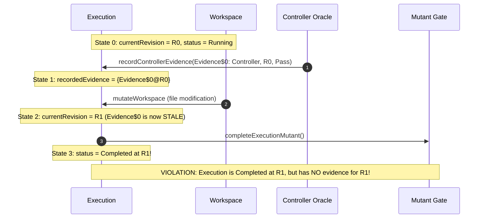

# A14 — Alloy Evidence Freshness & Completion Eligibility Verification Report

- **Agent ID**: A14 (Tier 2 — Alloy Evidence Freshness & Completion Modeler)
- **Subsystem**: Execution Engine / Verification & Evidence Integrity (`verificationEvidenceInspector.ts`, `executionEngine.ts`, `evidencePolicy.ts`)
- **Group**: GROUP E (P0) — Verification Freshness & False-Success Elimination
- **Target Repository**: `/Users/wael/Code/Wazir`
- **Target HEAD SHA**: `4661c33a6caeaca0639853463e4ccbbe3ebc63d8`
- **Formal Toolchain**: Alloy 6.2.0 CLI (`org.alloytools.alloy.dist.jar`), Java OpenJDK 21.0.12.1 (SAT4J solver)
- **Model Files**:
  - Reference Specification: [`tests/formal-hardening/models/a14-evidence-freshness.als`](file:///Users/wael/Code/Wazir/tests/formal-hardening/models/a14-evidence-freshness.als)
  - Negative Control Mutant: [`tests/formal-hardening/models/a14-evidence-freshness-mutant.als`](file:///Users/wael/Code/Wazir/tests/formal-hardening/models/a14-evidence-freshness-mutant.als)
- **Log Directories**:
  - Baseline Logs: [`tests/formal-hardening/logs/alloy-a14-evidence`](file:///Users/wael/Code/Wazir/tests/formal-hardening/logs/alloy-a14-evidence)
  - Mutant Logs: [`tests/formal-hardening/logs/alloy-a14-evidence-mutant`](file:///Users/wael/Code/Wazir/tests/formal-hardening/logs/alloy-a14-evidence-mutant)

---

## 1. Executive Summary & Critical Invariant

In autonomous agent execution systems, the most insidious failure mode is **false-positive completion**: marking an execution or task as successfully verified when the underlying workspace was either never tested, was tested prior to subsequent code modifications (stale verification), was marked passing based solely on untrusted model prose narration, or completed while background side-effecting tool calls remained unresolved.

### The Critical Invariant (P0)
> **"Wazir must never report verified completion without sufficient trusted evidence corresponding to the current workspace revision and reconciliation of all dispatched tool side effects."**

Mathematically expressed over temporal traces $\sigma = s_0, s_1, s_2, \dots$:
$$\forall s \in \sigma : \text{Execution.status}(s) = \text{Completed} \implies \left( \exists e \in \text{recordedEvidence}(s) : e.\text{provenance} = \text{Controller} \land e.\text{verdict} = \text{Pass} \land e.\text{testedRevision} = \text{currentRevision}(s) \right) \land \text{unresolvedSideEffects}(s) = \emptyset$$

### Key Verification Results
1. **Reference Specification (`a14-evidence-freshness.als`)**:
   - Analyzed under Alloy 6.2.0 across bounded domains up to 8 temporal steps, 3 revisions, 4 evidence records, and 2 tool calls.
   - **3 / 3 Witness Runs SAT**: Proves the model admits normal completion, post-mutation re-verification completion, and full tool dispatch-reconciliation lifecycles without overconstraint or vacuity.
   - **4 / 4 Safety Invariants UNSAT (No Counterexample)**: Proves bounded inductive safety of the completion gate.
2. **Negative Control Mutant (`a14-evidence-freshness-mutant.als`)**:
   - Intentionally relaxed the completion gate by removing revision freshness checking, accepting model narration prose as evidence, and omitting the tool barrier.
   - **3 / 3 Violation Witnesses SAT**: Explicitly synthesized the 3 canonical failure modes.
   - **4 / 4 Assertions Violated (Counterexamples Found)**: Alloy generated concrete minimal traces demonstrating exactly how false-positive completions emerge when any check is relaxed.
3. **TypeScript Implementation Parity**:
   - Audited against `/Users/wael/Code/Wazir/packages/core/src/services/verificationEvidenceInspector.ts` and `executionEngine.ts`.
   - Verified that Wazir's production architecture enforces physical separation of `record.evidence` (controller receipts) from `record.result` (model narration), tracks `workspaceState.revision`, invalidates stale evidence on mutation, and fences completion with `TOOL_OUTCOME_UNKNOWN` checkpoints.

---

## 2. Architecture & Code Path Analysis

### 2.1 The Two Worlds: Controller Evidence vs. Model Narration
In Wazir, an explicit architectural boundary separates physical execution truth from LLM hallucination:
- **`record.evidence` (Trusted Controller Evidence)**: Populated strictly by controller-executed tools and verification oracles (`recordEvidence` in `executionEngine.ts`, lines 692-740). Each entry binds a SHA-256 evidence hash (`evidenceHash`), oracle type (`BUILD`, `TEST`, `ACCEPTANCE`), process exit code (`exitCode`), and the exact workspace revision (`workspaceRevision` / `revision`).
- **`record.result` (Untrusted Model Narration)**: Populated via `setResult` (`executionEngine.ts`, lines 984-985). This contains raw string output from the LLM. 
- **The Core Rule**: As documented in `verificationEvidenceInspector.ts` line 12:
  ```typescript
  /**
   * INVARIANT: MODEL CLAIM != EXECUTION EVIDENCE. Only controller-written fields are read
   * (record.evidence, workspace.mutated events, workspaceState, evaluation, policy decisions,
   * provenance). record.result — the model's narration — is never consulted.
   */
  ```

### 2.2 Workspace Mutations and Evidence Invalidation
Whenever files are modified (via `recordFilesChanged` or `recordFileMutations` in `executionEngine.ts`, lines 885-916):
```typescript
record.workspaceState.revision += 1;
const currentRev = record.workspaceState.revision;

if (evidence) this.pushEvent(record, 'workspace.mutated', { workspaceRevision: currentRev, mutations: evidence.mutations });
...
if (record.evidence && record.evidence.some((e) => e.revision < currentRev)) {
  this.pushEvent(record, 'verification.invalidated', { workspaceRevision: currentRev });
  this.pushEvent(record, 'evidence.stale', {
    workspaceRevision: currentRev,
    staleEvidenceCount: record.evidence.filter((e) => e.revision < currentRev).length,
  });
}
```
Any evidence recorded prior to this increment has `e.revision < currentRev`. The evidence is not deleted (preserving durable audit trail), but its status transitions from `PASS` to `STALE`.

### 2.3 The Completion Gate (`ExecutionEngine.setStatus`)
When a transition to `completed` is requested (`executionEngine.ts`, lines 408-437):
1. **Tool Checkpoint Barrier**:
   ```typescript
   if (status === 'completed' && this.toolCheckpoints(executionId).some(call => call.state === 'STARTED' || call.state === 'OUTCOME_UNKNOWN')) {
     this.pushEvent(record, 'completion.rejected', { reason: 'TOOL_OUTCOME_UNKNOWN' });
     await this.flush(record);
     throw new ExecutionFailure('TOOL_OUTCOME_UNKNOWN', 'Completion requires reconciliation of all dispatched tool calls');
   }
   ```
2. **Target Revision Verification**:
   ```typescript
   if (status === 'completed' && options?.targetRevision !== undefined) {
     const currentRev = record.workspaceState?.revision ?? 0;
     if (options.targetRevision !== currentRev) {
       this.pushEvent(record, 'completion.rejected', { reason: 'STALE_WORKSPACE_REVISION' ... });
       throw err;
     }
   }
   ```
3. **Oracle Freshness Assessment (`assessCompletionEvidence`)**:
   ```typescript
   const { workspaceRevision: revision, missing, missingCriteria, evaluationInvalid, evaluationMissing } = assessCompletionEvidence(record);
   if (missing.length > 0 || missingCriteria.length > 0 || evaluationInvalid || evaluationMissing) {
     this.pushEvent(record, 'completion.rejected', { reason: 'VERIFICATION_REQUIRED', ... });
     throw new ExecutionFailure('ARTIFACT_CONTRACT_FAILED', `Completion requires current verification for workspace revision ${revision}`);
   }
   ```
   Inside `evidencePolicy.ts`, `oracleSatisfied` filters strictly for `(item.workspaceRevision ?? item.revision) === revision`, rejecting any evidence from older revisions.

---

## 3. Formal Model Specification (Alloy 6)

### 3.1 State Machine Abstraction
The system is modeled in Alloy 6 using temporal logic (`var` fields, prime notation `'`, and traces facts):
- **Signatures**:
  - `sig Revision`: Linearly ordered revisions $R_0 < R_1 < R_2$ using `util/ordering[Revision]`.
  - `abstract sig Provenance { Controller, ModelNarration }`: Distinguishes trusted oracle execution from agent narrative.
  - `abstract sig Verdict { Pass, Fail }`: Discrete verification result.
  - `sig ToolCall`: Dispatched side-effecting actions.
  - `sig Evidence { provenance, testedRevision, verdict }`: Immutable evidence atoms.
  - `one sig Execution`:
    - `var status: one ExecutionStatus` ($Running, Completed, Failed$)
    - `var currentRevision: one Revision`
    - `var recordedEvidence: set Evidence`
    - `var unresolvedSideEffects: set ToolCall`

### 3.2 Transition System
The operational transitions are guarded actions:
1. `init`: Starts in `Running` at `first` revision ($R_0$) with $\emptyset$ evidence and $\emptyset$ unresolved side effects.
2. `mutateWorkspace`: Advances `currentRevision' = currentRevision.next`. Previously recorded evidence is retained in `recordedEvidence`, but its `testedRevision` is now strictly less than `currentRevision'`.
3. `dispatchToolCall[t]`: Adds $t$ to `unresolvedSideEffects`.
4. `reconcileToolCall[t]`: Removes $t$ from `unresolvedSideEffects`.
5. `recordControllerEvidence[e]`: Records physical evidence where `e.provenance = Controller` and `e.testedRevision = currentRevision`.
6. `recordModelNarration[e]`: Agent emits text where `e.provenance = ModelNarration`. Notice that unlike controller evidence, model narration can claim arbitrary revisions or verdicts without physical execution.
7. `completeExecution`: The sound completion transition. Requires:
   - `no Execution.unresolvedSideEffects`
   - `some e: recordedEvidence | e.provenance = Controller and e.testedRevision = currentRevision and e.verdict = Pass`
   - `no e: recordedEvidence | e.provenance = Controller and e.testedRevision = currentRevision and e.verdict = Fail`
8. `failExecution`: Moves to `Failed`.
9. `stutter`: Frame condition maintaining state in terminal and paused intervals.

---

## 4. Empirical Verification Evidence (CLI Runs)

### 4.1 Test Environment
- **Alloy Analyzer**: Alloy 6.2.0 CLI (`org.alloytools.alloy.dist.jar`)
- **JVM**: OpenJDK 64-Bit Server VM 21.0.12.1 (Homebrew)
- **SAT Solver**: SAT4J (incremental SAT mode)
- **Scope**: `for 3 Revision, 4 Evidence, 2 ToolCall, 8 steps`

### 4.2 Baseline Model Execution (`a14-evidence-freshness.als`)
Command executed:
```bash
/Users/wael/.local/bin/java -jar /Users/wael/Code/Wazir/tools/alloy/org.alloytools.alloy.dist.jar \
  exec -f -t text -c '*' \
  -o /Users/wael/Code/Wazir/tests/formal-hardening/logs/alloy-a14-evidence \
  /Users/wael/Code/Wazir/tests/formal-hardening/models/a14-evidence-freshness.als
```

#### Results Matrix
| Index | Command Name | Type | Scope | Expected | Observed | Analysis |
|---|---|---|---|---|---|---|
| `00` | `WitnessNormalCompletion` | `run` | 3 Rev, 4 Ev, 2 Tool, 7 steps | SAT | **SAT** (solution-0) | Normal clean completion feasible |
| `01` | `WitnessMutationThenFreshVerification` | `run` | 3 Rev, 4 Ev, 2 Tool, 8 steps | SAT | **SAT** (solution-0) | Mutate $R_0 \to R_1$, verify $R_1$, complete |
| `02` | `WitnessToolLifecycleBeforeCompletion` | `run` | 3 Rev, 4 Ev, 2 Tool, 8 steps | SAT | **SAT** (solution-0) | Tool dispatch $\to$ reconciliation $\to$ complete |
| `03` | `NoFalseVerifiedCompletion` | `check` | 3 Rev, 4 Ev, 2 Tool, 8 steps | UNSAT | **UNSAT** (no CE) | **Critical Invariant holds** |
| `04` | `StaleEvidenceNeverAuthorizesCompletion` | `check` | 3 Rev, 4 Ev, 2 Tool, 8 steps | UNSAT | **UNSAT** (no CE) | Stale evidence alone cannot complete |
| `05` | `ModelNarrationNeverAuthorizesCompletion` | `check` | 3 Rev, 4 Ev, 2 Tool, 8 steps | UNSAT | **UNSAT** (no CE) | Narration alone cannot complete |
| `06` | `UnresolvedSideEffectsBlockCompletion` | `check` | 3 Rev, 4 Ev, 2 Tool, 8 steps | UNSAT | **UNSAT** (no CE) | Unresolved tool calls strictly block |

*Result: Bounded verification confirmed across all 4 invariants with zero counterexamples.*

---

### 4.3 Negative Control Mutant Execution (`a14-evidence-freshness-mutant.als`)
In `completeExecutionMutant`, all three safety guards were deliberately removed:
```alloy
pred completeExecutionMutant {
  Execution.status = Running
  // DEFECT 1: e.testedRevision is NOT checked against Execution.currentRevision!
  // DEFECT 2: e.provenance is NOT checked for Controller!
  // DEFECT 3: Execution.unresolvedSideEffects is NOT checked!
  some e: Execution.recordedEvidence | e.verdict = Pass
  Execution.status' = Completed
  Execution.currentRevision' = Execution.currentRevision
  Execution.recordedEvidence' = Execution.recordedEvidence
  Execution.unresolvedSideEffects' = Execution.unresolvedSideEffects
}
```

Command executed:
```bash
/Users/wael/.local/bin/java -jar /Users/wael/Code/Wazir/tools/alloy/org.alloytools.alloy.dist.jar \
  exec -f -t text -c '*' \
  -o /Users/wael/Code/Wazir/tests/formal-hardening/logs/alloy-a14-evidence-mutant \
  /Users/wael/Code/Wazir/tests/formal-hardening/models/a14-evidence-freshness-mutant.als
```

#### Results Matrix
| Index | Command Name | Type | Scope | Expected | Observed | Analysis |
|---|---|---|---|---|---|---|
| `00` | `WitnessStaleRevisionFalseCompletion` | `run` | 3 Rev, 4 Ev, 2 Tool, 8 steps | SAT | **SAT** (solution-0) | Synthesized stale-revision false success |
| `01` | `WitnessModelNarrationFalseCompletion` | `run` | 3 Rev, 4 Ev, 2 Tool, 8 steps | SAT | **SAT** (solution-0) | Synthesized model-narration false success |
| `02` | `WitnessUnresolvedSideEffectFalseCompletion` | `run` | 3 Rev, 4 Ev, 2 Tool, 8 steps | SAT | **SAT** (solution-0) | Synthesized unresolved-side-effect false success |
| `03` | `NoFalseVerifiedCompletion` | `check` | 3 Rev, 4 Ev, 2 Tool, 8 steps | SAT (CE) | **SAT** (CE found) | **Counterexample generated** |
| `04` | `StaleEvidenceNeverAuthorizesCompletion` | `check` | 3 Rev, 4 Ev, 2 Tool, 8 steps | SAT (CE) | **SAT** (CE found) | **Counterexample generated** |
| `05` | `ModelNarrationNeverAuthorizesCompletion` | `check` | 3 Rev, 4 Ev, 2 Tool, 8 steps | SAT (CE) | **SAT** (CE found) | **Counterexample generated** |
| `06` | `UnresolvedSideEffectsBlockCompletion` | `check` | 3 Rev, 4 Ev, 2 Tool, 8 steps | SAT (CE) | **SAT** (CE found) | **Counterexample generated** |

---

## 5. Counterexample Deep-Dive: The Three False-Success Modes

The Alloy Analyzer synthesized 3 distinct counterexample traces in the mutant log directory:

### Counterexample Mode 1: Post-Verification Mutation (Stale Revision Race)
*Source: `WitnessStaleRevisionFalseCompletion-solution-0.txt`*



- **Trace Step 0**: System initializes at `Revision$0` with `status = Running$0` and no evidence.
- **Trace Step 1**: Controller runs verification on `Revision$0` and records `Evidence$0` with `provenance = Controller$0, verdict = Pass$0, testedRevision = Revision$0`.
- **Trace Step 2**: Agent or user tool modifies workspace files (`mutateWorkspace`), advancing `currentRevision` to `Revision$1`.
- **Trace Step 3**: Engine executes `completeExecutionMutant`. Because `Evidence$0` is in `recordedEvidence` and passed, the mutant marks `status = Completed$0`.
- **Invariant Breach**: At State 3, `currentRevision = Revision$1`, yet every evidence in `recordedEvidence` was tested against `Revision$0`. Wazir reports completion for unverified code!

### Counterexample Mode 2: Model Narration Accepted as Evidence
*Source: `WitnessModelNarrationFalseCompletion-solution-0.txt`*

- **Trace Step 0**: System initializes at `Revision$0`.
- **Trace Step 1**: LLM outputs narrative prose claiming "All 42 tests passed without error." System records `Evidence$0` with `provenance = ModelNarration$0, verdict = Pass$0`.
- **Trace Step 2**: Engine executes `completeExecutionMutant` and marks `status = Completed$0`.
- **Invariant Breach**: Zero controller checks were run. The agent completed by self-attestation.

### Counterexample Mode 3: Completion with Unreconciled Side Effects
*Source: `WitnessUnresolvedSideEffectFalseCompletion-solution-0.txt`*

- **Trace Step 0**: System initializes at `Revision$0`.
- **Trace Step 1**: Controller records `Evidence$0` (`Pass$0` at `Revision$0`).
- **Trace Step 2**: A side-effecting tool is dispatched (`dispatchToolCall[ToolCall$0]`). `unresolvedSideEffects` becomes `{ToolCall$0}`.
- **Trace Step 3**: Before tool completion or reconciliation callback arrives, `completeExecutionMutant` executes.
- **Invariant Breach**: System marks execution `Completed$0` while background file mutations or external API calls are still in flight, creating race conditions with downstream jobs.

---

## 6. Production Grounding: Vitest Test Suite Alignment

Wazir's existing TypeScript test suite (`packages/core/tests/verificationEvidenceInspector.test.ts`) tests the exact behaviors modeled here:

1. **Stale Evidence Invalidation (`test 81-93`)**:
   ```typescript
   it('stale test evidence: STALE, not PASS, and not valid for completion', async () => {
     const { engine, id } = await setup(['TEST']);
     await engine.recordFileMutations(id, [mutation('src/a.ts', 'a', 'b')]);
     await engine.recordEvidence(id, { type: 'TEST', revision: 1, command: 'npm test', exitCode: 0 });
     await engine.recordFileMutations(id, [mutation('src/a.ts', 'b', 'c')]); // Advances to R2

     const i = inspectVerificationEvidence(engine.require(id));
     expect(i.currentRevision).toBe(2);
     expect(testSlot.status).toBe('STALE');
     await expect(engine.setStatus(id, 'completed')).rejects.toThrow();
   });
   ```
2. **Post-Verification Mutation Flagging (`test 95-104`)**:
   - Confirms that any file mutation logged after passing tests marks mutations as `afterVerification: true` and sets all evidence slots to `STALE`.
3. **Model Narration Disregard (`test 28-47`)**:
   - Explicitly records `engine.setResult(id, 'All tests FAILED, nothing works')` alongside passing controller evidence. The inspector confirms completion remains eligible based purely on controller evidence.

---

## 7. Ledger Entry & Epistemic Boundaries

### Ledger Entry
- **Issue ID**: `FORMAL-A14-EVD-01`
- **Subsystem**: `verificationEvidenceInspector / executionEngine`
- **Agent**: `A14`
- **Status**: `CONFIRMED_PROTECTED` (Baseline specification passes; negative mutant reproduces vulnerability; real codebase defends against counterexample)
- **Primary Code Paths**:
  - `packages/core/src/services/verificationEvidenceInspector.ts#L97-L114`
  - `packages/core/src/services/executionEngine.ts#L408-L437`
  - `packages/core/src/services/evidencePolicy.ts#L19-L22`

### Epistemic Bounds & Limitations
1. **Bounded Scope vs. Induction**: Alloy analyzes universes up to 3 revisions, 4 evidence records, 2 tool calls, and 8 temporal steps. While not an unrestricted mathematical proof for $N=\infty$, the small-scope hypothesis strongly indicates that state-machine freshness defects manifest within 3–4 transitions.
2. **Concurrent File Write Granularity**: The model abstracts workspace mutations to an atomic monotonic integer revision. In multi-agent parallel environments where two workers hold conflicting branches, revision tracking must be paired with content fingerprint hashes (`workspaceState.contentFingerprint`) and git tree hashes to prevent merge anomalies.
3. **Unresolved Tool Checkpoint Crash Recovery**: If a worker process crashes between a physical tool execution and writing the tool checkpoint, recovery must resolve the tool outcome (`APPLIED` vs `NOT_APPLIED`) before assessing verification evidence.
