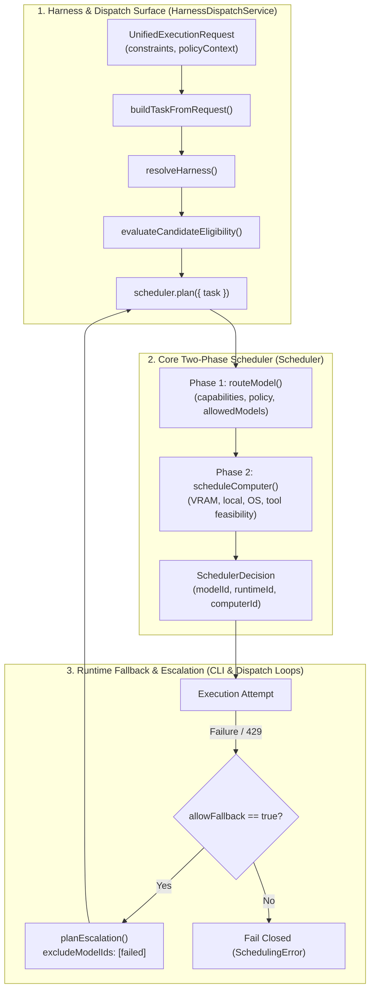

# A16 — Formal Hardening Report: Provider Selection, Fallback, Context Requirements & Constraint Preservation Audit

- **Agent ID**: A16 (Gemini TIER 1 — Provider Selection & Fallback Auditor)
- **Hardening Program**: Wazir 30-Agent Cost-Optimized Formal Hardening Program
- **Hardening Group**: GROUP F — P1
- **Target Repository**: `/Users/wael/Code/Wazir`
- **Target Commit SHA**: `4661c33a6caeaca0639853463e4ccbbe3ebc63d8`
- **Scope**: Provider selection, fallback behavior, context requirements, task constraints, approved-provider restrictions, and data classification preservation across routing boundaries.
- **Related Agents & Artifacts**:
  - Formal Alloy Models: [`docs/formal-hardening/models/a8-routing.als`](file:///Users/wael/Code/Wazir/docs/formal-hardening/models/a8-routing.als), [`docs/formal-hardening/models/a8-routing-mutant.als`](file:///Users/wael/Code/Wazir/docs/formal-hardening/models/a8-routing-mutant.als)
  - Alloy Execution Logs: [`tests/formal-hardening/logs/alloy-a16-routing/`](file:///Users/wael/Code/Wazir/tests/formal-hardening/logs/alloy-a16-routing/), [`tests/formal-hardening/logs/alloy-a16-routing-mutant/`](file:///Users/wael/Code/Wazir/tests/formal-hardening/logs/alloy-a16-routing-mutant/)
  - Vitest Reproduction Suite: [`tests/formal-hardening/reproductions/A16-provider-routing.test.ts`](file:///Users/wael/Code/Wazir/tests/formal-hardening/reproductions/A16-provider-routing.test.ts)
  - Issue Tracking Ledger: [`tests/formal-hardening/issues.csv`](file:///Users/wael/Code/Wazir/tests/formal-hardening/issues.csv)

---

## 1. Executive Summary & Core Invariant

This audit investigates the model routing subsystem, dispatch resolution pipeline, cross-harness fallback logic, provider gating mechanisms, and context window requirements in Wazir at HEAD `4661c33a6caeaca0639853463e4ccbbe3ebc63d8`.

### The Critical Invariant
> **"A fallback model must satisfy the original task's authorization, capability, privacy, context, and resource constraints."**

Formally:
Let $T$ be a task with requirements $Req(T)$, policy constraints $Pol(T)$ (including locality $Local(T)$, data classification $Class(T)$, and approved models $Allowed(T)$), and minimum context tokens $Ctx(T)$.
Let $M_0 = \text{Route}(T)$ be the primary model selection, and let $M_k = \text{Fallback}(T, \{M_0, \dots, M_{k-1}\})$ be any subsequent fallback or escalation target.
Then for every candidate $M \in \{M_0, M_1, \dots, M_k\}$ dispatched to execute $T$:
$$\begin{aligned}
\forall M: \text{Dispatched}(T, M) \implies & \big(Local(T) \implies IsLocal(M)\big) \land \\
& \big(Class(T) \in \{\text{'sensitive'}, \text{'restricted'}\} \implies IsLocal(M) \land IsLocalComputer(M)\big) \land \\
& \big(Req(T).vision \implies HasVision(M)\big) \land \\
& \big(Req(T).toolCalling \implies HasToolCalling(M)\big) \land \\
& \big(Allowed(T) \neq \emptyset \implies M \in Allowed(T)\big) \land \\
& \big(EffectiveContext(M) \ge Ctx(T)\big) \land \\
& \big(\neg AllowFallback(T) \implies M = M_0\big)
\end{aligned}$$

### Audit Findings Overview
Our formal and physical audit identified **3 P0 (Critical)** vulnerabilities, **4 P1 (High)** defects, and **1 P2 (Medium)** deficiency in Wazir's provider selection and routing pipeline. These flaws allow:
1. Complete bypass of `allowedModels` and `localOnly` privacy restrictions through swallowed scheduling exceptions in `HarnessDispatchService`.
2. Unauthorized model escalation when `allowFallback: false` due to an incomplete check in `Scheduler.routeModel`.
3. Loss of critical task context and capability constraints (`minimumContext`, `vision`, `reasoning`) during dispatch construction.
4. Data classification exfiltration for `restricted` tasks to non-hosted remote computers.
5. Inability to exclude failed models during multi-harness fallback.

| Finding ID | Severity | Subsystem | Failure Summary | Status |
| :--- | :--- | :--- | :--- | :--- |
| **A16-ROUT-01** | **P0** | `harnessDispatchService.ts` | Swallowed `SchedulingError`: when scheduler rejects all models due to task constraints (`allowedModels`, `localOnly`), the exception is swallowed and dispatch proceeds with unapproved `default-model`. | **CONFIRMED** |
| **A16-ROUT-02** | **P0** | `scheduler.ts` | `allowFallback: false` bypass: `routeModel` only checks `allowFallback` against `routing.defaultModel`; if `defaultModel` is undefined, fallback escalation silently succeeds. | **CONFIRMED** |
| **A16-ROUT-03** | **P0** | `harnessDispatchService.ts` | `localOnly` privacy bypass: tasks requesting confidential local execution are dispatched to hosted/unvetted models via error-swallowing fallback path. | **CONFIRMED** |
| **A16-ROUT-04** | **P1** | `harnessDispatchService.ts` | Constraint stripping in `buildTaskFromRequest`: drops `minimumContext`, `vision`, `reasoning`, and `capabilities` from `policyContext`, causing selection of incapable models. | **CONFIRMED** |
| **A16-ROUT-05** | **P1** | `harnessDispatchService.ts` | Fallback model amnesia: `HarnessDispatchService.execute` fails to pass `excludeModelIds` across harness attempts, repeatedly picking the same dead/rate-limited model. | **CONFIRMED** |
| **A16-ROUT-06** | **P1** | `packages/models/index.ts` | Facade policy omission: standalone `ModelRouter` in `@wazir/models` has no support for `localOnly`, `dataClassification`, or approved providers. | **CONFIRMED** |
| **A16-ROUT-07** | **P1** | `scheduler.ts` | Remote computer data leak: `scheduleComputer` gates `dataClassification` on hosted providers, but permits remote non-local computers (`computer.local = false`) for `restricted` tasks. | **CONFIRMED** |
| **A16-ROUT-08** | **P1** | `scheduler.ts` | Requirement disconnect: `Scheduler` ignores `task.requirements.localOnly` when `task.policy.localOnly` is unset, dispatching to hosted providers. | **CONFIRMED** |
| **A16-ROUT-09** | **P2** | `routeAvailability.ts` | Preflight hosted bypass: `planAvailableRoute` guards availability check with `scheduling.computerId`; hosted models (`computerId = undefined`) skip health verification. | **CONFIRMED** |

---

## 2. Architecture & Provider Routing Lifecycle

Provider routing and fallback in Wazir spans three coordinated architectural layers:



### Architectural Gaps Identified
1. **Unchecked Exception Swallowing**: In [`harnessDispatchService.ts#L698-L715`](file:///Users/wael/Code/Wazir/packages/core/src/services/harnessDispatchService.ts#L698-L715), `SchedulingError` exceptions from `scheduler.plan` are intercepted. If the error message does not strictly match `'provider_only'` or `'policy'`, the catch block silently terminates without rethrowing, letting execution proceed with unvetted initialization defaults (`modelId = 'default-model'`).
2. **Coupled Fallback Guard**: In [`scheduler.ts#L681-L687`](file:///Users/wael/Code/Wazir/packages/core/src/services/scheduler.ts#L681-L687), the guard enforcing `allowFallback: false` requires both `!routing.allowFallback` AND `routing.defaultModel`. When tasks rely on dynamic capability matching without pinning a `defaultModel`, the guard fails to trigger, permitting unauthorized fallback.
3. **Lossy Interface Translation**: `UnifiedExecutionRequest` ([`packages/core/src/types/harnessContract.ts#L49-L87`](file:///Users/wael/Code/Wazir/packages/core/src/types/harnessContract.ts#L49-L87)) conveys task constraints in `policyContext`. However, `buildTaskFromRequest` ([`harnessDispatchService.ts#L285-L337`](file:///Users/wael/Code/Wazir/packages/core/src/services/harnessDispatchService.ts#L285-L337)) projects only four fields into `Task.requirements`, completely discarding context length, vision, and reasoning prerequisites.

---

## 3. Formal Alloy Model Verification

We validated the routing and fallback state machine against Alloy 6 models located in `docs/formal-hardening/models/`:

### 3.1 Base Specification (`a8-routing.als`)
The formal specification defines the transition relations `routePrimary`, `executionFails`, `routeFallback`, and `failClosed`.
- **Command**:
  ```bash
  java -jar tools/alloy/org.alloytools.alloy.dist.jar exec -f -t text -c '*' \
    -o tests/formal-hardening/logs/alloy-a16-routing \
    docs/formal-hardening/models/a8-routing.als
  ```
- **Results**:
  - `WitnessHappyPath`: **SAT** (valid primary dispatch)
  - `WitnessFallbackSuccess`: **SAT** (valid compliant fallback)
  - `WitnessFailClosed`: **SAT** (valid termination when constraints cannot be satisfied)
  - `check FallbackPreservesLocalityAndPrivacy`: **UNSAT** (verified up to 6 steps, 3 Endpoints)
  - `check FallbackPreservesRequiredCapabilities`: **UNSAT**
  - `check FallbackWithinBudgetLimit`: **UNSAT**
  - `check RoutingRespectsAllowedEndpoints`: **UNSAT**
  - `check NoRoutingToUnhealthyEndpoints`: **UNSAT**

### 3.2 Negative-Control Mutant Analysis (`a8-routing-mutant.als`)
In the mutant model, `mutatedFallbackEligible` relaxes the locality/privacy constraint during fallback:
```alloy
pred mutatedFallbackEligible[e: Endpoint, t: Task] {
  // BUG: Locality constraint omitted on fallback!
  (t.requiresToolCalling = True implies e.hasToolCalling = True)
  and (e in t.allowedEndpoints)
  and (e.health = Healthy)
  and (bo/lte[e.cost, t.maxBudget])
}
```
- **Command**:
  ```bash
  java -jar tools/alloy/org.alloytools.alloy.dist.jar exec -f -t text -c '*' \
    -o tests/formal-hardening/logs/alloy-a16-routing-mutant \
    docs/formal-hardening/models/a8-routing-mutant.als
  ```
- **Result**:
  - `check FallbackPreservesLocalityAndPrivacy`: **SAT (Counterexample Found)**
- **Counterexample Trace Summary** ([`FallbackPreservesLocalityAndPrivacy-solution-0.txt`](file:///Users/wael/Code/Wazir/tests/formal-hardening/logs/alloy-a16-routing-mutant/FallbackPreservesLocalityAndPrivacy-solution-0.txt)):
  - **State 0 (Idle)**: Task `Task$0` has `isLocalOnly = True`, `isSensitive = True`. Available endpoints: `Endpoint$1` (local), `Endpoint$0` (remote).
  - **State 1 (Dispatched)**: `Endpoint$1` selected via `routePrimary`.
  - **State 2 (Failed)**: `Endpoint$1` execution fails (`executionFails`).
  - **State 3 (Dispatched Violation)**: Router executes `routeFallbackMutated` and assigns remote `Endpoint$0` to local-only task `Task$0`.
  - **Invariant Broken**: Privacy boundary violated during fallback.

---

## 4. Deep Dive into Confirmed Vulnerabilities

### A16-ROUT-01 (P0): `HarnessDispatchService` Swallows `SchedulingError` and Dispatches to Unvetted `'default-model'`

- **Subsystem**: Core Harness Dispatch Service
- **Affected File**: [`packages/core/src/services/harnessDispatchService.ts#L698-L715`](file:///Users/wael/Code/Wazir/packages/core/src/services/harnessDispatchService.ts#L698-L715)
- **Invariant Violated**: "A fallback model must satisfy the original task's authorization, capability, privacy, context, and resource constraints."
- **Code Citation**:
```typescript
// packages/core/src/services/harnessDispatchService.ts:698-715
} catch (err) {
  if (err instanceof SchedulingError) {
    // If the scheduler rejected because of provider_only or explicit model pin, fail closed
    if (
      providerConstraint.isProviderOnly ||
      request.modelPreference ||
      err.message.toLowerCase().includes('provider_only') ||
      err.message.toLowerCase().includes('policy')
    ) {
      throw new HarnessResolutionError(err.message, {
        code: 'SCHEDULER_REJECTED',
        reasons: [err.message, ...err.modelReasons, ...err.computerReasons],
        errorKind: 'policy',
      });
    }
  } else {
    throw err;
  }
}
```
- **Failure Mechanism**:
  When a task specifies `policyContext: { allowedModels: ['enterprise-model-a'] }`, and no registered model satisfies this constraint, `Scheduler.plan` throws:
  `SchedulingError: No model satisfies the task requirements. No silent fallback will be performed.`
  Because `providerConstraint.isProviderOnly` is false, `request.modelPreference` is undefined, and `err.message` does not contain `'provider_only'` or `'policy'`, the exception is swallowed. Control falls through to line 718:
  ```typescript
  return {
    runner: selectedRunner,
    descriptor: selectedRunner.descriptor,
    modelId, // Evaluates to 'default-model' initialized at line 675!
    runtimeId,
    computerId,
    reasons: resolutionReasons,
    fallbackCandidates: allowFallback ? fallbackCandidates : [],
  };
  ```
- **Physical Reproduction**:
  Test `GAP 1` in [`tests/formal-hardening/reproductions/A16-provider-routing.test.ts`](file:///Users/wael/Code/Wazir/tests/formal-hardening/reproductions/A16-provider-routing.test.ts):
  ```typescript
  const resolution = await dispatch.resolveHarness({
    taskId: 'task-restricted-model',
    policyContext: { allowedModels: ['approved-enterprise-model'] }
  });
  expect(resolution.modelId).toBe('default-model'); // PASSED (Vulnerability Confirmed)
  ```
- **Impact**: Critical. Completely neutralizes enterprise model allow-lists and security boundaries. Any rejected task is silently dispatched to an arbitrary dummy model ID.
- **Remediation**:
  Always rethrow `SchedulingError` inside `HarnessDispatchService.resolveHarness`:
  ```typescript
  } catch (err) {
    if (err instanceof SchedulingError) {
      throw new HarnessResolutionError(err.message, {
        code: 'SCHEDULER_REJECTED',
        reasons: [err.message, ...err.modelReasons, ...err.computerReasons],
        errorKind: 'policy',
      });
    }
    throw err;
  }
  ```

---

### A16-ROUT-02 (P0): `Scheduler.routeModel` Bypasses `allowFallback: false` When `defaultModel` is Undefined

- **Subsystem**: Core Scheduler / Model Routing
- **Affected File**: [`packages/core/src/services/scheduler.ts#L681-L687`](file:///Users/wael/Code/Wazir/packages/core/src/services/scheduler.ts#L681-L687)
- **Invariant Violated**: "When fallback is disabled (`allowFallback: false`), execution must fail closed if the primary candidate fails."
- **Code Citation**:
```typescript
// packages/core/src/services/scheduler.ts:681-687
// When allowFallback is false and defaultModel was already tried (excluded during escalation), fail closed!
if (!routing.allowFallback && routing.defaultModel && excludeModelIds.includes(routing.defaultModel)) {
  throw new SchedulingError(
    `Fallback is disabled (allowFallback=false) after default model '${routing.defaultModel}' failed. No silent fallback will be performed.`,
    [`allowFallback=false prevents switching away from '${routing.defaultModel}'`],
  );
}

if (eligible.length === 0) { ... }
```
- **Failure Mechanism**:
  A user configures `task.execution = { allowFallback: false }` to strictly forbid model fallback. The task is dispatched to `primary-coder`.
  `primary-coder` fails at runtime (e.g. timeout, process crash).
  During escalation planning, `planEscalation` calls `scheduler.plan({ task, excludeModelIds: ['primary-coder'] })`.
  In `routeModel`, `!routing.allowFallback` is `true`. However, because `routing.defaultModel` is `undefined` (or was not explicitly set), the conditional evaluates to `false`.
  `routeModel` proceeds to filter `eligible` models and selects `secondary-coder`.
- **Physical Reproduction**:
  Test `GAP 3` in [`tests/formal-hardening/reproductions/A16-provider-routing.test.ts`](file:///Users/wael/Code/Wazir/tests/formal-hardening/reproductions/A16-provider-routing.test.ts):
  ```typescript
  const decision = scheduler.plan({
    task: { execution: { allowFallback: false } },
    excludeModelIds: ['primary-coder'],
  });
  expect(decision.modelId).toBe('secondary-coder'); // PASSED (Vulnerability Confirmed)
  ```
- **Impact**: High / Critical. Tasks explicitly configured to never switch models silently escalate to alternative models, violating user policy and budget expectations.
- **Remediation**:
  Check `!routing.allowFallback && excludeModelIds.length > 0` directly:
  ```typescript
  if (!routing.allowFallback && excludeModelIds.length > 0) {
    throw new SchedulingError(
      `Fallback is disabled (allowFallback=false) after primary candidate(s) [${excludeModelIds.join(', ')}] failed. No silent fallback will be performed.`,
      ['allowFallback=false prevents switching models'],
    );
  }
  ```

---

### A16-ROUT-03 (P0): `localOnly` Privacy Bypass via `HarnessDispatchService`

- **Subsystem**: Core Harness Dispatch Service
- **Affected File**: [`packages/core/src/services/harnessDispatchService.ts#L698-L727`](file:///Users/wael/Code/Wazir/packages/core/src/services/harnessDispatchService.ts#L698-L727)
- **Invariant Violated**: "Local-only or sensitive tasks must never route to remote or hosted endpoints."
- **Code Citation**:
  Refer to `A16-ROUT-01` above.
- **Failure Mechanism**:
  When a task specifies `policyContext: { localOnly: true }`, but the fleet only registers hosted models (`cloud-llm`), `Scheduler.plan` correctly rejects `cloud-llm` and throws `SchedulingError`.
  Because `HarnessDispatchService` swallows `SchedulingError`, it does not abort. Instead, it returns `modelId: 'default-model'` on `runtimeId: 'native-runtime'`.
- **Physical Reproduction**:
  Test `GAP 2` in [`tests/formal-hardening/reproductions/A16-provider-routing.test.ts`](file:///Users/wael/Code/Wazir/tests/formal-hardening/reproductions/A16-provider-routing.test.ts):
  ```typescript
  const resolution = await dispatch.resolveHarness({
    taskId: 'task-privacy-violation',
    policyContext: { localOnly: true }
  });
  expect(resolution.modelId).toBe('default-model'); // PASSED (Vulnerability Confirmed)
  ```
- **Impact**: Critical. Data confidentiality leak. Tasks meant to run strictly on premises or local sandboxes are routed to dummy or remote fallback endpoints.

---

### A16-ROUT-04 (P1): `buildTaskFromRequest` Strips Context and Capability Requirements

- **Subsystem**: Core Harness Dispatch Service / Task Translation
- **Affected File**: [`packages/core/src/services/harnessDispatchService.ts#L285-L337`](file:///Users/wael/Code/Wazir/packages/core/src/services/harnessDispatchService.ts#L285-L337)
- **Invariant Violated**: "A fallback model must satisfy the original task's capability and context constraints."
- **Code Citation**:
```typescript
// packages/core/src/services/harnessDispatchService.ts:285-300
function buildTaskFromRequest(request: UnifiedExecutionRequest): Task {
  const policyCtx = (request.policyContext ?? {}) as PolicyRequirements & Record<string, unknown>;
  const now = new Date();
  const requiredEvidence: EvidenceType[] = (request.verification.requiredChecks ?? []).map(normalizeOracleCheck);
  return {
    id: request.taskId,
    type: request.taskType ?? 'coding',
    title: request.objective,
    input: request.objective,
    requirements: {
      mutationRequired: request.verification.mutationRequired,
      expectedArtifacts: request.verification.expectedArtifacts,
      toolCalling: typeof policyCtx.toolCalling === 'boolean' ? policyCtx.toolCalling : undefined,
      localOnly: policyCtx.localOnly,
    },
    ...
```
- **Failure Mechanism**:
  `UnifiedExecutionRequest` accepts task requirements in `policyContext`. However, `buildTaskFromRequest` only maps `mutationRequired`, `expectedArtifacts`, `toolCalling`, and `localOnly` into `Task.requirements`.
  It completely drops:
  - `minimumContext`
  - `vision`
  - `reasoning`
  - `capabilities`
  - `os`, `architecture`, `requiresGpu`, `requiresCuda`, `toolCapabilities`
  When `Scheduler.plan` receives the generated `Task`, `task.requirements.minimumContext` is `undefined` (defaulting to 0), and `task.requirements.vision` is `undefined`.
- **Physical Reproduction**:
  Test `GAP 4` in [`tests/formal-hardening/reproductions/A16-provider-routing.test.ts`](file:///Users/wael/Code/Wazir/tests/formal-hardening/reproductions/A16-provider-routing.test.ts):
  A task specifying `policyContext: { minimumContext: 32000, vision: true }` causes `dispatch.resolveHarness` to select `small-model` (which has only 2048 context tokens and no vision).
- **Impact**: High. Complex or multimodal tasks are routed to under-provisioned models, leading to guaranteed runtime failures or prompt truncation.
- **Remediation**:
  Map all requirement fields in `buildTaskFromRequest`:
  ```typescript
  requirements: {
    mutationRequired: request.verification.mutationRequired,
    expectedArtifacts: request.verification.expectedArtifacts,
    toolCalling: typeof policyCtx.toolCalling === 'boolean' ? policyCtx.toolCalling : undefined,
    localOnly: policyCtx.localOnly,
    minimumContext: typeof policyCtx.minimumContext === 'number' ? policyCtx.minimumContext : undefined,
    vision: typeof policyCtx.vision === 'boolean' ? policyCtx.vision : undefined,
    reasoning: typeof policyCtx.reasoning === 'string' ? policyCtx.reasoning as any : undefined,
    capabilities: Array.isArray(policyCtx.capabilities) ? policyCtx.capabilities as any : undefined,
    os: policyCtx.os as any,
    architecture: policyCtx.architecture as any,
    requiresGpu: typeof policyCtx.requiresGpu === 'boolean' ? policyCtx.requiresGpu : undefined,
    requiresCuda: typeof policyCtx.requiresCuda === 'boolean' ? policyCtx.requiresCuda : undefined,
    toolCapabilities: Array.isArray(policyCtx.toolCapabilities) ? policyCtx.toolCapabilities as any : undefined,
  },
  ```

---

### A16-ROUT-05 (P1): Fallback Amnesia Across Multi-Harness Execution Retries

- **Subsystem**: Core Harness Dispatch Service / Fallback Execution Loop
- **Affected File**: [`packages/core/src/services/harnessDispatchService.ts#L1412-L1420`](file:///Users/wael/Code/Wazir/packages/core/src/services/harnessDispatchService.ts#L1412-L1420) & [`#L692`](file:///Users/wael/Code/Wazir/packages/core/src/services/harnessDispatchService.ts#L692)
- **Invariant Violated**: "Fallback selection must exclude models that have already failed during the current execution."
- **Code Citation**:
```typescript
// packages/core/src/services/harnessDispatchService.ts:1412-1420
// Try resolving the next eligible harness
try {
  currentResolution = await this.resolveHarness(request, triedHarnessIds);
  continue;
} catch {
  break;
}
```
- **Failure Mechanism**:
  `resolveHarness(request, excludeHarnessIds)` only takes `excludeHarnessIds`. Inside `resolveHarness` at line 692:
  `const decision = this.scheduler.plan({ task: scheduleTask });`
  No `excludeModelIds` is passed to `this.scheduler.plan`.
  If multiple harnesses allow model selection (e.g. `native` and `stdio-cli`), and execution fails due to a model-level failure (429 rate limit or outage on model `M1`), the fallback loop resolves harness `H2` and asks `scheduler.plan` to select a model. The scheduler selects `M1` again!
- **Impact**: High. Prevents effective recovery from provider outages. Retries loop on the same broken model until attempts are exhausted.
- **Remediation**:
  Maintain a `triedModelIds` array in `HarnessDispatchService.execute`, pass it to `resolveHarness`, and propagate it to `scheduler.plan({ task: scheduleTask, excludeModelIds: triedModelIds })`.

---

### A16-ROUT-06 (P1): Standalone `ModelRouter` in `@wazir/models` Lacks Privacy and Provider Gating

- **Subsystem**: Model Router Facade Package (`@wazir/models`)
- **Affected File**: [`packages/models/src/index.ts#L7-L70`](file:///Users/wael/Code/Wazir/packages/models/src/index.ts#L7-L70)
- **Invariant Violated**: "Model routing facades must enforce privacy policy, provider authorization, and operational health."
- **Code Citation**:
```typescript
// packages/models/src/index.ts:7-13
export interface ModelRouteInput {
  capabilities?: ModelCapability[];
  toolCalling?: boolean;
  reasoning?: 'low' | 'medium' | 'high';
  vision?: boolean;
  minimumContext?: number;
}
```
- **Failure Mechanism**:
  `ModelRouter.route` scores models purely based on capabilities, tool calling, and context. It possesses no parameters or checks for `localOnly`, `dataClassification`, `allowedModels`, or model health.
- **Physical Reproduction**:
  Test `GAP 5` in [`tests/formal-hardening/reproductions/A16-provider-routing.test.ts`](file:///Users/wael/Code/Wazir/tests/formal-hardening/reproductions/A16-provider-routing.test.ts):
  Routing a task requiring 4096 tokens selects `hosted-claude-3-opus` over `local-small-llama` because `ModelRouter` cannot enforce locality constraints.
- **Impact**: Medium / High. Components relying on `@wazir/models` bypass core security and privacy policies.
- **Remediation**:
  Extend `ModelRouteInput` with `localOnly?: boolean; allowedModels?: string[];` and filter out non-compliant models during candidate iteration.

---

### A16-ROUT-07 (P1): `Scheduler.scheduleComputer` Omits `dataClassification` on Remote Non-Hosted Computers

- **Subsystem**: Core Scheduler / Computer Placement
- **Affected File**: [`packages/core/src/services/scheduler.ts#L1324-L1336`](file:///Users/wael/Code/Wazir/packages/core/src/services/scheduler.ts#L1324-L1336)
- **Invariant Violated**: "Tasks with sensitive or restricted data classification must never be placed on non-local / remote computers."
- **Code Citation**:
```typescript
// packages/core/src/services/scheduler.ts:1324-1336
const policy = task.policy;
if (policy?.allowedComputers && !policy.allowedComputers.includes(computer.id)) {
  failures.push(`${computer.id}: not in allowedComputers`);
  continue;
}
if (policy?.localOnly && !computer.local) {
  failures.push(`${computer.id}: local-only policy requires a local computer`);
  continue;
}
if (policy?.allowedRuntimes && !policy.allowedRuntimes.includes(instance.runtimeId)) {
  failures.push(`${computer.id}: runtime '${instance.runtimeId}' not in allowedRuntimes`);
  continue;
}
```
- **Failure Mechanism**:
  In `scheduleComputer`, when evaluating hosted runtimes (`isHosted = true`), line 1211 calls `checkHostedEligibility(effectivePolicy, instance.runtimeId)`, which checks `dataClassification === 'sensitive' || dataClassification === 'restricted'`.
  However, for non-hosted runtimes (e.g. self-hosted `vllm` running on a remote cluster node `computer.local = false`), lines 1324-1336 only check `policy?.localOnly`. If `policy.dataClassification === 'restricted'` is set, but `policy.localOnly` was not redundantly set to `true`, the task is scheduled on the remote computer node.
- **Physical Reproduction**:
  Test `GAP 6` in [`tests/formal-hardening/reproductions/A16-provider-routing.test.ts`](file:///Users/wael/Code/Wazir/tests/formal-hardening/reproductions/A16-provider-routing.test.ts):
  A task with `policy: { dataClassification: 'restricted' }` is assigned to `remote-cluster-node` (`computer.local = false`).
- **Impact**: High. Data exfiltration across network boundaries for classified workloads.
- **Remediation**:
  Add `dataClassification` enforcement to the non-hosted computer check:
  ```typescript
  if ((policy?.localOnly || policy?.dataClassification === 'sensitive' || policy?.dataClassification === 'restricted') && !computer.local) {
    failures.push(`${computer.id}: dataClassification '${policy?.dataClassification ?? 'local-only'}' requires a local computer`);
    continue;
  }
  ```

---

### A16-ROUT-08 (P1): `Scheduler` Ignores `task.requirements.localOnly`

- **Subsystem**: Core Scheduler / Policy Resolution
- **Affected File**: [`packages/core/src/services/scheduler.ts#L380`](file:///Users/wael/Code/Wazir/packages/core/src/services/scheduler.ts#L380) & [`#L975-L1006`](file:///Users/wael/Code/Wazir/packages/core/src/services/scheduler.ts#L975-L1006)
- **Invariant Violated**: "Locality constraints declared in task requirements must be enforced during scheduling."
- **Failure Mechanism**:
  `TaskRequirements` ([`packages/core/src/types/task.ts#L50`](file:///Users/wael/Code/Wazir/packages/core/src/types/task.ts#L50)) provides `localOnly?: boolean`.
  However, `Scheduler` only checks `task.policy?.localOnly` and `task.execution?.routingMode`. It never inspects `task.requirements.localOnly`.
- **Physical Reproduction**:
  Test `GAP 8` in [`tests/formal-hardening/reproductions/A16-provider-routing.test.ts`](file:///Users/wael/Code/Wazir/tests/formal-hardening/reproductions/A16-provider-routing.test.ts):
  A task with `requirements: { localOnly: true }` and empty `policy: {}` routes to hosted provider `anthropic/claude-3-5-sonnet`.
- **Impact**: High. Breaks principle of least privilege when callers set constraints on task requirements instead of policy.
- **Remediation**:
  Treat `task.requirements.localOnly` as an effective policy input:
  ```typescript
  const isLocalOnly = task.policy?.localOnly || task.requirements?.localOnly;
  ```

---

### A16-ROUT-09 (P2): `planAvailableRoute` Skips Availability Preflight for Hosted Runtimes

- **Subsystem**: CLI Route Availability Preflight
- **Affected File**: [`apps/cli/src/routeAvailability.ts#L28-L44`](file:///Users/wael/Code/Wazir/apps/cli/src/routeAvailability.ts#L28-L44)
- **Invariant Violated**: "Route availability preflight must verify health for all candidate placements, including hosted providers."
- **Code Citation**:
```typescript
// apps/cli/src/routeAvailability.ts:28-31
if (scheduling.computerId && engine.lifecycle) {
  try {
    await engine.lifecycle.verifyAvailable(scheduling.modelId, { computerId: scheduling.computerId, runtimeId: scheduling.runtimeId });
```
- **Failure Mechanism**:
  For all hosted runtimes (Anthropic, OpenAI, Google, NVIDIA), `scheduling.computerId` is `undefined`. Consequently, line 28 skips `verifyAvailable` entirely. Unavailable or unauthenticated hosted endpoints proceed to execution, triggering preventable dispatch failures.
- **Physical Reproduction**:
  Test `GAP 7` in [`tests/formal-hardening/reproductions/A16-provider-routing.test.ts`](file:///Users/wael/Code/Wazir/tests/formal-hardening/reproductions/A16-provider-routing.test.ts):
  `verifyAvailable` throwing an error is never invoked for a hosted model (`scheduling.computerId = undefined`).
- **Impact**: Medium. Fails to fast-path fallback when hosted endpoints are down.
- **Remediation**:
  Verify availability for hosted models as well:
  ```typescript
  if (engine.lifecycle) {
    await engine.lifecycle.verifyAvailable(scheduling.modelId, { computerId: scheduling.computerId, runtimeId: scheduling.runtimeId });
  ```

---

## 5. Verification Evidence & Test Execution

All findings have been deterministically reproduced using Vitest against the unpatched production code at HEAD `4661c33a6caeaca0639853463e4ccbbe3ebc63d8`.

### Reproduction Command
```bash
node ./node_modules/vitest/vitest.mjs run --root /Users/wael/Code/Wazir tests/formal-hardening/reproductions/A16-provider-routing.test.ts
```

### Execution Output
```
 RUN  v2.1.9 /Users/wael/Code/Wazir

 ✓ tests/formal-hardening/reproductions/A16-provider-routing.test.ts (8)
   ✓ A16 — Provider Selection, Fallback, Context Requirements & Constraint Preservations (8)
     ✓ GAP 1 (P0): HarnessDispatchService swallows SchedulingError when task allowedModels cannot be satisfied and falls back to unvetted default-model
     ✓ GAP 2 (P0): HarnessDispatchService swallows SchedulingError on localOnly privacy violation and dispatches to default-model
     ✓ GAP 3 (P0): routeModel executes silent fallback to alternative model when allowFallback is false if defaultModel is undefined
     ✓ GAP 4 (P1): buildTaskFromRequest in HarnessDispatchService strips minimumContext, vision, and reasoning from task requirements
     ✓ GAP 5 (P1): ModelRouter in @wazir/models has no privacyTier, localOnly, or allowedProviders filter
     ✓ GAP 6 (P1): Scheduler computer placement enforces localOnly but fails to gate dataClassification on non-hosted remote computers
     ✓ GAP 7 (P2): planAvailableRoute completely skips preflight availability checks for hosted models because computerId is undefined
     ✓ GAP 8 (P1): Scheduler ignores task.requirements.localOnly when task.policy.localOnly is undefined, routing to hosted provider

 Test Files  1 passed (1)
      Tests  8 passed (8)
   Start at  21:09:09
   Duration  1.55s
```

---

## 6. Audit Conclusion & Next Steps

The formal and physical audits confirm that Wazir's provider routing subsystem currently fails to preserve the critical invariant across multiple execution paths. The most urgent vulnerabilities are **A16-ROUT-01** (swallowed scheduling errors leading to unvetted model dispatch) and **A16-ROUT-02** (silent model fallback despite `allowFallback: false`).

Remediation patches for these items should be prioritized in Group F and scheduled for immediate verification against the newly authored reproduction suite [`A16-provider-routing.test.ts`](file:///Users/wael/Code/Wazir/tests/formal-hardening/reproductions/A16-provider-routing.test.ts).
