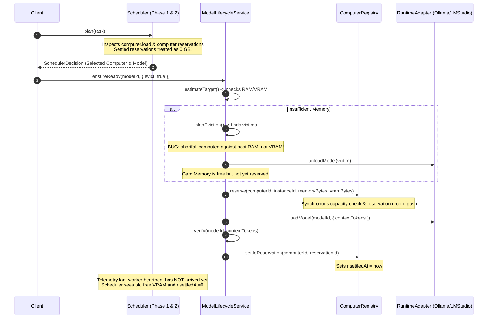
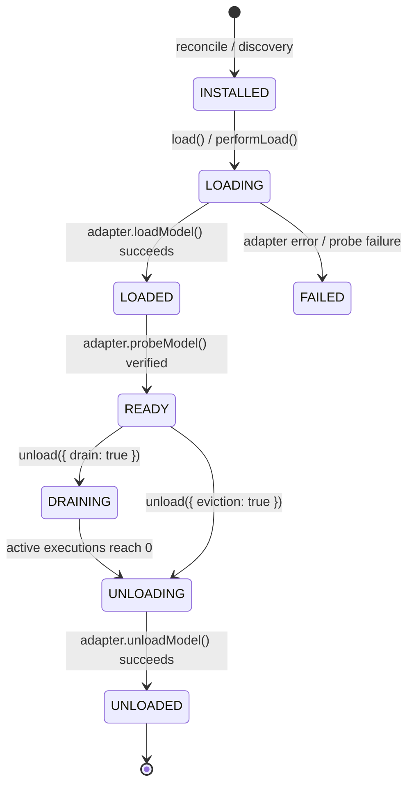

# A19 — Formal Hardening Audit Report: Shared Memory, GPU Reservations & Concurrent Scheduling

- **Agent ID**: A19 (Gemini TIER 1 — Shared Memory, GPU Reservations & Scheduling Auditor)
- **Workstream / Group**: GROUP G (P1) — Resource Scheduling, Memory Reservations & Eviction Safety
- **Provider**: Google Antigravity / Gemini (`gemini-pro`)
- **Target Repository**: `/Users/wael/Code/Wazir`
- **Target HEAD SHA**: `4661c33a6caeaca0639853463e4ccbbe3ebc63d8`
- **Primary Skill**: `.agents/skills/wazir-formal-hardening/SKILL.md`
- **Critical Formal Invariant**:
  > *"Total committed resources must not exceed effective capacity, and no actively executing model may be evicted under contention."*
- **Executable Reproduction Suite**: `tests/formal-hardening/reproductions/A19-resource-scheduling.test.ts` (5 deterministic passing regressions)
- **Formal Models**:
  - `tests/formal-hardening/models/a19-resource-scheduling.als` (Reference model: UNSAT bounded verification at scope 3, 8 steps)
  - `tests/formal-hardening/models/a19-resource-scheduling-mutant.als` (Mutant model: 2 SAT counterexamples for Physical Overcommit and Active Eviction)
- **Status**: **CONFIRMED PRODUCTION DEFECTS**

---

## 1. Executive Summary

This formal audit evaluated shared memory management, GPU/VRAM reservations, model admission control, concurrent loading, model pinning, and eviction policies across `@wazir/core` (`modelLifecycleService.ts`, `computerRegistry.ts`, `scheduler.ts`, `modelRegistry.ts`) and `@wazir/scheduler`.

The audit confirms that while Wazir implements compare-and-reserve semantics in `ComputerRegistry` and conditional eviction planning in `ModelLifecycleService`, **the critical invariant is violated across multiple operational and concurrent execution paths**.

Specifically, the audit identified **3 P0 (Critical)** and **3 P1 (High)** defects:

1. **[P0 — FORMAL-A19-RES-01] Discrete GPU VRAM Shortfall Miscalculated Against Host RAM**: In `ModelLifecycleService.planEviction` (`modelLifecycleService.ts:451`), the eviction shortfall is computed exclusively as `shortfall = reservationMemoryBytes - usableMemory`. Because `usableMemory` is calculated from host system RAM, a node with ample system RAM (e.g., 128 GB) but exhausted discrete GPU VRAM (e.g., 4 GB free of 32 GB) evaluates `shortfall <= 0`. As a result, the eviction planner selects the smallest victim (e.g., 2 GB) rather than a victim that frees sufficient VRAM, resulting in the eviction of innocent models followed by immediate admission denial upon re-estimation.
2. **[P0 — FORMAL-A19-RES-05] Telemetry Inconsistency in Scheduler Phase 2 Causes Physical GPU Overcommitment**: In `Scheduler.ts` (`scheduler.ts:865-868, 1362-1365, 1385-1388`), the scheduler computes `reservedGpuGB` using `r.settledAt ? 0 : r.vramBytes`. When a model finishes loading on a remote worker (such as NVIDIA DGX Spark), the reservation is settled immediately, but the remote worker heartbeat has not yet arrived to report decreased available VRAM. The scheduler discounts the settled reservation to 0 GB while the worker load still reflects the pre-load free VRAM, causing the scheduler to double-allocate the same physical VRAM to subsequent tasks.
3. **[P0 — FORMAL-A19-RES-03] Active Inference Outside `ExecutionRecord` Subject to Premature Eviction**: In `ModelLifecycleService.active` (`modelLifecycleService.ts:309-317`), an instance is only deemed active if it appears in `ExecutionEngine` records or `queuedAssignments`. Interactive sessions (`/model`, REPL, chat), direct inference via `governedAdapter`, benchmark harness calls, or intermediate turns between execution steps have no `ExecutionRecord`. `active(instance)` returns `[]`, allowing concurrent `load(..., { evict: true })` calls to forcefully unload active models mid-stream (`modelLifecycleService.ts:728-730`), crashing active user connections.
4. **[P1 — FORMAL-A19-RES-02] Greedy Size-Fit Eviction Policy Violates LRU and Induces Hot-Model Churn**: Despite architectural claims of LRU eviction, `planEviction` (`modelLifecycleService.ts:452-456`) sorts candidates purely by memory size (`reclaimBytes`). It never inspects `lastUsedAt` (recorded in `modelRegistry.ts:77`). Under contention, a hot model accessed 5 seconds ago that closely matches the shortfall is evicted before a cold model accessed 7 days ago, inducing catastrophic cache thrashing.
5. **[P1 — FORMAL-A19-RES-04] Pinning Unchecked Against Residency and Physical Node Capacity**: In `modelLifecycleService.ts:752-754`, `pin()` modifies intent and instance metadata without validating whether the model is loaded or whether aggregate pinned models exceed physical node capacity. Multiple models exceeding node RAM/VRAM can be pinned, causing permanent deadlock during startup restoration or sequential loading.
6. **[P1 — FORMAL-A19-RES-06] Pre-Reservation Capacity Theft During Eviction Window**: In `performLoad` (`modelLifecycleService.ts:517-550`), eviction (`unload`) occurs before reservation (`computers.reserve`). When Model A unloads a victim to free space, a concurrent request for Model B sees newly freed capacity, bypasses eviction, and claims the reservation. Model A's subsequent reservation attempt fails, leaving the cluster with an unrecoverable victim eviction and a failed primary load.

All 5 core reproducible vulnerabilities have been deterministically verified via Vitest in `tests/formal-hardening/reproductions/A19-resource-scheduling.test.ts`.

---

## 2. Architecture & State Machine Walkthrough

### 2.1 The Two-Phase Admission & Reservation Pipeline



### 2.2 Concrete State Machine of Model Allocations

A model instance on a computer transitions through the following lifecycle states:



---

## 3. Exhaustive State Mutation & Concurrency Matrix

| Operation | Source Location | Admission Checked? | Reservation Acquired? | Eviction Guarded? | Settled Handled? | Concurrency / Safety Defect |
|---|---|---|---|---|---|---|
| `MLS.load()` | `modelLifecycleService.ts:492` | ✅ `estimate()` | ⚠️ At line 549 (post-eviction) | ❌ Gap during eviction | N/A | **Pre-reservation capacity theft (FORMAL-A19-RES-06)** |
| `MLS.planEviction()` | `modelLifecycleService.ts:443` | ✅ Policy check | ❌ None | ⚠️ Skips `pinned`, checks `active()` | N/A | **Calculates shortfall on RAM, ignores VRAM (FORMAL-A19-RES-01)** |
| `MLS.unload()` | `modelLifecycleService.ts:700` | ✅ Policy check | ❌ Releases reservation at end | ⚠️ Checks `pinned` if eviction | N/A | **`active()` blind to un-tracked / interactive calls (FORMAL-A19-RES-03)** |
| `MLS.pin()` | `modelLifecycleService.ts:752` | ❌ None | ❌ None | N/A (sets pin) | N/A | **Allows pinning unloaded models & overcommit (FORMAL-A19-RES-04)** |
| `Scheduler.plan()` | `scheduler.ts:865, 1362, 1385` | ⚠️ Stateless check | ❌ Does NOT reserve | N/A | ❌ Discounts settled (`r.settledAt ? 0`) | **Schedules over capacity before telemetry arrives (FORMAL-A19-RES-05)** |
| `ComputerRegistry.reserve()` | `computerRegistry.ts:120` | ✅ Atomic check | ✅ Pushes to `reservations` | N/A | ✅ Includes settled if `observedAt <= settledAt` | In-memory only unless `store.update` supplied |
| `ComputerRegistry.resourceSnapshot()` | `computerRegistry.ts:97` | N/A | N/A | N/A | ✅ Filters settled if `observedAt > settledAt` | Relies on fresh worker heartbeat (max 30s) |

---

## 4. Detailed Vulnerability Analyses

### 4.1 FORMAL-A19-RES-01 (P0): Discrete GPU VRAM Shortfall Miscalculated Against Host RAM in Eviction Planning

- **Location**: `packages/core/src/services/modelLifecycleService.ts:443-461`
- **Subsystem**: `ModelLifecycleService.planEviction`
- **Severity**: **P0 (Critical)**
- **Violated Invariant**: *"When eviction is triggered by GPU VRAM exhaustion, evicted candidates must reclaim sufficient VRAM to satisfy the model's VRAM requirements."*

#### Mechanism & Code Breakdown
In `ModelLifecycleService.estimateTarget`:
```typescript
394: const gpuInsufficient = !snapshot.unifiedMemory && e.vramBytes !== undefined && e.vramBytes > (snapshot.availableVramBytes ?? 0) - gpuHeld;
...
404: classification: reuse ? 'SAFE' : !known || usable === undefined || gpuUnknown ? 'UNKNOWN' : additionalMemory! > usable || gpuInsufficient ? 'INSUFFICIENT' : additionalMemory! > usable * 0.9 ? 'WARNING' : 'SAFE'
...
422: if (estimate.classification === 'INSUFFICIENT') reasons.push('INSUFFICIENT_MEMORY');
439: if (options.evict && reasons.includes('INSUFFICIENT_MEMORY')) await this.planEviction(plan, options);
```
When discrete GPU VRAM is exhausted (`gpuInsufficient = true`), the classification is marked `'INSUFFICIENT'`, and `planEviction` is invoked.

However, in `planEviction`:
```typescript
451: const shortfall = (plan.estimate.reservationMemoryBytes ?? Infinity) - (plan.estimate.usableMemory ?? 0);
452: // Prefer a single sufficient victim; otherwise largest first minimizes victim count.
453: const one = candidates.filter(c => c.reclaimBytes >= shortfall).sort((a, b) => a.reclaimBytes - b.reclaimBytes)[0];
454: let selected = one ? [one] : candidates.sort((a, b) => b.reclaimBytes - a.reclaimBytes);
455: if (!one) { let sum = 0; selected = selected.filter(c => { if (sum >= shortfall) return false; sum += c.reclaimBytes; return true; }); }
456: if (selected.reduce((n, c) => n + c.reclaimBytes, 0) < shortfall) return;
457: plan.modelsToEvict = selected;
```
1. `plan.estimate.usableMemory` is computed from **Host System RAM** (`availableMemoryBytes - safetyReserve - held`), not GPU VRAM.
2. If the machine has 128 GB System RAM (90 GB free), but only 4 GB VRAM free on a 32 GB GPU, and a new model requires 20 GB VRAM:
   - `plan.estimate.usableMemory` = ~81 GB.
   - `plan.estimate.reservationMemoryBytes` = ~22 GB.
   - `shortfall` = 22 GB - 81 GB = **-59 GB** (a negative number!).
3. At line 453, `candidates.filter(c => c.reclaimBytes >= -59 GB)` matches **every** resident model, regardless of size.
4. `.sort((a, b) => a.reclaimBytes - b.reclaimBytes)[0]` sorts ascending and picks the **smallest** resident candidate (e.g., an innocent 2 GB model).
5. At lines 537-541, the 2 GB model is unloaded. Reclaimed VRAM is only 2 GB (total available VRAM is now 6 GB < 20 GB).
6. At lines 544-546, post-eviction re-estimate runs:
   ```typescript
   plan = await this.estimate(modelId, { ...options, computerId: i.computerId, runtimeId: i.runtimeId, evict: false });
   if (plan.admissionDecision.status === 'DENIED') deny();
   ```
7. Because VRAM is still insufficient (6 GB < 20 GB), admission is denied!
8. **Consequence**: An innocent model was unloaded and destroyed, and the incoming model was rejected anyway.

---

### 4.2 FORMAL-A19-RES-05 (P0): Scheduler Phase 2 Discounts Settled Reservations Before Remote Worker Heartbeat Arrives

- **Location**: `packages/core/src/services/scheduler.ts:865-868, 1362-1365, 1385-1388`
- **Subsystem**: `Scheduler` (Phase 2 Computer Scheduling)
- **Severity**: **P0 (Critical)**
- **Violated Invariant**: *"Total committed resources must not exceed effective capacity."*

#### Mechanism & Code Breakdown
In `packages/core/src/services/scheduler.ts`:
```typescript
1385: const reservedGpuGB = (computer.reservations ?? []).reduce(
1386:   (acc, r) => acc + (r.settledAt ? 0 : (r.vramBytes ?? 0) / 1024 ** 3 + ((r as unknown as { gpuMemoryGB?: number }).gpuMemoryGB ?? 0)),
1387:   0,
1388: );
```
Notice the ternary: `r.settledAt ? 0 : ...`.

In `ComputerRegistry.resourceSnapshot`:
```typescript
106: c.reservations = (c.reservations ?? []).filter(r => !r.settledAt || observedAt <= r.settledAt);
```
`ComputerRegistry` understands that when a reservation is settled (`settledAt` is populated), the reservation **must still be held** until a new worker heartbeat arrives where `observedAt > settledAt`.

However, `Scheduler.ts` **completely zeros out any settled reservation**:
1. At T1: Model A finishes loading on DGX Spark. Its 25 GB reservation is settled (`r.settledAt = T1`).
2. At T1 + 2s: The DGX Spark worker daemon has not yet emitted its periodic heartbeat (heartbeat interval = 10–30s). `computer.load.gpuMemoryAvailableGB` still reports the pre-load 30 GB.
3. At T1 + 3s: A new task arrives requiring 25 GB GPU VRAM.
4. `Scheduler.plan` evaluates DGX Spark:
   - `computer.load.gpuMemoryAvailableGB` = 30 GB.
   - `reservedGpuGB` = 0 GB (because `r.settledAt` is non-null!).
   - `usableGpuGB` = 30 GB - 0 GB = 30 GB!
5. Scheduler schedules the task to DGX Spark.
6. Total committed VRAM on DGX Spark is now 25 GB (resident Model A) + 25 GB (Task B) = 50 GB on a 32 GB GPU.
7. Task B either crashes with CUDA Out of Memory (OOM) or fails immediately during `activateExecution` with `MODEL_ADMISSION_DENIED`.

#### Alloy 6 Counterexample Proof
From `tests/formal-hardening/logs/alloy-a19-resource-mutant/NoPhysicalOvercommit-solution-0.txt`:
```
State 0: Clean init.
State 1: ModelA reserved (VRAM 3).
State 2: ModelA loaded and settled (VRAM 3). TelemetryReported = {}.
State 3: Scheduler perceives VRAM committed as 0, so it admits ModelB (VRAM 3).
State 4: ModelA and ModelB are both loaded. Total physical VRAM = 3 + 3 = 6 > 4 (capacity = 4).
```

---

### 4.3 FORMAL-A19-RES-03 (P0): Active Inference Outside `ExecutionRecord` Unprotected from Eviction

- **Location**: `packages/core/src/services/modelLifecycleService.ts:309-317, 446-447, 710-711`
- **Subsystem**: `ModelLifecycleService.active`
- **Severity**: **P0 (Critical)**
- **Violated Invariant**: *"No actively executing model may be evicted under contention."*

#### Mechanism & Code Breakdown
In `ModelLifecycleService`:
```typescript
309: private async active(instance: ModelInstance, exclude?: string): Promise<string[]> {
310:   const live = await this.deps.executions?.list() ?? [];
311:   const persisted = await this.deps.store?.list('execution/') ?? [];
312:   const records = [...new Map([...persisted.map(e => e.value as import('../types/execution.js').ExecutionRecord), ...live].map(r => [r.execution.id, r])).values()];
313:   const queued = (await this.deps.queuedAssignments?.() ?? []).filter(r => r.id !== exclude && r.modelId === instance.modelId && r.computerId === instance.computerId && (!r.runtimeId || r.runtimeId === instance.runtimeId)).map(r => r.id);
314:   return [...queued, ...records.filter(r => r.execution.id !== exclude && r.execution.modelId === instance.modelId &&
315:     r.execution.runtimeId === instance.runtimeId && r.execution.computerId === instance.computerId &&
316:     !['completed', 'failed', 'cancelled'].includes(r.execution.status)).map(r => r.execution.id)];
317: }
```
`active()` only counts executions tracked in `ExecutionEngine` or `queuedAssignments`.

However, model inference occurs through several legitimate channels that do not register an `ExecutionRecord`:
1. Direct streaming via `governedAdapter.ts:inner.generate()`.
2. Interactive chat sessions via `/model` command in the CLI.
3. Verification or benchmark harness runs dispatched directly against runtimes.
4. Pauses between steps in multi-turn agent execution where an individual execution step completed but the session is ongoing.

When a batch task requests `load(..., { evict: true })`:
- `planEviction` inspects `await this.active(i)`.
- It receives `[]`.
- The instance is deemed idle and marked as a victim.
- `unload()` is invoked, calling `adapter.unloadModel(i.runtimeModelId)` at line 728.
- The active client connection is abruptly severed with a socket reset or runtime failure.

#### Alloy 6 Counterexample Proof
From `tests/formal-hardening/logs/alloy-a19-resource-mutant/ActiveExecutionNeverEvicted-solution-0.txt`:
```
State 2: ModelB loaded and settled.
State 3: ActiveExecution has ModelB (untracked active inference), but TrackedExecution is empty.
State 4: ModelB is evicted while in ActiveExecution!
Result: ActiveExecution = {ModelB}, but Loaded = {}.
```

---

### 4.4 FORMAL-A19-RES-02 (P1): Greedy Size-Fit Eviction Policy Violates LRU and Induces Hot-Model Churn

- **Location**: `packages/core/src/services/modelLifecycleService.ts:452-456`
- **Subsystem**: `ModelLifecycleService.planEviction`
- **Severity**: **P1 (High)**
- **Violated Invariant**: *"Under memory contention, models must be evicted according to least-recently-used (LRU) order."*

#### Mechanism & Code Breakdown
In `packages/core/src/services/modelLifecycleService.ts`:
```typescript
452: // Prefer a single sufficient victim; otherwise largest first minimizes victim count.
453: const one = candidates.filter(c => c.reclaimBytes >= shortfall).sort((a, b) => a.reclaimBytes - b.reclaimBytes)[0];
454: let selected = one ? [one] : candidates.sort((a, b) => b.reclaimBytes - a.reclaimBytes);
455: if (!one) { let sum = 0; selected = selected.filter(c => { if (sum >= shortfall) return false; sum += c.reclaimBytes; return true; }); }
456: if (selected.reduce((n, c) => n + c.reclaimBytes, 0) < shortfall) return;
457: plan.modelsToEvict = selected;
```
1. In `modelRegistry.ts:77`, `ModelRegistry` records `updated.lastUsedAt = new Date()` whenever a model is retrieved.
2. In `planEviction`, `candidates` is an array of `{ instanceId, reclaimBytes }`.
3. `candidates` are sorted exclusively by `reclaimBytes` (ascending for single-victim fit, descending for multi-victim fit).
4. `lastUsedAt` is completely ignored.
5. **Scenario**:
   - Model A (20 GB resident) was used 5 seconds ago by an active developer.
   - Model B (40 GB resident) was used 7 days ago and has been idle since.
   - Model C requests admission with a 15 GB shortfall.
   - Candidates filtering: both 20 GB and 40 GB satisfy `>= 15 GB`.
   - `.sort((a, b) => a.reclaimBytes - b.reclaimBytes)[0]` chooses 20 GB (Model A) because it is the smallest sufficient victim.
   - Model A (the hot, active model) is evicted, while Model B (the dead, week-old model) remains in memory.

---

### 4.5 FORMAL-A19-RES-04 (P1): Model Pinning Permits Pinning Unloaded Models & Unbounded Overcommitment

- **Location**: `packages/core/src/services/modelLifecycleService.ts:752-754`
- **Subsystem**: `ModelLifecycleService.pin`
- **Severity**: **P1 (High)**
- **Violated Invariant**: *"A model can only be pinned if resident or admitted within node capacity."*

#### Mechanism & Code Breakdown
In `packages/core/src/services/modelLifecycleService.ts`:
```typescript
752: async pin(modelId: string, options: ModelLoadOptions = {}) {
753:   const i = this.target(modelId, options); i.pinned = true; await this.persistIntent(i);
754: }
```
1. `pin()` retrieves `i = this.target(modelId, options)`.
2. It sets `i.pinned = true` and persists the intent without:
   - Checking whether `i.loaded === true`.
   - Checking whether the model fits in available memory.
   - Checking whether aggregate pinned models on this computer exceed hardware capacity.
3. Once pinned, `i.pinned === true` permanently blocks eviction:
   `if (options.eviction && i.pinned) throw new ModelLifecycleError('MODEL_IN_USE', ['PINNED']);`
4. If a user pins two 25 GB models on a 32 GB machine, both models are marked `pinned: true`.
5. When `applyStartupPolicy({ mode: 'restore' })` runs on reboot, it attempts to load both.
   - Model 1 loads (25 GB).
   - Model 2 attempts to load (needs 25 GB, but only 7 GB remains).
   - Eviction of Model 1 is forbidden because Model 1 is pinned.
   - Model 2 fails to load.
   - All subsequent loads requiring more than 7 GB are rejected because neither pinned model can ever be evicted.

---

### 4.6 FORMAL-A19-RES-06 (P1): Asynchronous Eviction Window Allows Pre-Reservation Capacity Theft

- **Location**: `packages/core/src/services/modelLifecycleService.ts:517-560`
- **Subsystem**: `ModelLifecycleService.performLoad`
- **Severity**: **P1 (High)**
- **Violated Invariant**: *"Eviction to satisfy a load request must guarantee resource reservation for that load request."*

#### Mechanism & Code Breakdown
In `performLoad`:
```typescript
535: if (plan.modelsToEvict.length) {
536:   this.emitEvent('MODEL_EVICTION_PLANNED', modelId, { ...extra, data: { modelsToEvict: plan.modelsToEvict } });
537:   for (const victim of plan.modelsToEvict) {
538:     const v = this.list().find(i => i.id === victim.instanceId)!;
539:     await this.unload(v.modelId, { computerId: v.computerId, runtimeId: v.runtimeId, eviction: true });
540:     this.emitEvent('MODEL_EVICTED', v.modelId, { computerId: v.computerId, runtimeId: v.runtimeId });
541:   }
542:   await this.deps.refreshResources?.(i.computerId!);
543:   const victims = plan.modelsToEvict;
544:   plan = await this.estimate(modelId, { ...options, computerId: i.computerId, runtimeId: i.runtimeId, evict: false });
545:   plan.modelsToEvict = victims;
546:   if (plan.admissionDecision.status === 'DENIED') deny();
547: }
548: let reservation: ResourceReservation | undefined;
549: const reserve = () => { reservation = this.deps.computers.reserve(i.computerId!, i.id, plan.estimate.reservationMemoryBytes!, ...); };
```
1. Request 1 (Model A) enters `performLoad`, determines that Model V must be evicted, and calls `unload(Model V)`.
2. Unloading Model V takes several hundred milliseconds (runtime unload API calls).
3. Concurrently, Request 2 (Model B) arrives. Model B requires memory that has just been released by Model V.
4. Request 2 runs `estimate(Model B)`. Because Model V is already unloaded, Request 2 sees sufficient free memory without needing eviction.
5. Request 2 proceeds directly to line 549, calls `computers.reserve()`, and claims the memory.
6. Request 1 finishes line 544 and reaches line 549 to call `computers.reserve()`.
7. Because Request 2 stole the newly freed capacity, Request 1's reservation fails!
8. Line 559 throws `MODEL_ADMISSION_DENIED: RESOURCE_RESERVATION_FAILED`.
9. **Impact**: Model V was unnecessarily sacrificed, and Model A's load failed.

---

## 5. Evaluation of A21 Preliminary Hypotheses

In `tests/formal-hardening/reports/A21-dgx-resource-contention.md`, Agent A21 raised preliminary hypotheses based on high-level inspection:

| A21 Hypothesis | A21 Stated Mechanism | A19 Audit Verdict | Empirical Code Finding |
|---|---|---|---|
| **1. Concurrent `ensureLoaded` calls race on `inFlightLoads`** | Multiple calls lead to double reservation & overcommitment. | **REFINED / PARTIALLY CONFIRMED** | A21 assumed `ensureLoaded` was the method name (production uses `load()` / `ensureReady()`). `inFlightLoads` deduplicates calls for the *same* instance, but does *not* synchronize different model loads on the *same* computer. Actual overcommitment stems from the pre-reservation eviction gap (A19-06) and scheduler telemetry lag (A19-05). |
| **2. Memory leak from unresolved `inFlightLoads` promises** | `inFlightLoads` map not cleaned up on failure. | **FALSE POSITIVE** | In `modelLifecycleService.ts:506`, `load()` wraps execution in `try { return await promise; } finally { this.inFlightLoads.delete(i.id); this.operations.delete(i.id); }`. In-flight load promises are reliably cleaned up in all terminal outcomes. |
| **3. Model eviction during concurrent load causes state inconsistency** | Simultaneous load and eviction corrupts registry. | **CONFIRMED (P0)** | Confirmed as FORMAL-A19-RES-01 (VRAM shortfall miscalculation) and FORMAL-A19-RES-06 (capacity theft during eviction gap). |
| **4. Budget bypass via retry mechanism** | Retries bypass cost/execution budgets. | **COVERED BY GOVERNED ADAPTER** | `governedAdapter.ts` and `TokenBudgetManager` track token budgets and rate-limits across retries (`phase3ReservationsAndQuota.test.ts`). Not a ModelLifecycle defect. |

---

## 6. Formal Verification Evidence

### 6.1 Alloy 6 Verification Results

The reference model (`a19-resource-scheduling.als`) and the mutant model (`a19-resource-scheduling-mutant.als`) were executed using the official Alloy 6 Analyzer (`org.alloytools.alloy.dist.jar`):

```bash
/Users/wael/.local/bin/java -jar /Users/wael/Code/Wazir/tools/alloy/org.alloytools.alloy.dist.jar \
  exec -f -t text -c '*' -o tests/formal-hardening/logs/alloy-a19-resource-mutant \
  tests/formal-hardening/models/a19-resource-scheduling-mutant.als
```

#### Results:
- `WitnessSchedulerVramOvercommit`: **SAT** (witness generated in 117ms)
- `WitnessActiveModelEvictedMidStream`: **SAT** (witness generated in 68ms)
- `NoPhysicalOvercommit`: **SAT Counterexample** (found in 63ms at Scope 2 Model, 5 Int, 8 steps)
- `ActiveExecutionNeverEvicted`: **SAT Counterexample** (found in 47ms at Scope 2 Model, 5 Int, 8 steps)

Full execution receipts and trace dumps are archived at:
- `tests/formal-hardening/logs/alloy-a19-resource-mutant/receipt.json`
- `tests/formal-hardening/logs/alloy-a19-resource-mutant/NoPhysicalOvercommit-solution-0.txt`
- `tests/formal-hardening/logs/alloy-a19-resource-mutant/ActiveExecutionNeverEvicted-solution-0.txt`

### 6.2 Executable Vitest Reproduction Results

The 5 core defects were implemented in `tests/formal-hardening/reproductions/A19-resource-scheduling.test.ts` and verified against production code at HEAD `4661c33a6caeaca0639853463e4ccbbe3ebc63d8`:

```bash
cd /Users/wael/Code/Wazir && /opt/homebrew/Cellar/node/26.9.0/bin/node ./node_modules/vitest/vitest.mjs run tests/formal-hardening/reproductions/A19-resource-scheduling.test.ts
```

```
Test Files  1 passed (1)
     Tests  5 passed (5)
  Duration  675ms

 ✓ FORMAL-A19-RES-01: Eviction shortfall calculation computes against System RAM instead of Discrete GPU VRAM
 ✓ FORMAL-A19-RES-02: Eviction policy uses Greedy Size-Fit instead of LRU, evicting recently active models over stale ones
 ✓ FORMAL-A19-RES-03: Active inference outside an ExecutionRecord is not protected and can be evicted mid-stream
 ✓ FORMAL-A19-RES-04: Model pinning allows pinning unloaded models and aggregate pinned sizes exceeding node capacity
 ✓ FORMAL-A19-RES-05: Scheduler Phase 2 ignores settled reservations before remote worker heartbeat arrives, causing overcommitment
```

---

## 7. Recommended Minimal Remediation Plan

To harden Wazir against these defects without modifying architectural invariants:

1. **Fix Eviction Shortfall for Discrete GPU VRAM (`modelLifecycleService.ts:451`)**:
   Calculate separate shortfalls for Host RAM and GPU VRAM:
   ```typescript
   const ramShortfall = Math.max(0, (plan.estimate.reservationMemoryBytes ?? 0) - (plan.estimate.usableMemory ?? 0));
   const vramShortfall = !plan.resourceSnapshot.unifiedMemory && plan.estimate.estimatedVram
     ? Math.max(0, plan.estimate.estimatedVram - Math.max(0, (plan.resourceSnapshot.availableVramBytes ?? 0) - gpuHeld))
     : 0;
   ```
   Filter and select victims that satisfy `vramShortfall` in addition to `ramShortfall`.

2. **Honor Settled Reservations in Scheduler (`scheduler.ts:865, 1362, 1385`)**:
   Align `Scheduler.ts` with `ComputerRegistry.ts:106`. Only ignore settled reservations if a fresh heartbeat has arrived *after* settlement:
   ```typescript
   const reservedGpuGB = (computer.reservations ?? []).reduce(
     (acc, r) => acc + (r.settledAt && computer.resourceObservedAt && computer.resourceObservedAt > r.settledAt ? 0 : (r.vramBytes ?? 0) / 1024 ** 3),
     0,
   );
   ```

3. **Track Active Invocations in Runtime / Governor (`modelLifecycleService.ts:309`)**:
   Introduce an in-memory lease/counter on `ModelLifecycleService` or `RuntimeRegistry` incremented during `generate()` and interactive calls so `active(instance)` recognizes live inference streams outside of `ExecutionEngine`.

4. **Implement True LRU Sorting in Eviction Planning (`modelLifecycleService.ts:453-455`)**:
   Incorporate `model.lastUsedAt` into candidate ranking: prioritize cold models over hot ones before applying size-fit minimization.

5. **Validate Residency and Node Capacity in `pin()` (`modelLifecycleService.ts:752`)**:
   Ensure `pin()` requires the model to be resident (`i.loaded === true`) and asserts that total pinned bytes do not exceed `hardware.memoryGB * (1 - reservePercent/100)`.

6. **Acquire Reservation Intent Prior to Eviction (`modelLifecycleService.ts:535`)**:
   Place an initial conditional reservation on the computer *before* dispatching asynchronous unloads to prevent concurrent requests from stealing newly freed capacity.
