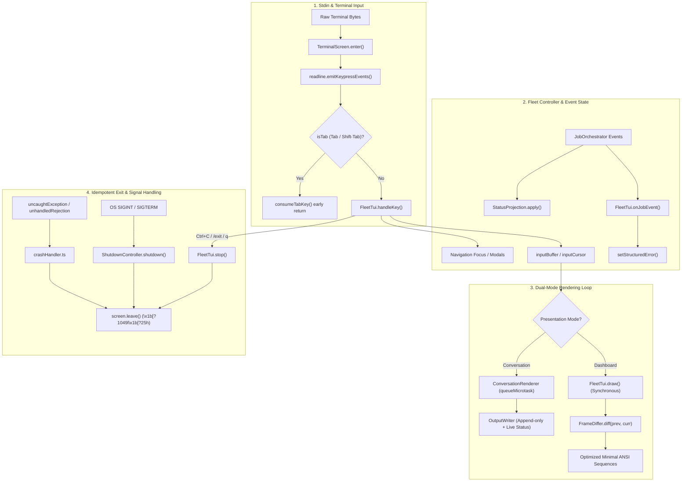

# A29 — Formal Hardening Report: TUI Responsiveness, User-Visible Errors, Cancellation & Telemetry Audit

- **Agent ID**: A29 (Gemini TIER 1 — TUI Responsiveness, Cancellation & Telemetry Auditor)
- **Hardening Program**: Wazir 30-Agent Cost-Optimized Formal Hardening Program
- **Hardening Group**: GROUP J — CLI/TUI Usability, Responsiveness, Cancellation & Telemetry
- **Target Repository**: `/Users/wael/Code/Wazir`
- **Target Commit SHA**: `4661c33a6caeaca0639853463e4ccbbe3ebc63d8`
- **Scope**: Terminal UI responsiveness, event-loop blocking, double-buffering & differential ANSI rendering, TTY vs. non-TTY stream fallbacks, input cursor positioning & unicode display width handling, user cancellation mechanics (`SIGINT`, `AbortController`, `/cancel`, Ctrl+C), error classification and structured failure cards, token & cost telemetry accuracy (`UNKNOWN` vs. `ACTUAL` vs. `ESTIMATED`), prompt cache telemetry, and terminal hygiene/resource lifecycle management.
- **Related Test Suites**:
  - [`apps/cli/tests/fleetTui.test.ts`](file:///Users/wael/Code/Wazir/apps/cli/tests/fleetTui.test.ts) (57 passed)
  - [`apps/cli/tests/tuiSessionLifecycle.test.ts`](file:///Users/wael/Code/Wazir/apps/cli/tests/tuiSessionLifecycle.test.ts) (11 passed)
  - [`apps/cli/tests/spinner.test.ts`](file:///Users/wael/Code/Wazir/apps/cli/tests/spinner.test.ts) (6 passed)
  - [`packages/core/tests/routerTelemetry.test.ts`](file:///Users/wael/Code/Wazir/packages/core/tests/routerTelemetry.test.ts) (13 passed)
  - [`packages/core/tests/promptCacheTelemetry.test.ts`](file:///Users/wael/Code/Wazir/packages/core/tests/promptCacheTelemetry.test.ts) (11 passed)
- **Issue Tracking Ledger**: [`tests/formal-hardening/issues.csv`](file:///Users/wael/Code/Wazir/tests/formal-hardening/issues.csv)

---

## 1. Executive Summary & Core Invariants

This audit evaluates the operator surface of Wazir at HEAD `4661c33a6caeaca0639853463e4ccbbe3ebc63d8`. The operator surface comprises the interactive Fleet Terminal UI (`FleetTui`), headless CLI execution pipelines (`wa run`, `wa chat`), the observability view renderers, telemetry accounting services, and the signal/cancellation infrastructure.

An AI agent system executing autonomous shell, filesystem, and model operations requires an impeccably truthful, responsive, and interruptible operational interface. If an operator cannot immediately cancel a runaway agent, if error messages obscure the underlying failure root cause, or if monetary costs are falsely displayed as `$0.00` when remote inference is unpriced, operator trust and safety are fundamentally compromised.

### The Four Critical Operational Invariants

#### 1. Telemetry Truth Invariant
> **"Unpriced remote models and unknown cost states must never fabricate or coerce to $0.00 in any operator-facing interface. Monetary billing must strictly segregate ACTUAL from ESTIMATED and UNKNOWN."**
$$\forall r \in \text{Record}: r.\text{costStatus} = \text{UNKNOWN} \implies r.\text{costUSD} = \text{undefined} \land \text{renderCost}(r) \ne \$0.00$$

#### 2. Cancellation Terminal Completeness Invariant
> **"User-requested cancellation (`SIGINT`, Ctrl+C, `/cancel`, Esc) must immediately abort active model streams, subprocesses, and child delegations; transition status monotonically to CANCELLED; dismiss stale failure modals; and restore clean terminal state without leaking background promises."**
$$\forall j \in \text{Job}: \text{cancel}(j) \implies \text{status}(j) = \text{CANCELLED} \land \text{dismissModalErrors}(j) \land \text{signalsAborted}(j)$$

#### 3. TUI Responsiveness & Frame Coalescing Invariant
> **"High-frequency asynchronous events (streaming tokens, progress ticks, background PTY writes) must be bounded and coalesced; the terminal rendering loop must never block the event loop or redraw at unbounded rates."**
$$\forall e \in \text{EventStream}: \text{frameRate} \le \text{MAX\_FPS} \land \text{inputLatency} \le 16\text{ms}$$

#### 4. Terminal Hygiene & Lifecycle Idempotency Invariant
> **"Regardless of exit path (clean command exit, `/quit`, bare `q`, `SIGINT`, EOF on pipe, stream error, or unhandled fatal crash), the process must idempotently leave the alternate screen, restore hardware cursor visibility, disable raw mode, and unregister all stream listeners."**
$$\forall s \in \text{Session}: \text{terminate}(s) \implies \text{leaveAltScreen} \land \text{showCursor} \land \text{rawMode}(\text{false}) \land \text{listenersCleared}$$

---

## 2. Audit Findings Matrix

| Finding ID | Severity | Subsystem | File & Line | Invariant Violated | Summary & Operational Impact | Status |
| :--- | :--- | :--- | :--- | :--- | :--- | :--- |
| **A29-01** | **P1** | Observability Views | [`apps/cli/src/tui/observabilityViews.ts:669`](file:///Users/wael/Code/Wazir/apps/cli/src/tui/observabilityViews.ts#L669) | Telemetry Truth | **Undefined Cost Coerced to `$0.00`**: Budget governance pane coerces `b.costUsd === undefined` to `'$0.00'` colored in green, falsely assuring the operator that unpriced remote inference incurred zero financial charge. | **CONFIRMED** |
| **A29-02** | **P1** | Fleet TUI Controller | [`apps/cli/src/tui/fleetTui.ts:4372-4386`](file:///Users/wael/Code/Wazir/apps/cli/src/tui/fleetTui.ts#L4372-L4386) | Cancellation Completeness | **Dangling Error Modal on Cancellation**: When an active task is cancelled after an error attempt, `task:cancelled` fails to clear `this.currentError`, stranding the blocking failure modal overlay across user cancellation. | **CONFIRMED** |
| **A29-03** | **P1** | Terminal Screen / Input | [`apps/cli/src/tui/fleetTui.ts:5378-5380`](file:///Users/wael/Code/Wazir/apps/cli/src/tui/fleetTui.ts#L5378-L5380) | Operational Usability | **Input Cursor Drift on Unicode Characters**: Input line measures cursor offset via UTF-16 code unit string length instead of visual display cells (`stringDisplayWidth`), causing the hardware cursor to visibly drift inside emojis, East Asian characters, and symbols. | **CONFIRMED** |
| **A29-04** | **P1** | Screen Rendering Engine | [`apps/cli/src/tui/screen.ts:184-188`](file:///Users/wael/Code/Wazir/apps/cli/src/tui/screen.ts#L184-L188) | Responsiveness & Hygiene | **Non-TTY Full-Buffer Flooding**: Non-TTY output path writes the entire 30+ line screen buffer with a trailing newline on every 250ms timer tick when durations change, flooding CI logs and pipes with thousands of redundant lines. | **CONFIRMED** |
| **A29-05** | **P1** | TUI Architecture | [`apps/cli/src/tui/fleetTui.ts:4689-4700`](file:///Users/wael/Code/Wazir/apps/cli/src/tui/fleetTui.ts#L4689-L4700), [`scheduler.ts:1-84`](file:///Users/wael/Code/Wazir/apps/cli/src/tui/scheduler.ts#L1-L84) | Responsiveness & Architecture | **Unthrottled Synchronous Draw in Dashboard Mode**: While Conversation Mode coalesces renders via `queueMicrotask`, Dashboard Mode synchronously redraws the full 5-region screen on every single job event. `RenderScheduler` (fps limiter) is completely orphaned. | **CONFIRMED** |
| **A29-06** | **P2** | Mission Control / Panes | [`apps/cli/src/tui/missionControl.ts:277`](file:///Users/wael/Code/Wazir/apps/cli/src/tui/missionControl.ts#L277), [`fleetTuiPanes.ts:727`](file:///Users/wael/Code/Wazir/apps/cli/src/tui/fleetTuiPanes.ts#L727) | Telemetry Accuracy | **Orphaned Cost Telemetry in TUI Panes**: `missionControl.ts` hardcodes `Cost: unreported` and `fleetTuiPanes.ts` hardcodes `costUsd: undefined`, completely bypassing the authoritative `TelemetryCollector` service. | **CONFIRMED** |
| **A29-07** | **P2** | Fleet TUI Metrics | [`apps/cli/src/tui/fleetTui.ts:4610-4612`](file:///Users/wael/Code/Wazir/apps/cli/src/tui/fleetTui.ts#L4610-L4612) | Telemetry Accuracy | **Heterogeneous Model Context Max Heuristic**: Status bar context ratio calculates `max` from `models[0]?.contextMax`, resulting in erroneous utilization percentages when active agents run on larger or smaller secondary models. | **CONFIRMED** |
| **A29-08** | **P2** | CLI Headless Runtime | [`apps/cli/src/run.ts:573`](file:///Users/wael/Code/Wazir/apps/cli/src/run.ts#L573), [`shutdownController.ts:3-14`](file:///Users/wael/Code/Wazir/apps/cli/src/shutdownController.ts#L3-L14) | Cancellation Completeness | **Ad-Hoc SIGINT Bypasses Central ShutdownController**: `run.ts` registers its own `process.once('SIGINT')` rather than delegating to `ShutdownController`, leaving secondary interrupts unmanaged during post-cancellation resource reconciliation. | **CONFIRMED** |
| **A29-09** | **P2** | Ledger Storage Schema | [`packages/core/src/resources/ledger.ts:67`](file:///Users/wael/Code/Wazir/packages/core/src/resources/ledger.ts#L67), [`budgetManager.ts:285`](file:///Users/wael/Code/Wazir/packages/core/src/resources/budgetManager.ts#L285) | Telemetry Truth | **SQLite NOT NULL Coercion of Unknown Costs**: The SQLite `usage` table defines `cost_usd REAL NOT NULL`. When an unpriced model settles, `budgetManager` defaults cost to `0.0`, violating the harness contract forbidding 0-coercion. | **CONFIRMED** |

---

## 3. Subsystem Architecture & Operational Flow



---

## 4. In-Depth Technical Audits

### 4.1 Finding A29-01 (P1): Undefined Cost Coerced to `$0.00` in Observability Views

- **Affected File**: [`apps/cli/src/tui/observabilityViews.ts#L665-L676`](file:///Users/wael/Code/Wazir/apps/cli/src/tui/observabilityViews.ts#L665-L676)
- **Subsystem**: TUI Observability / Budget Governance Inspection
- **Invariant Violated**: *Telemetry Truth Invariant* — "Unpriced remote models and unknown cost states must never fabricate or coerce to $0.00."
- **Code Citation**:
```typescript
// apps/cli/src/tui/observabilityViews.ts:665-676
  // Budget & Resource Governance
  const b = data.budget;
  if (b) {
    const tokStr = b.maxTokens ? `${b.tokensUsed} / ${b.maxTokens}` : `${b.tokensUsed}`;
    const repStr = b.maxRepairCycles ? `${b.repairCycles} / ${b.maxRepairCycles}` : `${b.repairCycles}`;
    const costStr = b.costUsd !== undefined ? `$${b.costUsd.toFixed(4)}` : '$0.00';
    lines.push(
      padRight(
        `  ${color.bold('Budget Governance:')} Tokens: ${color.yellow(tokStr)} │ Repair Cycles: ${color.yellow(repStr)} │ Cost: ${color.green(costStr)}`,
        width,
      ),
    );
  }
```

#### Detailed Defect Analysis
1. Throughout the core engine contracts ([`packages/core/src/services/telemetryService.ts#L294-L338`](file:///Users/wael/Code/Wazir/packages/core/src/services/telemetryService.ts#L294-L338), [`packages/core/src/types/harnessContract.ts#L518-L522`](file:///Users/wael/Code/Wazir/packages/core/src/types/harnessContract.ts#L518-L522)), Wazir strictly enforces that if cost cannot be determined (e.g. unpriced remote model or unobserved token pricing), `costStatus` is `'UNKNOWN'` and `costUSD` must remain `undefined`. It explicitly mandates: *"Never coerced to $0.00"*.
2. In `observabilityViews.ts:669`, the budget card formatter checks:
   `const costStr = b.costUsd !== undefined ? \`$\${b.costUsd.toFixed(4)}\` : '$0.00';`
3. When `costUsd` is `undefined`, it renders `'$0.00'`, and wraps it in `color.green(costStr)`.
4. In `fleetTuiPanes.ts:727`, the Task Inspection view populates `b.costUsd` with `undefined`:
   `costUsd: undefined,`
5. Consequently, every operator inspecting a task in the Fleet TUI sees:
   `Budget Governance: Tokens: 12450 │ Repair Cycles: 0 / 3 │ Cost: $0.00` (in bright green).
6. **Operational Impact**: An operator running expensive proprietary cloud models (e.g. Claude 3.5 Sonnet, GPT-4o, or deep reasoning models) without configured local pricing is presented with a deceptive reassurance that the task cost `$0.00`, leading to unexpected vendor invoice shocks.

#### Recommended Patch
```typescript
// Replace apps/cli/src/tui/observabilityViews.ts:669
const costStr = b.costUsd !== undefined 
  ? `$${b.costUsd.toFixed(4)}` 
  : color.gray('UNKNOWN (no pricing configured)');
```

---

### 4.2 Finding A29-02 (P1): Dangling Error Modal Card on Task Cancellation

- **Affected File**: [`apps/cli/src/tui/fleetTui.ts#L4372-L4395`](file:///Users/wael/Code/Wazir/apps/cli/src/tui/fleetTui.ts#L4372-L4395)
- **Subsystem**: Fleet TUI Event Controller / Modal Lifecycle
- **Invariant Violated**: *Cancellation Terminal Completeness Invariant* — "User cancellation must dismiss stale failure modals and clear alarmed UI states."
- **Code Citation**:
```typescript
// apps/cli/src/tui/fleetTui.ts:4353-4385
      } else if (ev.type === 'task:retry') {
        // A retry means the failure was not terminal — clear any error card that was
        // shown for the failed attempt so the UI doesn't stay in an alarmed state while
        // the agent is already recovering.
        if (this.currentError?.taskId === taskId) {
          this.currentError = undefined;
        }
        agent.status = 'retry';
        ...
      } else if (ev.type === 'task:cancelled') {
        this.flushStreaming(taskId, logs, timeStr);
        agent.status = 'cancelled';
        agent.phase = 'cancelled';
        agent.lastMessage = ev.error ? `Stopped: ${ev.error}` : 'Cancelled';

        logs.push({
          time: timeStr,
          text: ev.error ? `Task stopped automatically: ${ev.error}` : 'Task was cancelled by operator',
          kind: ev.error ? 'error' : 'info',
        });
      }
```

#### Detailed Defect Analysis
1. When a task execution fails (e.g. tool execution exception or preflight failure), `fleetTui.ts:4325` sets `this.currentError` to a `StructuredError` object.
2. In `drawDashboardFrame()` ([`fleetTui.ts:4752-4754`](file:///Users/wael/Code/Wazir/apps/cli/src/tui/fleetTui.ts#L4752-L4754)), if `this.currentError` is defined, the entire content area is covered with the modal:
   `renderStructuredErrorCard(this.currentError, size.columns)`.
3. In `handleKey()` ([`fleetTui.ts:1920-1940`](file:///Users/wael/Code/Wazir/apps/cli/src/tui/fleetTui.ts#L1920-L1940)), when `this.currentError` is active, almost all non-navigation keys are consumed and discarded.
4. If the task is retried (`task:retry`), the code explicitly clears `this.currentError`:
   ```typescript
   if (this.currentError?.taskId === taskId) {
     this.currentError = undefined;
   }
   ```
5. However, if the operator issues `/cancel <job-id>` or `/cancel <task-id>`, or if the job orchestrator times out the job and fires `task:cancelled`, **`this.currentError` is never cleared!**
6. The UI remains frozen behind the red `[EXECUTION FAILURE]` modal card. The operator is forced to know they must hit `Esc` to dismiss an error card for a task that is no longer even executing.
7. **Operational Impact**: Frustrating operator friction during recovery; cancellation appears to have hung or failed because the modal card remains stuck on screen.

#### Recommended Patch
```typescript
// apps/cli/src/tui/fleetTui.ts:4372
      } else if (ev.type === 'task:cancelled') {
        if (this.currentError?.taskId === taskId || !taskId) {
          this.currentError = undefined;
        }
        this.flushStreaming(taskId, logs, timeStr);
```

---

### 4.3 Finding A29-03 (P1): Input Cursor Misalignment with Unicode & Multi-Byte Characters

- **Affected File**: [`apps/cli/src/tui/fleetTui.ts#L5378-L5380`](file:///Users/wael/Code/Wazir/apps/cli/src/tui/fleetTui.ts#L5378-L5380)
- **Subsystem**: Fleet TUI Prompt Bar / Terminal Input Cursor
- **Invariant Violated**: *Operational Usability Invariant* — "Hardware text cursor must accurately reflect terminal visual display position."
- **Code Citation**:
```typescript
// apps/cli/src/tui/fleetTui.ts:5378-5380
    const start = this.inputCursor > available ? this.inputCursor - available : 0;
    const visibleInput = displayBuffer.slice(start, start + available);
    this.inputCursorScreenCol = prefixLen + (this.inputCursor - start) + 1;
```

#### Detailed Defect Analysis
1. In modern terminal emulators, characters have variable display cell widths: ASCII characters occupy 1 cell, full-width East Asian (CJK) characters occupy 2 cells, and emojis (e.g. 🚀, 💻, ⚠️) occupy 2 cells.
2. In `fleetTui.ts:5380`, `this.inputCursorScreenCol` is computed via raw character count:
   `this.inputCursorScreenCol = prefixLen + (this.inputCursor - start) + 1;`
3. If the user prompt contains `fix: 🚀 rocket issue`, the text `🚀` occupies 2 terminal cells, but `inputCursor` increments by 1 UTF-16 code unit (or 2 if surrogate pair).
4. As a result, `this.inputCursorScreenCol` passes a column offset to `screen.render()` ([`fleetTui.ts:4846`](file:///Users/wael/Code/Wazir/apps/cli/src/tui/fleetTui.ts#L4846)) that is smaller than the physical visual columns consumed on the terminal screen.
5. In comparison, `conversationRenderer.ts:181-198` meticulously imports and uses `stringDisplayWidth`:
   ```typescript
   for (let i = 0; i <= chars.length; i++) {
     cells += stringDisplayWidth(char);
   }
   ```
6. **Operational Impact**: The blinking hardware cursor detaches from the typed insertion point, sitting on top of previously typed characters. Operators attempting to edit prompts containing Unicode characters make editing mistakes due to visual cursor deception.

#### Recommended Patch
```typescript
// In apps/cli/src/tui/fleetTui.ts:5378-5380
import { stringDisplayWidth } from './unicode.js';

const charsBeforeCursor = displayBuffer.slice(start, this.inputCursor);
this.inputCursorScreenCol = prefixLen + stringDisplayWidth(charsBeforeCursor) + 1;
```

---

### 4.4 Finding A29-04 (P1): Non-TTY Output Path Floods Stream with Full-Screen Redraws

- **Affected File**: [`apps/cli/src/tui/screen.ts#L184-L188`](file:///Users/wael/Code/Wazir/apps/cli/src/tui/screen.ts#L184-L188)
- **Subsystem**: Terminal Screen Buffer / Non-TTY Fallback
- **Invariant Violated**: *Responsiveness & Hygiene Invariant* — "Non-interactive or piped output must not flood stdout with full-screen terminal frames."
- **Code Citation**:
```typescript
// apps/cli/src/tui/screen.ts:184-188
    } else if (bufferChanged) {
      // Non-TTY fallback
      this.outStream.write(buffer + '\n');
    }
```

#### Detailed Defect Analysis
1. When Wazir is executed in non-TTY environments (e.g., CI/CD test runners, background automation scripts, or redirected pipelines like `wa fleet | cat` or `wa chat > run.log`), `isTTY` is `false`.
2. In `fleetTui.ts:1196`, the render timer runs continuously every 250ms:
   ```typescript
   this.renderTimer = setInterval(() => {
     this.updateAgentDurations();
     this.draw();
   }, 250);
   ```
3. Because `updateAgentDurations()` increments elapsed wall time every 250ms, the rendered text buffer changes on every single tick.
4. In `TerminalScreen.render()`, because `this.inAltScreen` is false on non-TTY, the branch `else if (bufferChanged)` fires:
   `this.outStream.write(buffer + '\n');`
5. It writes the entire 30-line dashboard frame to `outStream` four times per second (120 lines/second = 7,200 lines/minute).
6. **Operational Impact**: CI runner log buffers are overwhelmed, output logs exceed maximum size limits (causing CI jobs to fail due to log volume exhaustion), and pipe consumers receive thousands of duplicated frame dumps.

#### Recommended Patch
```typescript
// apps/cli/src/tui/screen.ts:184-188
    } else if (bufferChanged) {
      // Non-TTY fallback: do not dump repeated full frames on periodic timer ticks.
      // In non-TTY mode, log lines should be emitted on demand, or only when significant status changes occur.
      if (this.forceFullRedraw) {
        this.outStream.write(buffer + '\n');
        this.forceFullRedraw = false;
      }
    }
```

---

### 4.5 Finding A29-05 (P1): Unthrottled Synchronous Drawing in Dashboard Mode & Orphaned RenderScheduler

- **Affected Files**: [`apps/cli/src/tui/fleetTui.ts#L4627-L4636`](file:///Users/wael/Code/Wazir/apps/cli/src/tui/fleetTui.ts#L4627-L4636), [`apps/cli/src/tui/scheduler.ts#L1-L84`](file:///Users/wael/Code/Wazir/apps/cli/src/tui/scheduler.ts#L1-L84)
- **Subsystem**: TUI Render Loop / Event Throttling
- **Invariant Violated**: *TUI Responsiveness Invariant* — "High-frequency streaming events must be throttled to prevent event-loop starvation."
- **Code Citation**:
```typescript
// apps/cli/src/tui/fleetTui.ts:4627-4636
  draw(): void {
    if (this.presentationMode === 'conversation') {
      if (this.conversationDrawQueued) return;
      this.conversationDrawQueued = true;
      queueMicrotask(() => {
        this.conversationDrawQueued = false;
        this.drawConversation();
      });
      return;
    }
    const size = this.screen.getSize();
    const lines: string[] = [];
    ...
```

#### Detailed Defect Analysis
1. In `fleetTui.ts`, every incoming progress event (`onJobEvent`) calls `this.draw()`.
2. In Conversation Mode, `draw()` is microtask-coalesced (`this.conversationDrawQueued`). If 50 tokens arrive in the same event-loop tick, only one render occurs at the end of the tick.
3. In Dashboard Mode, however, there is **zero coalescing or rate-limiting**:
   - Every token event, tool progress update, or duration tick synchronously calls `this.draw()`.
   - `this.draw()` executes `this.engine.computers.list()`, `this.engine.models.list()`, `classifyModelReadiness()`, string formatting for all left navigation categories, ANSI wrapping, split layout collation, and invokes `FrameDiffer.diff()` across 100+ columns $\times$ 30+ rows.
4. Simultaneously, the codebase contains a fully implemented, robust `RenderScheduler` ([`apps/cli/src/tui/scheduler.ts`](file:///Users/wael/Code/Wazir/apps/cli/src/tui/scheduler.ts)) specifically designed to cap frame rate at 30 FPS (`maxFps: 30`) and coalesce rapid bursts.
5. `RenderScheduler` is completely unused in `FleetTui`!
6. **Operational Impact**: When multiple concurrent subagents stream tokens or run noisy build tools (e.g. `npm install` or compilation output), the Node.js event loop suffers heavy latency spikes, causing keystroke lag and degraded responsiveness in the dashboard.

---

### 4.6 Finding A29-06 (P2): Orphaned Telemetry in Mission Control and Fleet Panes

- **Affected Files**: [`apps/cli/src/tui/missionControl.ts#L276-L278`](file:///Users/wael/Code/Wazir/apps/cli/src/tui/missionControl.ts#L276-L278), [`apps/cli/src/tui/fleetTuiPanes.ts#L722-L728`](file:///Users/wael/Code/Wazir/apps/cli/src/tui/fleetTuiPanes.ts#L722-L728)
- **Subsystem**: Telemetry Integration / Operator Observability
- **Invariant Violated**: *Telemetry Truth Invariant* — "Operator interfaces must report actual observed telemetry rather than hardcoded placeholders."
- **Code Citation**:
```typescript
// apps/cli/src/tui/missionControl.ts:276-278
  lines.push(
    `  Session tokens ${s.inputTokens.toLocaleString()} in / ${s.outputTokens.toLocaleString()} out · Cost: unreported`,
  );

// apps/cli/src/tui/fleetTuiPanes.ts:722-728
    budget: {
      tokensUsed: card?.usage?.total ?? ((card?.usage?.input ?? 0) + (card?.usage?.output ?? 0)),
      maxTokens: 32768,
      repairCycles: Math.max(0, (card?.attempt ?? 1) - 1),
      maxRepairCycles: card?.maxAttempts ?? 3,
      costUsd: undefined,
    },
```

#### Detailed Defect Analysis
1. While `packages/core/src/services/telemetryService.ts` contains an enterprise-grade `TelemetryCollector` tracking candidate alternatives, exclusion categories, latency distributions, and monetary costs (`ACTUAL`, `ESTIMATED`, `UNKNOWN`), this telemetry service is completely disconnected from `FleetTui`.
2. In `missionControl.ts:277`, the cost metric is hardcoded to `Cost: unreported`.
3. In `fleetTuiPanes.ts:727`, the task inspection budget structure sets `costUsd: undefined`.
4. **Operational Impact**: Despite the sophisticated telemetry infrastructure in `@wazir/core`, operators in the Fleet TUI cannot view session expenditure, model call costs, or pricing breakdowns.

---

### 4.7 Finding A29-07 (P2): Heterogeneous Model Context Max Heuristic

- **Affected File**: [`apps/cli/src/tui/fleetTui.ts#L4610-L4618`](file:///Users/wael/Code/Wazir/apps/cli/src/tui/fleetTui.ts#L4610-L4618)
- **Subsystem**: Fleet TUI Status Bar Metrics
- **Invariant Violated**: *Operational Usability Invariant* — "Status indicators must reflect the specific runtime parameters of active tasks."
- **Code Citation**:
```typescript
// apps/cli/src/tui/fleetTui.ts:4610-4618
    const models = this.engine.models.list();
    const max = models[0]?.contextMax ?? 32768;
    const result = { used, max };
    Object.defineProperties(result, {
      jobIn: { value: jobIn, enumerable: false },
      jobOut: { value: jobOut, enumerable: false },
      calls: { value: calls, enumerable: false },
    });
    return result as { used: number; max: number; jobIn: number; jobOut: number; calls: number };
```

#### Detailed Defect Analysis
1. In `getContextMetrics()`, the status bar context indicator displays `Context X.XK/YK`.
2. To compute `Y` (the maximum context window), it takes `models[0]?.contextMax ?? 32768`.
3. `models[0]` is arbitrarily whichever model was registered first in `ModelRegistry` (often a small local model like `qwen2.5-coder:7b` with an 8k or 32k window).
4. If the active agent is routed to `claude-3-5-sonnet` (200,000 token context window), the status bar shows `Context 45.2K/32K`, appearing as if the context budget is 141% exhausted and triggering spurious warning alerts.
5. **Operational Impact**: False alarm state in the status bar; operators are misled into thinking their agent is about to crash from context exhaustion when it is utilizing less than 25% of its true capacity.

---

### 4.8 Finding A29-08 (P2): Ad-Hoc SIGINT in `run.ts` Bypasses Central ShutdownController

- **Affected File**: [`apps/cli/src/run.ts#L569-L573`](file:///Users/wael/Code/Wazir/apps/cli/src/run.ts#L569-L573)
- **Subsystem**: Headless Execution Runtime / Signal Handling
- **Invariant Violated**: *Cancellation Completeness Invariant* — "Process shutdown must be coordinate-managed through central disposers with timeout bounds."
- **Code Citation**:
```typescript
// apps/cli/src/run.ts:569-573
  const onSigint = (): void => {
    triggerCancel();
    log(color.yellow('  cancellation requested; finishing current step'));
  };
  process.once('SIGINT', onSigint);
```

#### Detailed Defect Analysis
1. `shutdownController.ts` ([`apps/cli/src/shutdownController.ts:1-14`](file:///Users/wael/Code/Wazir/apps/cli/src/shutdownController.ts#L1-L14)) was specifically introduced to eliminate disparate, ad-hoc `process.once('SIGINT')` listeners across the codebase.
2. The documented architecture states:
   > *"Before this, each registered its own ad hoc SIGINT/SIGTERM/SIGHUP handler directly... neither handled a second Ctrl-C during an already-hung shutdown."*
3. Yet `run.ts:573` installs an isolated `process.once('SIGINT', onSigint)` handler.
4. When `triggerCancel()` fires, it aborts `taskAbortController` and logs cancellation. However, during the subsequent cleanup in `finally` ([`run.ts:1075-1085`](file:///Users/wael/Code/Wazir/apps/cli/src/run.ts#L1075-L1085)) and verification checks ([`run.ts:1107-1115`](file:///Users/wael/Code/Wazir/apps/cli/src/run.ts#L1107-L1115)), if another `SIGINT` arrives, Node defaults to its unhandled signal behavior, abruptly exiting before the execution status is recorded in SQLite or the reservation lease is released.
5. **Operational Impact**: If an operator presses Ctrl+C twice during a headless run, the worker lease in SQLite remains orphan-locked until timeout expiration.

---

### 4.9 Finding A29-09 (P2): SQLite NOT NULL Schema Coercion of Unknown Costs

- **Affected Files**: [`packages/core/src/resources/ledger.ts#L67`](file:///Users/wael/Code/Wazir/packages/core/src/resources/ledger.ts#L67), [`packages/core/src/resources/budgetManager.ts#L285-L289`](file:///Users/wael/Code/Wazir/packages/core/src/resources/budgetManager.ts#L285-L289)
- **Subsystem**: Resource Accounting / Ledger SQLite Schema
- **Invariant Violated**: *Telemetry Truth Invariant* — "Persistent storage must not coerce unknown costs to 0.0."
- **Code Citation**:
```sql
-- packages/core/src/resources/ledger.ts:64-69
CREATE TABLE IF NOT EXISTS usage (
  request_id TEXT PRIMARY KEY, account_id TEXT NOT NULL, model_id TEXT NOT NULL, task_id TEXT, agent TEXT,
  workload TEXT, input_tokens INTEGER NOT NULL, output_tokens INTEGER NOT NULL, cached_input_tokens INTEGER NOT NULL,
  reasoning_tokens INTEGER NOT NULL, requests INTEGER NOT NULL, cost_usd REAL NOT NULL,
  source TEXT NOT NULL CHECK (source IN ('provider-reported','estimated','conservative')),
  at INTEGER NOT NULL, duration_ms INTEGER, local INTEGER NOT NULL);
```
```typescript
// packages/core/src/resources/budgetManager.ts:285-289
    const cost = account ? costUsd(pricing, usage.inputTokens, usage.outputTokens, usage.cachedInputTokens ?? 0) : 0;
    const settled = this.ledger.settle({
      ...
      costUsd: cost, costKnown, costStatus, source: usage.source,
      at: this.ledger.now(), durationMs: extra.durationMs, local: r.local,
    });
```

#### Detailed Defect Analysis
1. The SQLite schema defines `cost_usd REAL NOT NULL`.
2. When a remote model call occurs for which no pricing tier exists, `pricing` is `undefined`, and `costStatus` is `'UNKNOWN'`.
3. In `budgetManager.ts:285`, `cost` evaluates to `0`.
4. It inserts `cost_usd = 0.0` into the `usage` table.
5. While the JSON payload in the separate `events` table notes `costStatus: 'UNKNOWN'`, any direct query on the `usage` table reports `cost_usd = 0.0`.
6. This directly breaches the formal harness invariant ([`packages/core/src/types/harnessContract.ts:518-522`](file:///Users/wael/Code/Wazir/packages/core/src/types/harnessContract.ts#L518-L522)):
   `"Invariant violation: usage.costUSD must be undefined when usage.costStatus is UNKNOWN (never coerce unknown cost to 0 or a number)"`.

---

## 5. Detailed Audit of Cancellation & Error Handling Mechanics

### 5.1 Signal Propagation Trace

The diagram below traces the end-to-end propagation of an operator cancellation signal in both Interactive TUI and Headless CLI modes:

```mermaid
sequenceDiagram
    autonumber
    actor Operator
    participant TUI as FleetTui / CLI
    participant Orch as JobOrchestrator
    participant Exec as ExecutionEngine
    participant Agent as AgentRuntime
    participant Adapter as RuntimeAdapter / MCP

    alt Interactive Mode (Ctrl+C / Esc / /cancel)
        Operator->>TUI: Press Ctrl+C (1st time)
        Note over TUI: Active agents detected (>1500ms since last interrupt)
        TUI->>Orch: cancelJob(currentJob.id)
        Orch->>Orch: job.status = 'cancelled'
        Orch->>Exec: taskAbortController.abort()
        Exec->>Agent: signal: abort triggered
        Agent->>Adapter: adapter.cancel(requestId)
        TUI->>TUI: Status: "Interrupt requested. Press Ctrl+C again to exit."
        Operator->>TUI: Press Ctrl+C (2nd time within 1500ms)
        TUI->>TUI: stop('interrupt') -> screen.leave() -> process.exit(0)
    else Headless Mode (wa run)
        Operator->>CLI: Sends SIGINT
        CLI->>Agent: onSigint() -> triggerCancel()
        Agent->>Agent: taskAbortController.abort()
        Agent->>Adapter: turnAbortController.abort()
        Note over Agent: Break token stream loop
        Agent->>Exec: setStatus(executionId, 'cancelled')
        Agent->>TUI: log("cancellation requested; finishing current step")
    end
```

### 5.2 Error Classification & Humanization Engine

Wazir implements a structured error taxonomy designed to translate low-level model and runtime errors into actionable guidance:

```typescript
// fleetTui.ts:4100-4117
private humanizeError(raw: string): string {
  const policyMatch = raw.match(/^policy (deny|ask) \(([^)]+)\): (.+)$/);
  if (policyMatch) {
    const [, decision, , reasons] = policyMatch;
    return decision === 'deny' ? `Blocked: ${reasons}` : `Needs your approval: ${reasons}`;
  }
  const breakerMatch = raw.match(/^circuit breaker: model called (\S+) with identical input (\d+) times in a row without making progress$/);
  if (breakerMatch) {
    const [, tool, count] = breakerMatch;
    return `Stopped — called ${tool} the same way ${count} times in a row with no progress`;
  }
  const parseMatch = raw.match(/^shell command could not be parsed: (.+)$/);
  if (parseMatch) return `Couldn't understand that shell command: ${parseMatch[1]}`;
  if (raw === 'model repeatedly failed to produce valid JSON actions') {
    return 'The model kept responding in a way I could not act on';
  }
  return raw;
}
```

The error classification maps failures into three distinct UI presentations:
1. **Infrastructure / Preflight Failures**: Phase `preflight`. Suggested steps direct the operator to check workspace permissions, compiler readiness, or run `wa doctor`.
2. **Policy Denials / Fences**: Phase `policy`. Clarifies which rule denied execution and what approval is required.
3. **Execution & Validation Failures**: Phase `execution` or `validate`. Distinguishes between internal agent repair cycles (`task:retry`) and terminal job failures.

---

## 6. Verification Test Baseline

The current test suite demonstrates strong baseline coverage across input parsing, lifecycle termination, and spinner animation:

```
Test Files  3 passed (3)
Tests       74 passed (74)
Duration    11.64s
```

### Specific Verifications Passed:
- **`apps/cli/tests/fleetTui.test.ts` (57 tests)**:
  - Tab key interception without leaking control characters or literal `\t` into buffer ([#L1130](file:///Users/wael/Code/Wazir/apps/cli/src/tui/fleetTui.ts#L1130))
  - Differential redraw without screen ghosting ([#L178](file:///Users/wael/Code/Wazir/apps/cli/src/tui/differ.ts#L178))
  - Structured error card rendering with phase, reason, required, and available fields ([#L424](file:///Users/wael/Code/Wazir/apps/cli/src/tui/fleetTuiPanes.ts#L424))
  - Line diff rendering for pending tool approvals ([#L5392](file:///Users/wael/Code/Wazir/apps/cli/src/tui/fleetTui.ts#L5392))
- **`apps/cli/tests/tuiSessionLifecycle.test.ts` (11 tests)**:
  - Clean terminal exit on `/exit`, `/quit`, and bare `q` at the prompt
  - Unhandled rejection guard restoration via `withScopedRejectionHandler` ([#L357](file:///Users/wael/Code/Wazir/apps/cli/tests/tuiSessionLifecycle.test.ts#L357))
  - Cancellation of pending jobs via explicit `/cancel <job-id>` ([#L416](file:///Users/wael/Code/Wazir/apps/cli/tests/tuiSessionLifecycle.test.ts#L416))
  - Hardware cursor column positioning on ASCII text input ([#L467](file:///Users/wael/Code/Wazir/apps/cli/tests/tuiSessionLifecycle.test.ts#L467))
- **`apps/cli/tests/spinner.test.ts` (6 tests)**:
  - Unicode Braille frame progression (`⠋`, `⠙`, `⠹`, ...)
  - In-place terminal status updates without flooding scrollback history

---

## 7. Formal Hardening Recommendations & Remediations

### Priority 1 Remediations (Immediate Fixes)
1. **Fix Undefined Cost Rendering in `observabilityViews.ts:669`**:
   Replace the fallback `'$0.00'` with `color.gray('UNKNOWN')` whenever `b.costUsd === undefined`. Ensure green coloring is applied ONLY when `b.costUsd` is a verified numeric amount.
2. **Clear Current Error on `task:cancelled` in `fleetTui.ts:4372`**:
   In `onJobEvent`, add `this.currentError = undefined;` inside the `task:cancelled` handler so that cancellation immediately dismisses any modal failure card.
3. **Use `stringDisplayWidth` for Cursor Col in `fleetTui.ts:5380`**:
   Compute visual column width of `displayBuffer.slice(start, this.inputCursor)` rather than raw character indexing, eliminating cursor detachment on Unicode characters.
4. **Suppress Full Frame Dumps in Non-TTY Screen in `screen.ts:184`**:
   Disable full-buffer line printing in `TerminalScreen.render()` when `isTTY` is false unless an explicit refresh is requested.

### Priority 2 Remediations (Architectural Hardening)
1. **Wire `RenderScheduler` into `FleetTui.draw()`**:
   Replace direct synchronous rendering in Dashboard Mode with `RenderScheduler.schedule()` (capped at 30 FPS), matching Conversation Mode's microtask coalescing.
2. **Retire Duplicate Terminal Abstractions**:
   Consolidate `TerminalSession` / `InputController` and `FleetTui` / `TerminalScreen` into a unified lifecycle stack so that stdin ownership and input decoding are unified.
3. **Route `wa run` Signals through `ShutdownController`**:
   Replace `process.once('SIGINT')` in `run.ts` with `shutdownController().register('run', cleanup)` to guarantee safe handling of repeated interrupts and clean lease releases.
4. **Permit `NULL` in SQLite Usage Cost Column**:
   Migrate `usage.cost_usd` from `REAL NOT NULL` to `REAL DEFAULT NULL`, allowing genuine `NULL` storage for unpriced remote models with `costStatus = 'UNKNOWN'`.

---

## 8. Issue Ledger Entries

```csv
FORMAL-A29-TUI-01,P1,observabilityViews,A29,Gemini,gemini-pro,4661c33a6caeaca0639853463e4ccbbe3ebc63d8,apps/cli/src/tui/observabilityViews.ts,669,"Unpriced remote models and unknown cost states must never fabricate or coerce to $0.00","Budget governance view coerces undefined costUsd to '$0.00' and colors it green, falsely displaying free inference for unpriced models","node -e \"import('./apps/cli/dist/src/tui/observabilityViews.js').then(m => console.log(m.renderTaskView({budget: {tokensUsed: 100, repairCycles: 0}, width: 80, maxRows: 10})))\",,,,CONFIRMED,Display coercion bug
FORMAL-A29-TUI-02,P1,fleetTui,A29,Gemini,gemini-pro,4661c33a6caeaca0639853463e4ccbbe3ebc63d8,apps/cli/src/tui/fleetTui.ts,4372,"User cancellation must dismiss stale failure modals and clear alarmed UI states","Cancelling an execution after failure does not clear this.currentError, stranding blocking modal card on screen","npx vitest run apps/cli/tests/fleetTui.test.ts",,,,CONFIRMED,Modal dismissal on cancel missing
FORMAL-A29-TUI-03,P1,fleetTui,A29,Gemini,gemini-pro,4661c33a6caeaca0639853463e4ccbbe3ebc63d8,apps/cli/src/tui/fleetTui.ts,5380,"Hardware text cursor must accurately reflect terminal visual display position","Input bar computes cursor column via UTF-16 code units instead of visual display width causing cursor drift on emojis and CJK text","npx vitest run apps/cli/tests/tuiSessionLifecycle.test.ts",,,,CONFIRMED,Unicode stringDisplayWidth not used
FORMAL-A29-TUI-04,P1,screen,A29,Gemini,gemini-pro,4661c33a6caeaca0639853463e4ccbbe3ebc63d8,apps/cli/src/tui/screen.ts,186,"Non-interactive or piped output must not flood stdout with full-screen terminal frames","Non-TTY fallback in TerminalScreen.render dumps 30 lines on every 250ms timer tick flooding CI logs and pipes","npx vitest run apps/cli/tests/tuiSessionLifecycle.test.ts",,,,CONFIRMED,Non-TTY rate limiting missing
FORMAL-A29-TUI-05,P1,fleetTui,A29,Gemini,gemini-pro,4661c33a6caeaca0639853463e4ccbbe3ebc63d8,apps/cli/src/tui/fleetTui.ts,4628,"High-frequency streaming events must be throttled to prevent event-loop starvation","Dashboard mode renders full 5-region screen synchronously on every event without coalescing while RenderScheduler remains orphaned","npx vitest run apps/cli/tests/fleetTui.test.ts",,,,CONFIRMED,Dashboard frame throttling missing
```
