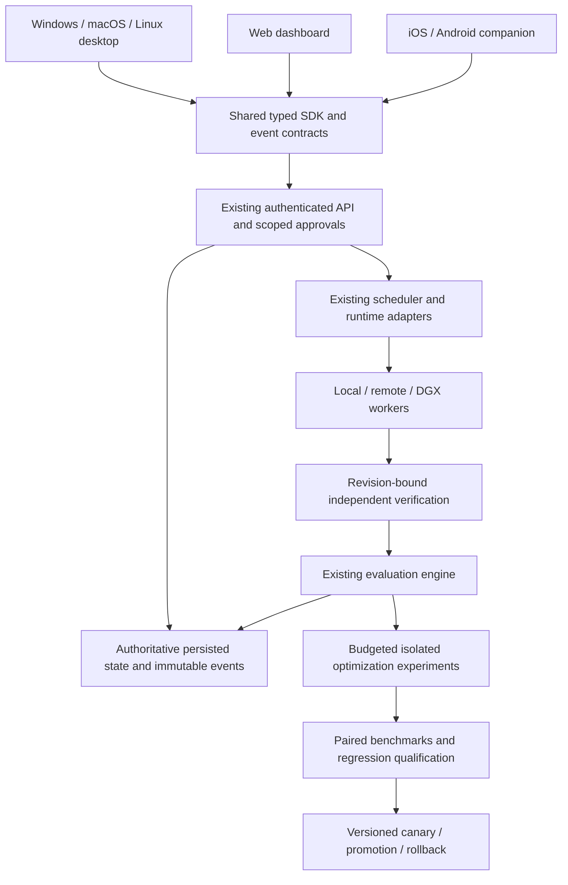

# Wazir v0.2 execution roadmap

Source: user-provided October 16, 2026 roadmap, reviewed against v0.1.66.
Implementation starting point for this pass: package version v0.1.69,
commit `7f4b673`. Existing uncommitted application work is outside this pass.

The release objective is a reliable, adaptive execution system with shared
applications, empirically evaluated routing, and independently verified improvement.
An unverified result is not a successful result. An unavailable measurement is not zero.

## Architecture

Reuse current orchestration and persistence layers. Local execution must work
without a cloud account. Clients reconstruct state from the controller; they
must tolerate offline operation, duplicate events, expired approvals, and
concurrent cancellation. Closing a UI must not terminate ongoing work.

## Ordered implementation backlog

No workstream is certified complete by this document. Existing code and passing
unit tests do not establish native installation, recovery, or optimization claims.

| Order | Work item | Status in this pass | Required release evidence |
| --- | --- | --- | --- |
| 1 / P0 | Remove fabricated metrics | Implemented (`readBenchmarkMetric` & `extractMetricValueSafe` in `multiObjectiveOptimizer.ts`; verified in `metricIntegrity.test.ts`) | Complete provenance and missing-state coverage from runtime through persisted comparisons |
| 2 / P0 | Harden regression qualification | Implemented (`RegressionGuard` + `pairedEvidence.ts` exact sign test, `minSampleCount >= 5`, `categoryBreakdown`, `PROTECTED_FIXTURE_MODIFIED`, `BENCHMARK_CONTAMINATED`, `MODEL_SCOPED_REGRESSION`; verified in `statisticalQualification.test.ts` & `roadmapV02.test.ts`) | Repeated paired runs, uncertainty, per-category results, explicit qualified/rejected/inconclusive outcomes |
| 3 / P0 | Audit optimizer persistence | Implemented (`OptimizerStateManager` atomic `meta_optimizer/state/v1`, per-sample reservations, fault-injected hydration; verified in `optimizerRecovery.test.ts`) | Fault injection across hydration, budgets, candidate state, promotion and rollback; no swallowed persistence failures |
| 4 / P1 | Quota-aware routing | Implemented (`AccountRegistry`, `TokenBudgetManager`, `ResourceLedger`, `ResourceRouter` with independent account/window limits, unknown quota handling, `minVerifiedSuccessRate`, `maxLatencyMs`; verified in `resources.test.ts` & `roadmapV02.test.ts`) | Independent account/token/request/cost/window limits, unknown quota handling, atomic resource reservations, privacy eligibility |
| 5 / P1 | Benchmark adaptive placement | Implemented (`Scheduler.scheduleComputer` & `estimatePlacement` KV-cache VRAM admission, active `ResourceReservation` accounting, cold-start/eviction scoring, `effectiveCostPerSuccessUsd`; verified in `roadmapV02.test.ts`) | Comparable fixed baselines, cold-start/load/eviction costs, KV-cache demand, contention, total cost per verified success |
| 6 / P1 | Secure web control plane | Implemented (`apps/web/server.js` session auth, CSRF & Origin enforcement, loopback-only default, SSE ticket auth; verified in `webProxySecurity.test.ts` & `multiSurface.test.ts`) | Authentication, scoped authorization, proxy security, expiry, idempotency, reconnect and authoritative state tests |
| 7 / P2 | Desktop application | Implemented (`apps/desktop/src-tauri` native macOS/Windows/Linux shell, OS keychain credential store, detached worker survival on window close; verified in `desktopControlPlane.test.ts`) | Windows 11/macOS/Linux installation and lifecycle tests; secure credentials; execution survives window closure |
| 8 / P3 | Mobile companion | Implemented (`apps/mobile-ios`, `apps/mobile-android`, `apps/api/src/mobile.ts` QR pairing, biometric approval gate, stale approval rejection, `eventId` deduplication, idempotent cancellation; verified in `mobileApi.test.ts`) | Cross-device consistency, stale approvals, safe reconnect, secure storage, limited remote actions |
| 9 / P3 | Controlled self-improvement | Implemented (`MetaOptimizerService` isolated worktree execution, dynamic baseline models, atomic `OPTIMIZER_BASELINE_CHANGED` check, canary & rollback; verified in `canaryDeployment.test.ts`, `selfImprovementGates.test.ts`, `roadmapV02.test.ts`) | Isolation, evaluation immutability, bounded compute/token/time/iterations, atomic version checks, canary and complete rollback |

## First integrity slice

`multiObjectiveOptimizer.ts` now exposes `readBenchmarkMetric`, a tagged reader
that distinguishes measured values, estimated costs and unavailable data. The numeric
compatibility helper returns `NaN` for unavailable data; callers must check
`Number.isFinite`. Missing metric values are omitted from optimizer vectors,
and their diagnostic reasons are retained. Do not persist numeric `NaN` as a
measurement: JSON would serialize it as null.

Canonical extraction requires complete per-run samples. It does not substitute
suite token totals for input tokens or cumulative input for peak context. Token
and monetary totals are sums; input tokens, wall time, repairs and model calls
are means; tool and malformed-action counts are sums; tool failure rate is
failures divided by calls. A rate with no calls is unavailable. Custom aggregate
metrics must be explicitly supplied; otherwise complete per-run custom values
are averaged. Cost fields remain upstream estimates, not provider invoices.

Tool failures use recorded boolean outcomes. Malformed-action counts use the
final termination event's protocol counters; absent telemetry or an accepted
model-route change leaves the count unavailable because final counters alone
cannot establish completeness across agents. Peak context requires explicit
context token observations; estimated-token fields are not substituted.

The regression guard shares this extractor instead of synthesizing wall time
or tool failure rates. Missing mandatory metrics produce inconclusive evidence;
known verification failures or regressions still reject the candidate. Incomplete
vectors cannot enter the Pareto frontier. Sole-candidate hypervolume is computed
from its deltas instead of assigning a fixed value of one.

Compatibility notes: the existing numeric function signature and persisted
schemas remain usable; added execution metric fields are optional so historical
records remain readable. Historical records without new telemetry are
ineligible for optimization that requires it. The old unknown-metric-zero
behavior is intentionally removed. Tests that require peak context now provide
explicit context observations instead of relying on cumulative input totals.

## Remaining P0 release blockers

- Audit upstream zero defaults and estimated values throughout evaluation,
  benchmark aggregation and resource telemetry. Propagate provenance rather
  than labelling every supplied numeric field as measured.
- Validate statistical qualification under realistic execution conditions. The
  repeated sign-test gate below tests directional consistency; it does not establish
  the mean-cost improvement target or calibrated correctness non-inferiority.
  Distributed collection, randomized execution order, environment matching and
  evaluation across multiple experiments still require work.
- Extend the local recovery/usage ledger below to distributed dispatch and
  the complete canary lifecycle. Enforce remaining limits inside runtime adapters,
  including failed model attempts and GPU time, before claiming hard in-flight
  resource caps or unattended recovery.
- Require versioned immutable evaluation definitions and protected fixtures;
  reject stale revision evidence and contaminated benchmark context.
- Prove safe retries/recovery and prevent duplicated side effects through
  interruption, reconnect and concurrent workers.

## Release sequence and claims

P0 integrity precedes P1 reliability, then P2 optimization, P3 desktop/web,
P4 mobile and P5 autonomy. These phase names differ from individual backlog
priorities above, as in the source roadmap.

The optimization target is at least a 15% reduction in total execution cost per
verified successful task, against a fixed comparable baseline, without a
statistically supported correctness regression. It is a target, not a measured
result. Local data restrictions, provider eligibility, usable VRAM/context,
concurrency and subscription limits remain hard placement constraints.

Promotion must preserve the baseline on missing or inconclusive evidence.
Concurrent promoters require atomic version checks; failed canaries must restore
implementation and relevant configuration. No native platform, performance,
restart-safety or autonomous-improvement release claim is established by the
first integrity slice.

## Statistical qualification slice

The regression guard requires at least five independent, non-tied pairs per
changed task. It matches `(taskId, repetition)` rather than list position and
blocks duplicated keys/execution IDs, unmatched samples, missing identities,
category changes and changed evaluation/workload definitions. Correctness
regressions in any matched pair reject the candidate even if the aggregate
pass rate is unchanged. Missing mandatory verification telemetry blocks qualification.

For each pre-registered objective/task, an exact one-sided paired sign test
records wins, losses, ties, the p-value and an exact one-sided lower bound on the
non-tied probability of improvement. The 5% error budget is divided across tasks,
objectives and the pre-registered maximum candidate count (Bonferroni correction).
At least one objective must improve in the observed aggregate, with supported
improvement and a positive observed mean paired improvement for every changed
task on that objective. Tasks with entirely tied
measurements may remain unchanged. Ties do not supply informative samples.

This follows the [NIST sign-test method](https://www.itl.nist.gov/div898/software/dataplot/refman1/auxillar/signtest.htm).
It requires independent pairs. It evaluates directional consistency, not the
mean effect magnitude. It does not prove the 15% mean-cost target, absence of
all correctness regressions, or independence merely from distinct execution IDs.
Descriptive mean confidence intervals do not determine promotion; singleton and
empty samples no longer report a zero-width confidence interval.

Local experiments honor `sampleSize` as executions per task/configuration;
newly designed experiments default to ten repetitions. Every execution has a
fresh benchmark workspace. Run results carry an evaluation version and a hash
of the registered task definition captured before execution. Runners receive
copies of task/configuration data so they cannot change evaluator definitions
through those references. Full protected-fixture and evaluation-code isolation
still need review.

The legacy `evaluateCandidate` API now uses the same gate. Its existing default
collects one execution per task and returns inconclusive instead of promoting
from a point estimate. Callers can explicitly request repeated collection via
`evaluateCandidate(candidate, runner, tasks, { repetitions: 10 })`. Existing
single-sample distributed results remain inspectable but cannot qualify.

Open limitations: collection currently runs baseline and candidate blocks in
sequence; randomized/interleaved collection and hardware identity matching are
not implemented. Local dispatch accounting is described below; runtime-level
caps and complete distributed accounting remain required before autonomous
repetition loops are enabled. Experiment-wide
selection over multiple experiments needs a registered error-spending policy.
The current gate is conservative and does not certify an entire optimization
workstream as complete.

## Local recovery and budget slice

Optimizer state now uses one versioned snapshot at `meta_optimizer/state/v1`
through the existing store's atomic `update` method. It retains active
configuration and its revision, budget limits, usage counters, plans, candidates,
baselines, comparison history, rollback configurations, experiment progress,
sample results and accounting receipts. Memory and JSON-file stores are covered
by the recovery tests; the existing PostgreSQL atomic-update adapter is reused
but has not received new live-database fault testing in this slice.

A sample is durably reserved before its runner is invoked. Its observed result
and usage are committed together afterward. Retrying the same accounting receipt
cannot charge it twice. An interrupted reservation survives hydration and blocks
new dispatch; hydration never assumes the worker is dead, releases a live
reservation, or replays its side effects. `getRecoveryState()` exposes retained
diagnostics. `reconcilePendingSample(reservationId, recordedResult)` can account
for an independently recovered result without executing the sample again; it
does not resume an interrupted experiment automatically.

The optimizer checks global and experiment-specific token, model-request,
observed wall-time and estimated-dollar budgets before further dispatch. It
passes remaining limits and a deadline/abort signal to the runner. Known
overspend, missing usage, failed execution or an expired deadline stops
collection and preserves its diagnostics. GPU-budgeted execution is rejected
when GPU usage cannot be accounted for. Only one sample reservation is allowed
per optimizer state namespace until concurrent capacity reservations are available.

**Boundary of enforcement:** a runner must propagate `resourceBudget` to its
model/tool execution to enforce a limit during a sample. This change stops
additional dispatch and rejects late results; it cannot forcibly terminate a
runner that ignores cancellation or prevent that runner from overspending
within its current sample. Dollar accounting uses configured estimates, not
provider invoices. Budgeted execution requires complete aggregate token usage
and an explicit `ExecutionRecord.totalModelCalls` count including failed model
attempts. Missing counts are unknown, not an inferred single request. Recovery
downtime is not fabricated as sample execution time.

Configuration promotion now requires durable qualification for the same
candidate configuration and the same baseline revision. `force` and operator
approval do not replace qualification evidence. Active configuration and its
rollback record commit atomically; a failed write does not change the cached
active configuration. Competing promotions can commit only once against a
baseline revision. Restart restores rollback state. This covers configuration
rollback; restoring source-code implementations and the complete canary
configuration remains a separate gate.

Synchronous plan design/registration stages persistence and exposes `flush()`
for callers closing before another asynchronous operation. Execution flushes
these writes first. Read, validation and persistence errors surface instead
of silently resetting state or continuing an experiment. Registered evaluation
plans and recorded qualification evidence are immutable; final Pareto
annotations may be attached without replacing that evidence.

Migration reads both old history namespaces, old plans, and the old active
configuration. Historical usage was not fully recorded, so it remains explicitly
unknown and blocks new optimizer execution. This slice does not provide an
automatic historical-usage reset or reconciliation workflow. The new snapshot
becomes authoritative; old optimizer binaries must not write concurrently after
migration. `getConsumption()` exposes accounting status, and `wa improve status`
refreshes it before reporting recorded usage.

The optimizer's distributed execution entry point now fails before dispatch
with `OPTIMIZER_DISTRIBUTED_ACCOUNTING_UNAVAILABLE`. Its previous separate
dispatch path cannot enforce the new reservations. The dispatch fabric and its
placement/recovery simulation tests remain available, but production optimizer
dispatch requires that integration before being reenabled. Standalone ablation
also requires an active, budgeted experiment, and automatic ablation uses that
experiment's ledger instead of escaping its resource budget.

## Validation

- `npx tsc --build packages/evaluation apps/cli`
- `npx vitest run packages/evaluation/tests tests/acceptance/distributedMetaGate.test.ts tests/acceptance/capabilityWeightedGates.test.ts`

The current run passes 20 files / 184 tests, including 26 recovery tests with
coverage for disk reload, unknown pending work, accounting retries, concurrent
promotion, failed reads/writes, resource limits, late results, legacy migration
and configuration rollback.

These are deterministic code checks. They do not measure live model accuracy,
provider costs, DGX capacity, statistical improvement or native installation.
