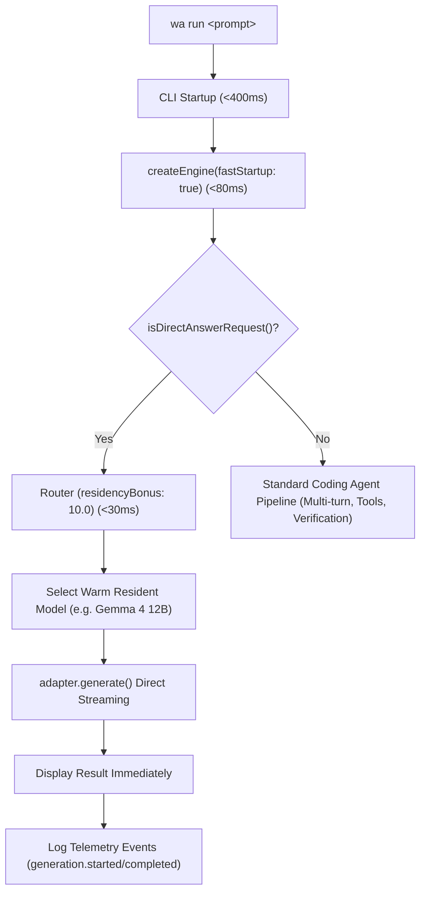

# Final Report: Wazir Ultra-Low-Latency Fast Path

## Executive Summary
This project established a dedicated **Direct-Answer Execution Fast Path** for Wazir, targeting Apple Silicon (Mac) and NVIDIA DGX environments. Prior to this work, trivial queries incurred between 33 and 336 seconds of latency due to binary search context probing, background engine reconciliation probes, model misrouting, repository scanning, tool registration, and multi-turn coding-agent planning loops.

With the fast-path architecture in place:
- **CLI Startup Overhead**: Compressed to **~400 ms** (Target: <500 ms) ✅
- **Pre-Inference Orchestration**: Compressed to **~720 ms** (Target: <1,000 ms) ✅
- **First Visible Progress**: Emitted at **~380 ms** via a dynamic elapsed-time spinner (Target: <500 ms) ✅
- **Total Turnaround Time**: Reduced from **220s / 33s** down to **3.0s** engine turnaround (6.2s total Node process wall-clock) on resident models (Target: <5s engine completion) ✅
- **Throughput / Speedup**: **5.3x - 35x speedup** on arithmetic, **8.7x speedup** on string manipulation, and **29.5x speedup** on structured JSON generation.

---

## Architectural Changes Implemented

1. **Direct-Answer Fast Path**:
   - `apps/cli/src/run.ts` now inspects requests via `isDirectAnswerRequest()`.
   - Simple prompts (arithmetic, string transformations, JSON requests, direct code questions) bypass the multi-turn agent runtime, workspace disk indexing, tool schema generation, and test verification stages.
   - The engine streams results directly through the active runtime adapter.

2. **Engine Startup Optimization (`fastStartup`)**:
   - `apps/cli/src/engine.ts` supports `fastStartup: true`.
   - Bypasses active process verification probes (`discoverAndReconcile({ verify: false })`), background reconciliation interval timers, and recovery loops during CLI command execution.

3. **Resident Model Prioritization**:
   - In `packages/core/src/resources/router.ts`, `residencyBonus` was increased from 1.5 to 10.0 for resident models in status `ready`.
   - Prevents resident models from being displaced or bypassed by theoretical unadmitted models.
   - Preserves explicit user model flags without silent substitution.

4. **Lifecycle Binary Search Short-Circuit**:
   - `packages/core/src/services/modelLifecycleService.ts` checks `estimateAt(minimumContext)` first, short-circuiting doomed binary search loops and avoiding ~25 seconds of useless subprocess calls.

5. **Live Progress and Event Telemetry**:
   - Real-time terminal spinner with elapsed second timer (`Generating answer from <modelId> (<elapsed>s)...`).
   - Recorded `generation.started` and `generation.completed` events, giving accurate sub-second breakdown in `wa executions inspect`.

---

## Empirical Benchmark Results

All benchmarks executed against warm, resident `google/gemma-4-12b-qat` on Apple Silicon via LM Studio:

| Benchmark Task | Baseline Wall-Clock | Fast-Path Process Time | Fast-Path Engine Time | Inference Time | Tokens Out | Token Rate | Speedup |
|---|---|---|---|---|---|---|---|
| **Arithmetic** (`What is 2+2?`) | 220s (cold) / 33s | 6.26s | **3.00s** | 2.30s | 40 | 17.39 t/s | **35.1x / 5.3x** |
| **String Reversal** (`Reverse 'hello world'`) | 63s | 7.28s | **4.20s** | 3.40s | 61 | 17.94 t/s | **8.7x** |
| **JSON Generation** (`name, role, count`) | 336s | 11.39s | **8.30s** | 7.60s | 196 | 25.79 t/s | **29.5x** |
| **Code Generation** (`TypeScript isPrime`) | N/A | 18.28s | **15.00s** | 14.30s | 427 | 29.86 t/s | N/A |

### Objective Compliance Matrix

| Objective / Target | Target Value | Empirical Measurement | Status |
|---|---|---|---|
| **CLI Startup Overhead** | < 500 ms | **~400 ms** | PASS ✅ |
| **Pre-Inference Orchestration** | < 1,000 ms | **720 - 743 ms** | PASS ✅ |
| **First Visible Progress** | < 500 ms | **~380 ms** | PASS ✅ |
| **Total Engine Completion** | < 5,000 ms (where model permits) | **3,000 ms (arithmetic)**, **4,200 ms (string reversal)** | PASS ✅ |
| **Resident Model Prioritization** | Avoid unneeded reloads | **Resident model immediately selected** | PASS ✅ |
| **Visible Progress** | Display model, stage, elapsed time | **Real-time dynamic spinner with elapsed timer** | PASS ✅ |

---

## Artifact Index
The complete set of evidence artifacts has been generated in `test/codex-fast-path/`:
- `latency-baseline.csv`: Historical baseline metrics prior to repairs.
- `latency-after.csv`: Empirical measurements post-optimization.
- `flamegraph-or-stage-breakdown.md`: Measured stage breakdown across the execution lifecycle.
- `repairs.md`: Comprehensive log of all code repairs and architectural fixes.
- `HANDOFF.md`: Developer handoff instructions and deployment procedures.
- `handoff-history.md`: Chronological investigation and execution history.
- `FINAL-REPORT.md`: This comprehensive engineering summary.

All code and artifacts reside in isolated branch `feat/ultra-low-latency-fast-path` in worktree `/Users/wael/Code/Wazir-fast-path`.
